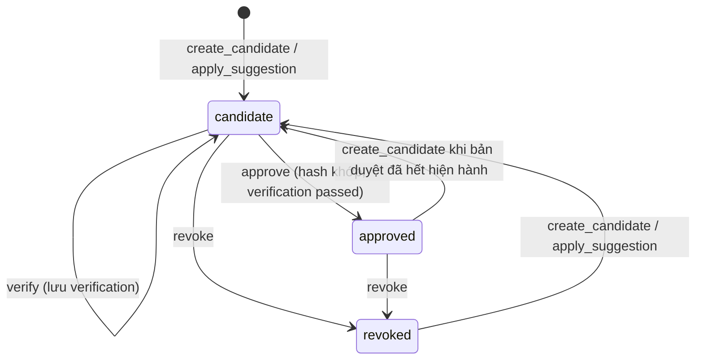

# Module `data_dictionary`

Mô tả luồng xử lý các API của module Data Dictionary (từ điển dữ liệu) trong backend Semantic Layer:
`extensions/semantic-layer/backend/src/text_to_bi/superset_semantic_layer/modules/data_dictionary/`. Module giữ metadata
nghiệp vụ của mỗi dataset Superset và từng cột của nó (tên hiển thị, mô tả, khóa, vai trò ngữ nghĩa, PII), ngữ nghĩa thời
gian (cột thời gian, cột loại dòng, grain của từng loại dòng), phép biến đổi cột, contract quan hệ giữa các base table
mà schema link của AI Agent được join, gợi ý AI AutoFill và nhập / xuất file.

Quy tắc chung về lỗi, decorator, transaction và quyền nằm ở [hanh-vi.md](../../hanh-vi.md); cấu trúc module nằm ở
[kien-truc.md](../../kien-truc.md). Đặc tả nghiệp vụ: grain và thời gian ở
[docs/specs/grain-va-ngu-nghia-thoi-gian.md](../../../specs/grain-va-ngu-nghia-thoi-gian.md), quan hệ và vai trò cột
ở [docs/specs/schema-link.md](../../../specs/schema-link.md).

Tài liệu này không mô tả khai báo chỉ số (`indicator_model`, tab "Chỉ số", `route_indicator.py`, `srv_indicator.py`): tính
năng đó đang được gỡ bỏ.

| Tài liệu | Route file trong `routes/` | API |
| --- | --- | --- |
| [route-dictionary.md](route-dictionary.md) | `route_dictionary.py` | Đích khóa ngoại, đọc và lưu từ điển một dataset, AI AutoFill (SSE) |
| [route-dictionary-file.md](route-dictionary-file.md) | `route_dictionary_file.py` | Xuất và nhập file (đang làm lại) |
| [route-grain.md](route-grain.md) | `route_grain.py` | Phát hiện grain (grain profile) |
| [route-relationship.md](route-relationship.md) | `route_relationship.py` | Quan hệ, gợi ý, contract đề xuất, kiểm tra dữ liệu, duyệt, thu hồi |

## Đường dẫn

Các route mixin `DataDictionaryRoutes`, `DataDictionaryFileRoutes`, `GrainRoutes`, `RelationshipRoutes` được ghép vào `SemanticLayerAPI` (`registry.py`,
`resource_name="semantic-layer"`, `class_permission_name = "text_to_bi_semantic_layer_api"`). Superset đặt API của
extension dưới tiền tố mà frontend dùng (`SEMANTIC_LAYER_API` trong `frontend/src/features/semantic-layer/constants.ts`,
các URL dựng trong `frontend/src/features/semantic-layer/api.ts`):

```text
{API} = /extensions/text-to-bi/superset-semantic-layer/semantic-layer
```

Các đường dẫn trong tài liệu viết tương đối với `{API}`, ví dụ `GET {API}/dataset/12/dictionary`.

## Các lớp

```text
routes/       DataDictionaryRoutes, DataDictionaryFileRoutes,   ← đọc request, kiểm tra quyền, commit, trả response
              GrainRoutes, RelationshipRoutes
utils/        util_serializer.py                                ← đổi model thành JSON trả về
services/     DataDictionaryService, RelationshipService,       ← quy tắc nghiệp vụ; không commit, trừ seed_dictionary
              srv_autofill, srv_dictionary_file, srv_grain,        và AutoFill (xem mục Transaction)
              srv_transformation, srv_column_semantics,
              srv_pii, srv_seeding, srv_relationship_contract,
              srv_relationship_discovery, srv_relationship_lookup
prompts/      prompt_column_dictionary, prompt_dataset_dictionary ← system prompt của hai agent AutoFill
repositories/ DatasetDictionaryRepository, ColumnDictionaryRepository,   ← truy vấn vào sáu bảng của module
              DatasetGrainRepository, ColumnTransformationRepository,
              RelationshipContractRepository
models/       DatasetDictionary, ColumnDictionary, DatasetGrain, ColumnTransformation,
              ColumnTransformationSource, RelationshipContract
```

- **Model** (`models/`): sáu bảng trong metadata database của Superset (xem mục [Bảng](#bảng)). Mọi model kế thừa
  `AuditedModel` (`common/base_model.py`): tên bảng là `text_to_bi_` + tên lớp dạng snake_case, kèm cột audit của
  `AuditMixinNullable` (`created_on`, `changed_on`, `created_by_fk`, `changed_by_fk`).
- **Repository** (`repositories/repo_*.py`): kế thừa `BaseRepository`; `add` và `update` flush ngay, `delete` không
  flush. Ngoại lệ: `RelationshipContractRepository.create` thêm contract với `flush=False` để người gọi đặt nốt các
  trường; `DatasetGrainRepository.update_dataset_grains` và `ColumnTransformationRepository.update_sources` xóa bộ cũ,
  flush, thêm bộ mới rồi flush, vì ràng buộc unique phải thấy dòng cũ đã mất trước khi dòng mới vào.
- **Dependency** (`dependencies.py`): `column_dictionary_repository()`, `column_transformation_repository()`,
  `dataset_dictionary_repository()`, `dataset_grain_repository()`, `relationship_contract_repository()`, mỗi hàm gắn
  repository với `db.session` của request.
- **Service**:
  - `services/srv_dictionary.py`: `DataDictionaryService` (`read`, `read_reference_options`, `update`,
    `_update_column`); kiểm tra payload bằng `validate_dictionary_payload` (mảng `columns`), `normalize_dataset_payload`
    (phần `dataset`) và `_checked_reference` (khóa ngoại).
  - `services/srv_seeding.py`: `seed_dictionary(dataset)` đồng bộ dòng từ điển với cột Superset rồi **commit**.
  - `services/srv_column_semantics.py`: `ROLES`, `AGGREGATIONS`, `default_semantic_role`, `checked_column_semantics`.
  - `services/srv_grain.py`: `GRAINS`, `TEMPORAL_KINDS`, `default_temporal_kind`, `checked_temporal_kind`,
    `checked_time_semantics`, `save_time_semantics`, và phần phát hiện grain (`read_grain_profile`,
    `build_grain_profile_payload`, `grain_profile_from_rows`, `suggested_grain`).
  - `services/srv_transformation.py`: `checked_transformation`, `stored_transformations`, `save_transformation`.
  - `services/srv_pii.py`: `checked_pii_flag`; `mark_catalog_pii` và `label_catalog_pii` gắn `contains_pii` vào
    `/datasets/query-metadata`; AI Agent ghép vào `/semantic-query/semantic-catalog` của extension AI Agent.
  - `services/srv_autofill.py`: `start_autofill` và luồng SSE `_autofill_events`; hai agent `_column_agent`,
    `_dataset_agent` (LangChain `create_agent`) dùng model của `core/llm.py`.
  - `services/srv_dictionary_file.py`: `export_dictionary`, `preview_dictionary_import`, `apply_dictionary_import`.
  - `services/srv_relationship.py`: `RelationshipService` (`create_candidate`, `apply_suggestion`, `read_all`,
    `read_row`, `approve`, `revoke`, `verify`).
  - `services/srv_relationship_contract.py`: `RelationshipEnd`, `CARDINALITIES`, `relationship_cardinality`,
    `relationship_contract_hash`, `relationship_is_approved_current`.
  - `services/srv_relationship_discovery.py`: `SOURCES`, `TableKeys`, `type_family`, `types_match`,
    `naming_suggestions`, `database_suggestions`, `merged_suggestions`, `verification_queries`, `verification_result`,
    `current_verification`, `stored_verification`.
  - `services/srv_relationship_lookup.py`: `relationship_ends(fk_entry)`, `base_tables(database_id)`.
- **Serializer** (`utils/util_serializer.py`): `serialize_dictionary`, `serialize_relationship_contract_fields`,
  `serialize_relationship_contract`, `serialize_revoked_contract`.
- **LLM** (`core/llm.py`, ngoài module): `get_chat_model()` (`lru_cache`) dựng `ChatOpenAI` qua OpenRouter
  (`settings.OPENROUTER_MODEL`, `OPENROUTER_BASE_URL`, `OPENROUTER_API_KEY`; `temperature=0.0`, `max_tokens=4096`, giữ
  timeout mặc định của client). Thiếu `OPENROUTER_API_KEY` thì `_build_chat_model` ném `RuntimeError` với hướng dẫn đặt
  biến trong `.env`. `get_judgement_chat_model()` cùng file là của phần mâu thuẫn, không dùng ở module này.
- **Lỗi** (`exceptions.py`):

| Lớp | Gốc | Status | Message mặc định |
| --- | --- | --- | --- |
| `DataDictionaryValidationError` | `ValidationError` | 400 | (luôn truyền message) |
| `NoColumnsToDescribeError` | `ValidationError` | 400 | "Dataset has no columns to describe." |
| `ReferencedColumnMissingError` | `ValidationError` | 400 | "Referenced column no longer exists." |
| `TransformationSourceMissingError` | `ValidationError` | 400 | "Cột nguồn của phép biến đổi không còn tồn tại." |
| `SuggestionInProgressError` | `ConflictError` | 409 | "Dataset này đang được AI gợi ý, vui lòng đợi hoàn tất." |
| `AutoFillUnavailableError` | `ServiceUnavailableError` | 503 | "AI AutoFill chưa sẵn sàng." (luôn được truyền message của `RuntimeError`) |
| `RelationshipValidationError` | `ValidationError` | 400 | (luôn truyền message) |
| `ForeignKeyColumnNotFoundError` | `NotFoundError` | 404 | "Foreign-key dictionary column not found in this dataset." |
| `RelationshipContractNotFoundError` | `NotFoundError` | 404 | "Relationship contract not found for this foreign key." |
| `RelationshipCandidateRequiredError` | `NotFoundError` | 404 | "Create a candidate contract before checking the data." |
| `ApprovedContractExistsError` | `ConflictError` | 409 | "Thu hồi bản đã duyệt trước khi tạo bản đề xuất mới." |

Ngoài ra module dùng lỗi chung: `DatasetAccessError` (403 "Dataset and database access required.",
`core/exceptions.py`), `AdminRequiredError`, `SemanticLayerViewRequiredError`, `CsrfTokenError`, và `DatasetNotFoundError`
(404 "Dataset not found.", `modules/superset/exceptions.py`) của `@requires_dataset`.

Ngoài các route dưới đây, AI Agent đọc `/datasets/query-metadata` và `/relationships/approved` qua HTTP để tự ghép
catalog/schema graph. Data Dictionary lọc quyền dataset và kiểm tra relationship contract tại API của mình; không
ghép catalog hay đọc giá trị cho Agent. Các module khác dùng metadata gồm `metric_management` (`GRAINS`, các repository
khi kiểm tra giá trị mặc định của metric), `business_model` (`read_references`, `read_primary_key_names`,
`read_into_datasets`, `read_classifications`), các API nguồn dữ liệu và tạo dataset nháp (`read_by_type(s)`, `seed_dictionary`),
`expert_rule_management` và `glossary_management` (`column_dictionary_repository`).

## Bảng

| Model | Bảng | Một dòng là |
| --- | --- | --- |
| `DatasetDictionary` | `text_to_bi_dataset_dictionary` | Metadata của một dataset Superset |
| `ColumnDictionary` | `text_to_bi_column_dictionary` | Metadata của một cột của dataset |
| `DatasetGrain` | `text_to_bi_dataset_grain` | Grain của một loại dòng trong dataset |
| `ColumnTransformation` | `text_to_bi_column_transformation` | Phép biến đổi khai báo cho một cột |
| `ColumnTransformationSource` | `text_to_bi_column_transformation_source` | Một cột đầu vào của phép biến đổi |
| `RelationshipContract` | `text_to_bi_relationship_contract` | Bản chụp và trạng thái duyệt của một khóa ngoại |

- `text_to_bi_dataset_dictionary`: khóa chính `id` đồng thời là FK `tables.id` `ON DELETE CASCADE`, nên `id` của từ
  điển chính là ID dataset Superset. `dataset_name`, `display_name` (bắt buộc), `description`, `grain` (Text: **mô tả tự
  do** một dòng đại diện cho gì, khác các grain có cấu trúc trong `text_to_bi_dataset_grain`), `create_column`,
  `dataset_type` (`base`, `aggregate` hoặc null), `layer_id` FK `text_to_bi_data_layer.id` `ON DELETE SET NULL` (tầng dữ
  liệu của module `business_model`), `time_column`, `row_kind_column`, `contains_pii`
  (bool, mặc định false).
- `text_to_bi_column_dictionary`: unique `(dataset_id, column_name)` (`uq_text_to_bi_column_dataset_column_name`);
  `dataset_id` FK `text_to_bi_dataset_dictionary.id` `ON DELETE CASCADE`; `referenced_column` FK tự trỏ
  `text_to_bi_column_dictionary.id` `ON DELETE SET NULL` (khóa ngoại khai báo, quan hệ ORM `referenced_column_record`).
  Các cột: `display_name`, `data_type`, `nullable`, `default` (thuộc tính `default_value`), `is_pk`, `is_fk`,
  `is_unique`, `unit`, `format`, `business_term`, `temporal_kind`, `semantic_role`, `aggregations` và `synonyms` (danh
  sách lưu thành JSON text), `description`, `contains_pii`.
- `text_to_bi_dataset_grain`: unique `(dataset_id, row_kind_value)` (`uq_text_to_bi_dataset_grain_row_kind`);
  `dataset_id` FK dataset dictionary `ON DELETE CASCADE`; `row_kind_value` (null khi mọi dòng cùng một grain), `label`,
  `grain`.
- `text_to_bi_column_transformation`: khóa chính `column_id` FK `text_to_bi_column_dictionary.id` `ON DELETE CASCADE`;
  `expression` (văn bản tự do, không bao giờ được phân tích).
- `text_to_bi_column_transformation_source`: unique `(column_id, source_column_id)`; `column_id` FK
  `text_to_bi_column_transformation.column_id` CASCADE; `source_column_id` FK `text_to_bi_column_dictionary.id` CASCADE;
  `position` giữ thứ tự khai báo.
- `text_to_bi_relationship_contract`: unique `(from_dataset_id, from_column)` (`uq_text_to_bi_relationship_contract_from`),
  nên mỗi cột khóa ngoại có tối đa một contract; `from_dataset_id`, `to_dataset_id` FK `tables.id` `ON DELETE CASCADE`;
  `from_column`, `to_column` là **tên** cột (không phải ID từ điển); `cardinality`, `contract_hash`, `status` (mặc định
  `candidate`, không có check constraint), `owner_id` / `approver_id` / `revoker_id` FK `ab_user.id` `ON DELETE SET NULL`,
  `approved_at`, `revoked_at`, `source`, `verification` (JSON text), `verified_hash`, `verified_at`.

Bảng tạo bởi `ensure_dictionary_tables()` (`migrations.py`), được mọi route của module gọi (trừ khi bị chặn trước bởi
quyền). Migration còn chèn một dòng `text_to_bi_dataset_dictionary` cho mỗi dòng `tables` chưa có.

Bảng ngoài module mà module đọc: `tables`, `table_columns`, `dbs` (Superset, qua `DatasetDAO` và quan hệ của `SqlaTable`),
`text_to_bi_data_layer` (kiểm tra `layer_id`). Phát hiện grain và kiểm tra quan hệ còn chạy truy vấn trên
database dữ liệu (warehouse).

## Khái niệm chính

### Seed: đồng bộ từ điển với cột Superset

`seed_dictionary(dataset)` (`srv_seeding.py`) chạy trước hầu hết thao tác trên một dataset:

1. `_read_or_create_dataset_dictionary`: tạo dòng dataset dictionary nếu chưa có (`id` = ID dataset, `dataset_name` và
   `display_name` = `table_name`, `description` = mô tả Superset).
2. `_seed_dictionary_columns`: xóa dòng cột không còn trong `dataset.columns` (khóa ngoại trỏ tới chúng được FK đặt về
   null); tạo dòng cho cột mới với `_column_metadata_values`: `display_name` = `verbose_name` hoặc tên cột, `data_type`
   = kiểu Superset, `temporal_kind` = `default_temporal_kind`, `semantic_role` = `default_semantic_role`, còn lại mặc
   định (không khóa, không đơn vị).
3. `db.session.commit()`. Hai request cùng seed va nhau ở khóa unique: bên thua (`IntegrityError`) rollback và thử lại
   một lần; lần thứ hai lỗi thì ném tiếp.

Seed vẫn commit nên chỉ dùng ở luồng ghi, trước các cập nhật nghiệp vụ. GET từ điển, quan hệ, schema graph, xuất file
và preview không seed; `read_dictionary_snapshot` trả object tạm cho dòng thiếu mà không thêm vào session. Migration
gate trên lần truy cập đầu là cơ chế riêng. PUT luôn kiểm tra lại ngữ nghĩa thời gian sau cập nhật cột, kể cả khi
không gửi `time_column`/grain, nên không được xóa loại thời gian của cột đang làm `time_column`.

### Ngữ nghĩa thời gian: `time_column`, `row_kind_column`, grain, `temporal_kind`

- `temporal_kind` của cột: `date` hoặc `timestamp` (`TEMPORAL_KINDS`) hoặc null. Seed suy từ kiểu cột
  (`default_temporal_kind`): kiểu chứa `TIMESTAMP`/`DATETIME` là `timestamp`, đúng `DATE` là `date`, cột Superset đánh
  dấu `is_dttm` mà không rõ kiểu là `timestamp`.
- `time_column` của dataset: cột đặt một dòng vào thời gian; phải là cột của dataset có `temporal_kind` khác null.
- `row_kind_column`: cột phân biệt các loại dòng khác grain trong cùng một bảng (ví dụ dự báo giờ và dự báo ngày trong
  `fact_tong_hop_thoi_tiet`); phải khác `time_column` và cần có `time_column`.
- Grain có cấu trúc (`text_to_bi_dataset_grain`): mỗi loại dòng một grain thuộc `GRAINS`
  (`instant`, `hour`, `day`, `week`, `month`, `quarter`, `year`, từ mịn tới thô; `instant` là dòng lấy ở thời điểm bất
  kỳ). Không có `row_kind_column` thì tối đa một grain với `row_kind_value` null; có thì mỗi grain mang một
  `row_kind_value` không trùng. Tối đa `MAX_ROW_KINDS` = 20 loại dòng. Kiểm tra ở `checked_time_semantics`, lưu ở
  `save_time_semantics` (thay cả bộ).
- Phát hiện grain ([route-grain.md](route-grain.md)) chỉ đọc và gợi ý; quản trị viên phải lưu qua PUT từ điển.

Metric dùng các trường này để kiểm tra và áp giá trị mặc định (`metric_management/services/srv_metric_query_defaults.py`).

### Vai trò ngữ nghĩa (`semantic_role`), phép tổng hợp, từ đồng nghĩa

- `semantic_role` thuộc `ROLES`: `key`, `measure`, `dimension`, `label`, `time`, `row_kind`, `attribute`. Seed đặt bằng
  `default_semantic_role`: `time` nếu có `temporal_kind`, `measure` nếu họ kiểu là số (`type_family`), còn lại
  `dimension` (seed luôn gọi với `is_key=False`).
- `aggregations` thuộc `AGGREGATIONS` (`SUM`, `AVG`, `MIN`, `MAX`, `COUNT`, `COUNT_DISTINCT`), lưu theo thứ tự đó, chỉ
  có nghĩa trên `measure`: lưu xong mà vai trò không phải `measure` thì `aggregations` bị xóa.
- `synonyms`: tối đa 20 từ, mỗi từ tối đa 100 ký tự, bỏ trùng và khoảng trắng. `description`: tối đa 2000 ký tự.

### PII

`contains_pii` (bool) trên dataset và trên cột, mặc định false, kiểm tra bằng `checked_pii_flag` (phải là `true` /
`false` JSON, không nhận chuỗi). `label_catalog_pii` gắn `contains_pii` vào mỗi dataset và dimension của
`/semantic-catalog` để bên tiêu thụ (AI Agent) xử lý như dữ liệu nhạy cảm. Module không tự che dữ liệu.

### Phép biến đổi cột

Quản trị viên khai báo một cột được tính từ những cột nào của bảng khác: danh sách nguồn chọn tường minh (1..20 cặp
`{dataset_id, column_name}`, bỏ trùng, không trỏ vào chính nó) và một biểu thức tự do ≤ 4000 ký tự, giữ nguyên, không
phân tích, không suy luận, không AI (`checked_transformation`, `save_transformation`). Semantic Model của module
`business_model` vẽ chúng thành cạnh `transform` (`read_into_datasets`).

### Contract quan hệ: candidate → kiểm tra dữ liệu → approved → revoked

Một khóa ngoại khai báo trong từ điển (`is_fk = true`, `referenced_column` trỏ tới dòng cột của dataset khác) là một
quan hệ. `relationship_ends(fk_entry)` dựng hai đầu `RelationshipEnd(dataset, entry, pk_count)` (`pk_count` = số cột
khóa chính còn sống của bảng). `relationship_cardinality(source, target)` đòi:

- hai dataset khác nhau, đều là dataset vật lý (không `sql`), cùng database;
- hai cột còn trong `dataset.columns`, `is_active` đúng `True`, không phải cột tính toán (`_live_column`);
- cột nguồn `is_fk` đúng `True`;
- cột đích tự giữ mỗi giá trị một lần (`is_unique`, hoặc `is_pk` khi bảng chỉ có một cột khóa chính);

và trả `one_to_one` nếu cột nguồn cũng như vậy, ngược lại `many_to_one`. Vi phạm là `RelationshipValidationError` (400).

`relationship_contract_hash` băm SHA-256 (`canonical_json`) của hai đầu (`_end_hash_payload`: ID dataset, catalog,
schema, bảng, `sql`, kiểu datasource, `connection_identity` của database, tên cột, kiểu và biểu thức cột Superset,
`data_type` từ điển, `is_pk`, `is_unique`, `is_fk`, `pk_count`) cùng `cardinality`.



- **Candidate**: `_snapshot_candidate` chụp quan hệ hiện tại (đích, `cardinality`, `contract_hash`, `source`) và xóa
  duyệt, thu hồi, kết quả kiểm tra. Không được chụp đè khi contract đang `approved` và còn hiện hành (409).
- **Kiểm tra dữ liệu** (`verify`): chạy ba truy vấn chỉ đọc trên warehouse, lưu JSON vào `verification` và
  `verified_hash = contract_hash`. Kết quả chỉ tính khi `verified_hash == contract_hash` (`current_verification`).
  Recheck không đạt hoặc truy vấn lỗi đưa contract về candidate và xóa lượt duyệt; cần kiểm tra đạt rồi duyệt lại.
- **Approved**: chỉ từ `candidate`, khi `contract_hash` khớp quan hệ hiện tại và kết quả kiểm tra hiện tại có
  `passed = true` (đích duy nhất và kiểu hai đầu cùng họ). Dòng mồ côi không chặn duyệt.
  Khi bật người duyệt thứ hai, người soạn candidate (`owner_id`, cập nhật khi chụp lại bản nháp) không được tự duyệt.
- **Hiện hành** (`relationship_is_approved_current`): `approved`, hai đầu và `cardinality` trùng contract, và
  `contract_hash` bằng mã băm tính lại, và kết quả kiểm tra còn khớp có `passed=true`. Trường `current` trong response là giá trị này; không có trạng thái `outdated`
  được lưu. Chỉ contract hiện hành giữa các base table mới là cạnh mà `/schema-graph` đưa cho schema link của AI Agent.
- `source` của contract: `database`, `dictionary` hoặc `naming` (`SOURCES`), nơi tìm ra quan hệ.
- `executable` luôn là `false`: chạy metric không bao giờ join.

### AI AutoFill qua SSE

`POST {API}/dataset/<id>/dictionary/suggest` trả `text/event-stream`. Agent cột gợi ý `display_name`, `unit`,
`business_term` theo lô 4 cột; agent dataset gợi ý `display_name`, `description`, `grain` (mô tả tự do), `create_column`.
Mỗi gợi ý chỉ được **lưu vào chỗ còn trống** (giá trị rỗng, hoặc tên hiển thị còn bằng tên vật lý) và commit theo từng
lô. Một dataset chỉ có một lượt AutoFill chạy cùng lúc giữa các worker nhờ PostgreSQL advisory lock trên connection riêng. Chi
tiết ở [route-dictionary.md](route-dictionary.md#post-datasetdataset_iddictionarysuggest).

## Khung chung của một route

Mọi route của module đi qua cùng một chuỗi decorator, từ ngoài vào trong:

1. `@expose` khai báo method và đường dẫn.
2. `@protect()` và `@permission_name("read" | "write")` của Flask-AppBuilder: chưa đăng nhập hoặc thiếu `can_read` /
   `can_write` trên `text_to_bi_semantic_layer_api` thì FAB trả lỗi trước khi vào hàm. "Semantic Layer Viewer" và
   "Semantic Layer Query" chỉ có `can_read` (`access_control/services/roles.py`).
3. `@safe`: lỗi không ai bắt được (ví dụ `RuntimeError` của `ensure_dictionary_tables`) thành 500.
4. Route thay đổi dữ liệu: `@csrf_protected` (403 "CSRF token không hợp lệ." khi header `X-CSRFToken` sai) rồi
   `@rollback_on_error` (rollback, 500 "Could not save the change."). `POST /dictionary/file/preview` có
   `@csrf_protected` nhưng không có `@rollback_on_error`.
5. `@handle_errors` (`core/database.py`): bắt `SemanticLayerError`, rollback, trả `status` và `message` của lỗi.
6. `@requires_dataset` (nếu có, sát hàm): `require_dataset(dataset_id)` qua `DatasetDAO.find_one_or_none`, 404 "Dataset
   not found."; truyền `dataset` vào hàm. Vì nó chạy trước kiểm tra vai trò trong thân hàm, người không có quyền vẫn nhận
   404 khi dataset không tồn tại.
7. Trong thân hàm: kiểm tra vai trò, `ensure_dictionary_tables()`, gọi service, `db.session.commit()` nếu ghi, serialize.

Chỉ `GET /dataset/<id>/dictionary` mở cho "Semantic Layer Viewer" (`require_semantic_layer_view` cộng
`require_dataset_access`); mọi route khác của module, kể cả GET, gọi `require_admin()`.

Bốn route quan hệ có `column_id` trên URL (candidate, verify, approve, revoke) **không** dùng `@requires_dataset`; chúng
nhận `dataset_id`, `column_id` trần và tìm cột bằng `ColumnDictionaryRepository.read_in_dataset`.

## Transaction

- Route ghi gọi `db.session.commit()` một lần sau service. Riêng `seed_dictionary` tự commit (xem trên), và luồng
  AutoFill commit sau mỗi lô cột và sau phần dataset, vì nó chạy sau khi route đã trả response.
- `PUT /dataset/<id>/dictionary` và `GET /dataset/<id>/dictionary` có thêm `try/except Exception` trong thân hàm: lỗi
  ngoài `SemanticLayerError` được log, rollback và trả 500 với message riêng ("Could not save dataset dictionary." /
  "Could not load dataset dictionary.").
- `verify` và `GET /grain-profile` trả 500 riêng khi truy vấn trên warehouse lỗi (service trả `None`).

## Danh mục file

| File | Nội dung |
| --- | --- |
| `models/model_dictionary.py` | `DatasetDictionary`, `ColumnDictionary` |
| `models/model_grain.py` | `DatasetGrain` |
| `models/model_transformation.py` | `ColumnTransformation`, `ColumnTransformationSource` |
| `models/model_relationship.py` | `RelationshipContract` |
| `repositories/repo_dataset_dictionary.py` | `DatasetDictionaryRepository`: `create`, `read`, `read_all`, `read_by_ids`, `read_by_type(s)`, `read_datasets_of_type`, … |
| `repositories/repo_column_dictionary.py` | `ColumnDictionaryRepository`: `create`, `read`, `read_by_dataset`, `read_in_dataset`, `read_by_column_name`, `read_referencing`, … |
| `repositories/repo_dataset_grain.py` | `DatasetGrainRepository`: `read_by_dataset`, `read_by_datasets`, `read_by_row_kind`, `update_dataset_grains` |
| `repositories/repo_column_transformation.py` | `ColumnTransformationRepository`: `create`, `read`, `read_by_columns`, `read_sources`, `read_into_datasets`, `update_sources` |
| `repositories/repo_relationship_contract.py` | `RelationshipContractRepository`: `create`, `read`, `read_by_from_column`, `read_approved`, `read_approved_between` |
| `dependencies.py` | Năm hàm tạo repository |
| `exceptions.py` | Các lớp lỗi của module |
| `services/srv_dictionary.py` | `DataDictionaryService`, `validate_dictionary_payload`, `normalize_dataset_payload`, `_checked_reference` |
| `services/srv_seeding.py` | `seed_dictionary` |
| `services/srv_autofill_lock.py` | Advisory lock PostgreSQL dùng chung giữa các worker, nhả khi stream đóng |
| `services/srv_column_semantics.py` | `ROLES`, `AGGREGATIONS`, `default_semantic_role`, `checked_column_semantics` |
| `services/srv_grain.py` | Loại thời gian, kiểm tra và lưu grain, phát hiện grain |
| `services/srv_transformation.py` | Kiểm tra, đọc, lưu phép biến đổi |
| `services/srv_pii.py` | `checked_pii_flag`, `mark_catalog_pii`, `label_catalog_pii` |
| `services/srv_autofill.py` | `start_autofill`, luồng SSE, hai agent và schema structured output |
| `services/srv_dictionary_file.py` | Xuất, xem trước, nhập file CSV / XLSX |
| `services/srv_relationship.py` | `RelationshipService` |
| `services/srv_relationship_contract.py` | `RelationshipEnd`, lực lượng, mã băm, hiện hành |
| `services/srv_relationship_discovery.py` | Họ kiểu, gợi ý quan hệ, truy vấn và kết quả kiểm tra |
| `services/srv_relationship_lookup.py` | `relationship_ends`, `base_tables` |
| `prompts/prompt_column_dictionary.py` | `system_prompt` của `column-dictionary-agent` |
| `prompts/prompt_dataset_dictionary.py` | `dataset_system_prompt` của `dataset-dictionary-agent` |
| `routes/route_dictionary.py` | `DataDictionaryRoutes` |
| `routes/route_dictionary_file.py` | `DataDictionaryFileRoutes` |
| `routes/route_grain.py` | `GrainRoutes` |
| `routes/route_relationship.py` | `RelationshipRoutes` |
| `utils/util_serializer.py` | Các hàm `serialize_*` |
