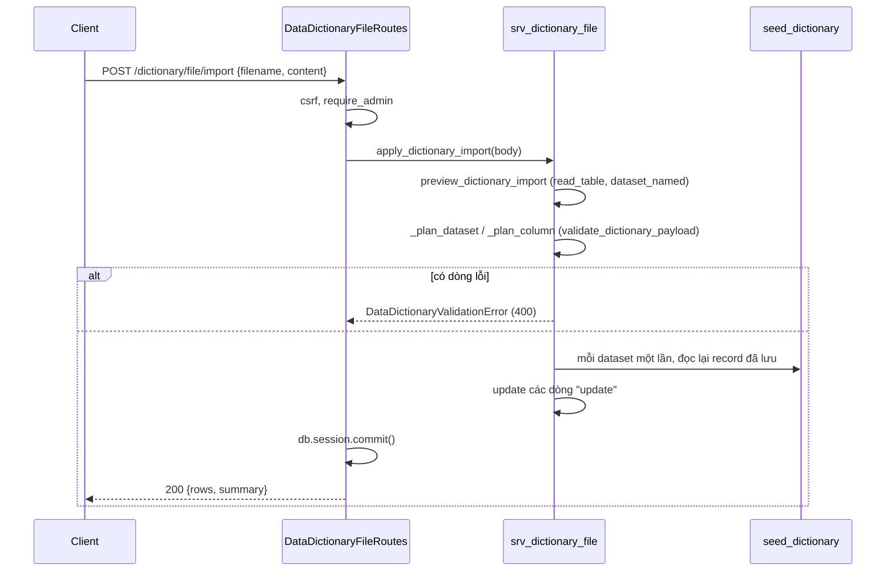

# `route_dictionary_file.py`: xuất và nhập từ điển bằng file

> Đang làm lại: chỉ còn Excel, có file mẫu tải riêng.

Route mixin `DataDictionaryFileRoutes` (`modules/data_dictionary/routes/route_dictionary_file.py`), ghép vào
`SemanticLayerAPI`. Đường dẫn tương đối với `{API}` (xem [README.md](README.md#đường-dẫn)). Logic nằm ở
`services/srv_dictionary_file.py`; đọc và ghi file dùng chung `common/utils/table_file.py`. Vì phần này đang được làm
lại, tài liệu chỉ mô tả luồng ở mức tổng quát.

| Method | Đường dẫn | Hàm | Ai gọi được | Commit |
| --- | --- | --- | --- | --- |
| GET | `/dictionary/file` | `export_dictionary_file` | Admin | Không |
| POST | `/dictionary/file/preview` | `preview_dictionary_file` | Admin | Không |
| POST | `/dictionary/file/import` | `import_dictionary_file` | Admin | Có |

Mọi route gọi `require_admin()` rồi `ensure_dictionary_tables()`; hai route POST đều có `@csrf_protected` và `@rollback_on_error`.

## Luồng tổng quát

- **Xuất** (`export_dictionary`): với mỗi dataset nghiệp vụ (`business_datasets_by_name`, bỏ database nội bộ),
  `read_dictionary_snapshot` rồi xuất một dòng dataset (cột `column` trống) và một dòng cho mỗi cột theo thứ tự Superset, không ghi database.
  Cột file: `dataset`, `column`, `display_name`, `description`, `semantic_role`, `aggregations`, `synonyms`, `unit`,
  `business_term`, `contains_pii`. Response `{"filename", "media_type", "content": <base64>}`.
- **Xem trước** (`preview_dictionary_import`): đọc file (`read_table`), tìm dataset theo tên bảng (`dataset_named`), đọc
  snapshot rồi lập kế hoạch cho từng dòng (`_plan_dataset` hoặc `_plan_column`). Dòng cột được kiểm tra bằng
  chính `validate_dictionary_payload` của PUT từ điển. Mỗi dòng nhận `action` `update`, `unchanged` hoặc `error` cùng
  danh sách trường đổi. Không seed, không sửa metadata và không commit.
- **Nhập** (`apply_dictionary_import`): chạy lại xem trước; có dòng `error` thì 400 (`refusal_message`) và không lưu
  gì; không thì seed các dataset cần dùng, đọc lại record đã lưu thay object tạm, cập nhật mọi dòng `update` (cột
  không phải `measure` bị xóa `aggregations`) và route commit phần cập nhật. Seed có commit riêng theo quy ước hiện tại.
- Response của xem trước và nhập là `import_report(rows)`: `{"rows": [{row, key, action, message, changes}],
  "summary": {"create", "update", "unchanged", "error"}}`.
- Lỗi file (không đọc được, quá lớn, sai cột, trống) và lỗi dòng là `DataDictionaryValidationError` (400).

