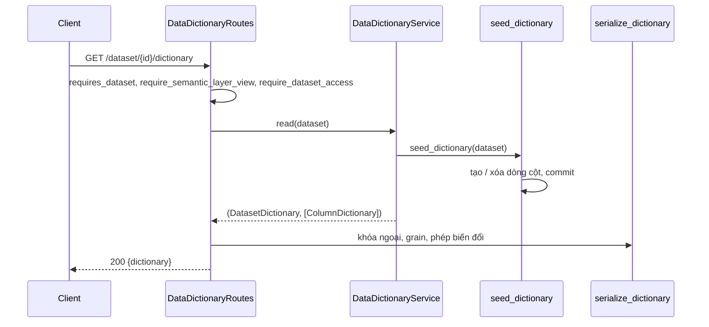
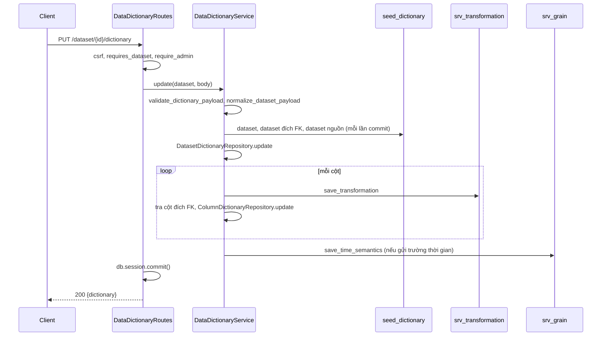
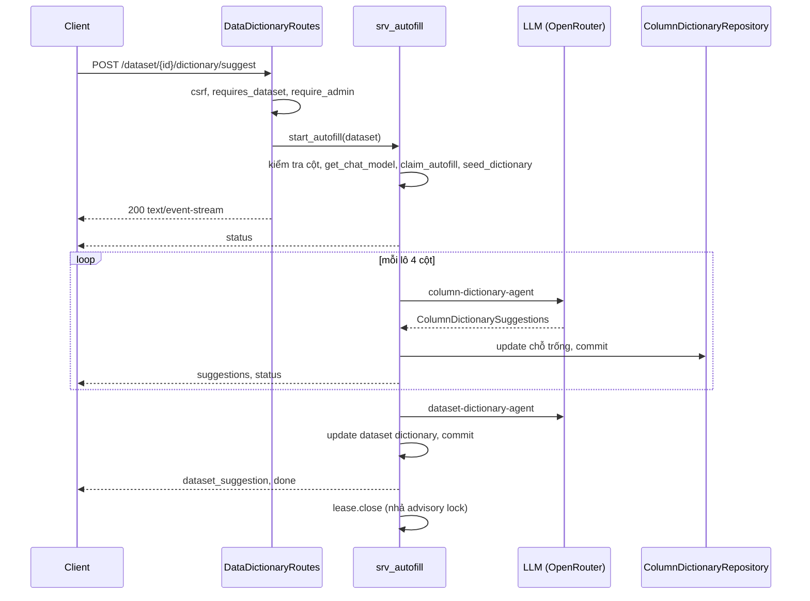

# `route_dictionary.py`: từ điển một dataset và AI AutoFill

Route mixin `DataDictionaryRoutes` (`modules/data_dictionary/routes/route_dictionary.py`), ghép vào `SemanticLayerAPI`.
Đường dẫn tương đối với `{API}` (xem [README.md](README.md#đường-dẫn)). Logic nằm ở `services/srv_dictionary.py`
(`DataDictionaryService`) và `services/srv_autofill.py`.

| Method | Đường dẫn | Hàm | Ai gọi được | Commit |
| --- | --- | --- | --- | --- |
| GET | `/datasets/reference-options` | `get_reference_options` | Admin | Không |
| GET | `/dataset/<dataset_id>/dictionary` | `get_dataset_dictionary` | Admin, "Semantic Layer Viewer" có quyền đọc dataset | Không |
| PUT | `/dataset/<dataset_id>/dictionary` | `update_dataset_dictionary` | Admin | Có |
| POST | `/dataset/<dataset_id>/dictionary/suggest` | `suggest_dataset_dictionary` | Admin | Có (seed, mỗi lô, cuối luồng) |

## GET `/datasets/reference-options`

Danh sách dataset Superset và cột của chúng để chọn đích khóa ngoại (và nguồn phép biến đổi) trong Data Dictionary.

**Quyền**: `@permission_name("read")`, rồi `require_admin()`.

**Input**: không có.

**Luồng**:

1. `@handle_errors` → `require_admin()` → `ensure_dictionary_tables()`.
2. `DataDictionaryService().read_reference_options()`:
   1. `ColumnDictionaryRepository.read_key_columns()`: dòng từ điển có `is_pk` hoặc `is_unique`; gom thành
      `key_flags[dataset_id][column_name] = {"pk", "unique"}`.
   2. `datasets_by_name()` (`DatasetDAO.find_all()`, sắp theo `table_name` rồi `id`); bỏ dataset của database nội bộ
      (`is_internal_dataset`: `extra` của database có cờ nội bộ).
   3. Mỗi dataset một mục: `label` = `database_name.schema.table_name` (bỏ phần trống), danh sách tên cột Superset,
      kiểu cột (cắt 64 ký tự), và `key_columns` từ bước 1.

**Bảng**: đọc `tables`, `table_columns`, `dbs`, `text_to_bi_column_dictionary`. Không ghi. Không seed, nên cột chưa có
dòng từ điển không có trong `key_columns`.

**Response 200**:

```json
{
  "datasets": [
    {"id": 12, "dataset_name": "dm_tram", "label": "data_wh.public.dm_tram", "database_name": "data_wh", "schema": "public",
     "columns": ["tram_id", "ten_tram"], "column_types": {"tram_id": "INTEGER", "ten_tram": "VARCHAR(255)"},
     "key_columns": {"tram_id": {"pk": true, "unique": false}}}
  ]
}
```

**Lỗi**:

| Status | Message | Nguồn |
| --- | --- | --- |
| 403 | "Admin access required." | `require_admin` |
| 500 | Lỗi migration | `ensure_dictionary_tables` → `@safe` |

## GET `/dataset/<dataset_id>/dictionary`

Từ điển của một dataset sau khi đồng bộ với cột Superset: metadata dataset, ngữ nghĩa thời gian, grain, và mỗi cột theo
đúng thứ tự cột Superset kèm khóa ngoại và phép biến đổi.

**Quyền**: `@permission_name("read")`, `require_semantic_layer_view()` (Admin hoặc permission `can_view` trên "Text to BI
Semantic Layer"), rồi `require_dataset_access(dataset)` (`security_manager.raise_for_access`). Đây là route duy nhất của
module mở cho "Semantic Layer Viewer".

**Input**: path `dataset_id`.

**Luồng**:

1. `@handle_errors` → `@requires_dataset` nạp `dataset` (404 nếu không có).
2. `require_semantic_layer_view()`, `ensure_dictionary_tables()`, `require_dataset_access(dataset)`.
3. Trong `try`: `DataDictionaryService().read(dataset)`:
   1. `read_dictionary_snapshot(dataset)` đọc metadata đã lưu; dataset/cột còn thiếu dùng object tạm trong bộ nhớ.
   2. Chỉ giữ các cột Superset đang có, theo đúng thứ tự; không tạo, xóa, flush hay commit dòng từ điển.
4. `serialize_dictionary(dataset, dictionary, columns)`:
   1. Khóa ngoại: `read_by_ids` các cột được tham chiếu, `get_datasets` các dataset của chúng (một truy vấn mỗi loại);
      mỗi cột có `referenced_column` (tên cột đích), `referenced_dataset_id`, `referenced_column_name`,
      `referenced_dataset_label` (`database.schema.table`).
   2. `DatasetGrainRepository.read_by_row_kind(dataset.id)` (sắp theo `row_kind_value`).
   3. `stored_transformations(column_ids)`: `read_by_columns` và `read_sources` (theo `position`).
   4. `data_type` lấy từ cột Superset hiện tại, không từ dòng từ điển; `aggregations`, `synonyms` qua `json_list`.
5. Lỗi ngoài dự kiến trong bước 3–4: log, `db.session.rollback()`, 500 "Could not load dataset dictionary.".

**Bảng**: đọc `tables`, `table_columns`, `text_to_bi_dataset_dictionary`, `text_to_bi_column_dictionary`,
`text_to_bi_dataset_grain`, `text_to_bi_column_transformation`, `text_to_bi_column_transformation_source`. Không seed hay ghi metadata.

**Commit**: không có trong luồng đọc, kể cả khi metadata chưa có dòng đã lưu.

**Response 200**:

```json
{
  "dataset_id": 12, "dataset_name": "fact_tong_hop_thoi_tiet", "display_name": "Tổng hợp thời tiết",
  "description": "…", "grain": "Một dòng là một dự báo…", "create_column": "thoi_diem",
  "dataset_type": "aggregate", "layer_id": 2, "time_column": "thoi_diem", "row_kind_column": "loai_du_bao",
  "contains_pii": false,
  "grains": [{"row_kind_value": "DU_BAO_GIO", "label": "Dự báo giờ", "grain": "hour"}],
  "read_only": false,
  "columns": [
    {"id": 81, "column_name": "tram_id", "display_name": "Trạm", "data_type": "INTEGER", "nullable": false,
     "default_value": null, "is_pk": false, "is_fk": true, "referenced_column": "tram_id", "referenced_dataset_id": 3,
     "referenced_column_name": "tram_id", "referenced_dataset_label": "data_wh.public.dm_tram", "is_unique": false,
     "unit": null, "format": null, "business_term": null, "temporal_kind": null, "semantic_role": "key",
     "aggregations": [], "synonyms": [], "description": null, "contains_pii": false,
     "transformation": {"expression": "…", "sources": [{"dataset_id": 5, "column_name": "ma_tram"}]}}
  ]
}
```

`transformation` là `null` khi cột không có phép biến đổi. `read_only = not is_admin()`: Viewer nhận `true`.

Cột chưa có metadata đã lưu có `id = null`; GET chỉ trả mặc định trong bộ nhớ. PUT của quản trị viên seed các dòng
còn thiếu rồi trả ID đã lưu. Frontend dùng tên cột làm ID vùng mở rộng để các cột chưa lưu không trùng ID HTML.

**Lỗi**:

| Status | Message | Nguồn |
| --- | --- | --- |
| 404 | "Dataset not found." | `requires_dataset` |
| 403 | `SemanticLayerViewRequiredError` | `require_semantic_layer_view` |
| 403 | "Dataset and database access required." | `require_dataset_access` |
| 500 | Lỗi migration | `ensure_dictionary_tables` → `@safe` |
| 500 | "Could not load dataset dictionary." | lỗi trong seed hoặc serialize |



## PUT `/dataset/<dataset_id>/dictionary`

Lưu hàng loạt metadata của dataset và các cột gửi lên. Chỉ trường có mặt trong body bị đổi; trường bỏ qua giữ giá trị đã
lưu. Từ điển không có vòng duyệt: lưu xong là có hiệu lực.

**Quyền**: `@permission_name("write")`, `@csrf_protected`, `require_admin()`.

**Input**: path `dataset_id`; header `X-CSRFToken`; body JSON:

```json
{
  "dataset": {
    "display_name": "Tổng hợp thời tiết", "description": "…", "grain": "…", "create_column": "thoi_diem",
    "dataset_type": "aggregate", "layer_id": 2, "contains_pii": false,
    "time_column": "thoi_diem", "row_kind_column": "loai_du_bao",
    "grains": [{"row_kind_value": "DU_BAO_GIO", "label": "Dự báo giờ", "grain": "hour"}]
  },
  "columns": [
    {"column_name": "tram_id", "display_name": "Trạm", "is_fk": true, "referenced_dataset_id": 3,
     "referenced_column_name": "tram_id", "semantic_role": "key", "contains_pii": false}
  ]
}
```

`columns` bắt buộc là mảng (có thể rỗng); `dataset` tùy chọn (mặc định `{}`).

Phần `dataset` (`normalize_dataset_payload`), khóa thuộc `DATASET_DICTIONARY_FIELDS` cộng `DATASET_TIME_FIELDS`:

| Trường | Quy tắc |
| --- | --- |
| `display_name` | Chuỗi không rỗng, tối đa 255 ký tự |
| `description`, `grain`, `create_column` | Chuỗi hoặc null; chuỗi trắng lưu thành null; `create_column` được `strip` và phải là cột của dataset |
| `dataset_type` | `base`, `aggregate` hoặc null |
| `layer_id` | Số nguyên (không phải bool) trỏ tới một tầng dữ liệu có thật (`data_layer_repository().get`), hoặc null |
| `contains_pii` | `true` / `false` (`checked_pii_flag`) |
| `time_column`, `row_kind_column` | Tên cột hoặc null; chuỗi rỗng thành null; kiểm tra ở `checked_time_semantics` |
| `grains` | Mảng tối đa 20 mục `{row_kind_value, label, grain}`; `null` (hoặc bỏ qua) giữ bộ grain đã lưu |

Mỗi mục của `columns` (`validate_dictionary_payload`), khóa thuộc `DICTIONARY_FIELDS` cộng `column_name`:

| Trường | Quy tắc |
| --- | --- |
| `column_name` | Bắt buộc, là cột Superset của dataset, không trùng trong mảng |
| `display_name` | Chuỗi không rỗng, tối đa 255 ký tự |
| `default_value`, `business_term` | Chuỗi hoặc null; `business_term` trắng thành null |
| `nullable`, `is_pk`, `is_fk`, `is_unique` | Boolean |
| `referenced_dataset_id` + `referenced_column_name` | Cả hai, hoặc cả hai null để bỏ khóa ngoại; dataset có thật, cột có trong dataset đó, không trỏ vào chính nó |
| `referenced_column` | Dạng cũ: tên một cột **cùng dataset**, hoặc null; bị bỏ qua khi có cặp trên |
| `unit`, `format` | Chuỗi tối đa 128 ký tự hoặc null; chuỗi trắng thành null |
| `temporal_kind` | `date`, `timestamp` hoặc null (`checked_temporal_kind`) |
| `semantic_role` | Một giá trị của `ROLES` |
| `aggregations` | Mảng con của `AGGREGATIONS`; khác rỗng thì `semantic_role` gửi cùng (nếu có) phải là `measure` |
| `synonyms` | Mảng chuỗi, sau khi bỏ trắng và trùng tối đa 20 từ, mỗi từ ≤ 100 ký tự |
| `description` | Chuỗi tối đa 2000 ký tự hoặc null; trắng thành null |
| `contains_pii` | `true` / `false` |
| `transformation` | `null` để xóa, hoặc `{"expression": "…", "sources": [{"dataset_id", "column_name"}]}` (`checked_transformation`) |

`is_fk` và cột đích là hai trường độc lập: route không đòi `is_fk = true` khi có cột đích. Một quan hệ chỉ được coi là
quan hệ ([route-relationship.md](route-relationship.md)) khi có cả hai.

**Luồng**:

1. `@csrf_protected` → `@rollback_on_error` → `@handle_errors` → `@requires_dataset`.
2. `require_admin()`, `ensure_dictionary_tables()`.
3. Trong `try`: `DataDictionaryService().update(dataset, request.get_json(silent=True))`:
   1. `validate_dictionary_payload(payload, actual_column_names, dataset.id)`: kiểm tra từng cột như bảng trên.
      `_checked_reference` đọc dataset đích bằng `get_dataset`; `checked_transformation` đọc tên cột của dataset nguồn
      qua `columns_of` (mỗi dataset một lần). Kết quả: giá trị đã chuẩn hóa, `aggregations` và `synonyms` thành JSON text.
   2. `normalize_dataset_payload(payload["dataset"], actual_column_names)`: tách `time_column`, `row_kind_column`,
      `grains` ra `time_updates`; kiểm tra phần còn lại.
   3. `seed_dictionary(dataset)`, rồi seed mỗi dataset đích khóa ngoại khác dataset này, rồi mỗi dataset nguồn phép biến
      đổi khác dataset này. Mỗi seed **commit**; chúng chạy trước mọi sửa đổi để sửa đổi chỉ commit ở bước 4.
   4. `DatasetDictionaryRepository.update(read(dataset.id), dataset_updates)` (flush).
   5. `rows_by_name` = `read_by_dataset`; với mỗi cột, `_update_column(row, update)`:
      1. Có `transformation`: `save_transformation(row.id, value)`. `None` xóa nguồn (`update_sources(column_id, [])`) và
         dòng biến đổi; có giá trị thì tra ID từ điển của mỗi nguồn (`read_by_column_name`, thiếu là
         `TransformationSourceMissingError`), giữ nguyên nếu biểu thức và nguồn không đổi, không thì tạo / sửa
         `ColumnTransformation` và thay nguồn (`update_sources`).
      2. Có cặp khóa ngoại: cả hai null thì `referenced_column = None`; không thì
         `read_by_column_name(referenced_dataset_id, referenced_column_name)` (không có là
         `ReferencedColumnMissingError`), lưu ID dòng đó.
      3. `ColumnDictionaryRepository.update(row, update)` (flush); vai trò sau khi lưu khác `measure` mà còn
         `aggregations` thì đặt `aggregations = None`.
   6. Luôn gọi `save_time_semantics(record, time_updates, rows_by_name)`, kể cả khi chỉ sửa cột: trường không gửi lấy giá trị đã lưu,
      `grains` không gửi lấy bộ đã lưu; `checked_time_semantics` kiểm tra với `temporal_kind` **sau khi** lưu cột; đặt
      `time_column`, `row_kind_column`; `DatasetGrainRepository.update_dataset_grains` thay cả bộ (xóa, flush, thêm,
      flush). `label` trống được thay bằng `row_kind_value`.
   7. Trả `read(dataset.id)` và `read_by_dataset(dataset.id)`.
4. `db.session.commit()`.
5. `serialize_dictionary(dataset, dictionary, columns)`.
6. `SemanticLayerError` được ném tiếp cho `@handle_errors` (rollback, 400/404); lỗi khác: log, rollback, 500 "Could not
   save dataset dictionary.".

Kiểm tra thời gian (`checked_time_semantics`) chỉ chạy khi body có `time_column`, `row_kind_column` hoặc `grains`. Xóa
`time_column` mà vẫn còn grain đã lưu là 400 "dataset.grains need a dataset.time_column."; gửi kèm `"grains": []` để bỏ.

**Bảng**: update `text_to_bi_dataset_dictionary`, `text_to_bi_column_dictionary`; insert / update / delete
`text_to_bi_column_transformation`, `text_to_bi_column_transformation_source`; delete và insert `text_to_bi_dataset_grain`;
đọc `tables`, `table_columns`, `text_to_bi_data_layer`. Seed có thể ghi từ điển của dataset này và các dataset được trỏ tới.

Sửa `is_pk`, `is_unique`, `is_fk` hay khóa ngoại làm `relationship_contract_hash` của contract quan hệ liên quan đổi:
contract đã duyệt hết hiện hành. Sửa `time_column`, `row_kind_column`, grain hay `temporal_kind` có thể làm giá trị mặc
định của metric không còn hợp lệ (module `metric_management`).

**Response 200**: như GET.

**Lỗi**:

| Status | Message (rút gọn) | Nguồn |
| --- | --- | --- |
| 403 | "CSRF token không hợp lệ." | `csrf_protected` |
| 404 | "Dataset not found." | `requires_dataset` |
| 403 | "Admin access required." | `require_admin` |
| 400 | "Request body must contain a columns array." | body không phải object hoặc thiếu `columns` |
| 400 | "columns[i] must be an object." / "… contains unsupported fields: …" | `validate_dictionary_payload` |
| 400 | "Unknown dataset column: …" / "Duplicate dataset column: …" | `column_name` |
| 400 | "columns[i].<field> must be …" | kiểu và độ dài từng trường |
| 400 | "columns[i] must specify both a referenced dataset and column.", "Unknown referenced dataset: …", "Unknown referenced column: …", "A column cannot reference itself." | `_checked_reference` |
| 400 | "columns[i].semantic_role must be one of …", "… aggregations are only declared on a measure.", "… synonyms may hold 20 words …" | `checked_column_semantics` |
| 400 | "… phải là object gồm expression và sources, hoặc null.", "… cần ít nhất một cột nguồn." | `checked_transformation` |
| 400 | "Một cột không thể là nguồn biến đổi của chính nó.", "Không tìm thấy dataset nguồn …", … | `checked_transformation` |
| 400 | "… phải là true hoặc false." | `checked_pii_flag` |
| 400 | "dataset must be an object.", "dataset contains unsupported fields: …", "dataset.display_name must be …" | `normalize_dataset_payload` |
| 400 | "dataset.dataset_type must be …", "dataset.create_column must reference …", "dataset.layer_id must reference …" | `normalize_dataset_payload` |
| 400 | "dataset.time_column must be a date or timestamp column.", "dataset.row_kind_column needs a dataset.time_column." | `checked_time_semantics` |
| 400 | "Several grains need a dataset.row_kind_column …", "dataset.grains[i].grain must be one of …", … | `checked_time_semantics` |
| 400 | "Referenced column no longer exists." | `ReferencedColumnMissingError` |
| 400 | "Cột nguồn của phép biến đổi không còn tồn tại." | `TransformationSourceMissingError` |
| 500 | "Could not save dataset dictionary." | lỗi ngoài dự kiến trong `try` |
| 500 | "Could not save the change." | lỗi ngoài `try`, `rollback_on_error` |



## POST `/dataset/<dataset_id>/dictionary/suggest`

AI AutoFill: gợi ý tên hiển thị, đơn vị, mô tả nghiệp vụ cho mọi cột và metadata mô tả của dataset, **lưu vào chỗ còn
trống**, và stream tiến trình về client dạng Server-Sent Events.

**Quyền**: `@permission_name("write")`, `@csrf_protected`, `require_admin()`.

**Input**: path `dataset_id`; header `X-CSRFToken`. Body không được đọc (frontend gửi `{}`).

**Luồng trước khi stream** (lỗi ở đây là response JSON thường):

1. `@csrf_protected` → `@rollback_on_error` → `@handle_errors` → `@requires_dataset`.
2. `require_admin()`, `ensure_dictionary_tables()`.
3. `start_autofill(dataset)`:
   1. `dataset.columns` rỗng → `NoColumnsToDescribeError` (400).
   2. `get_chat_model()` (`core/llm.py`); `RuntimeError` (thiếu `OPENROUTER_API_KEY`) → log và
      `AutoFillUnavailableError(str(ex))` (503).
   3. `_agent_context(dataset)`: `dataset_name`, `dataset_description`, và mỗi cột `column_name`, `data_type`,
      `superset_display_name` (`verbose_name`), `description`, `is_datetime`.
   4. `claim_autofill(db.engine, dataset.id)` lấy PostgreSQL advisory lock trên connection riêng, autocommit. Đang có
      lượt khác giữ khóa → `SuggestionInProgressError` (409), trước khi seed hay gọi LLM.
   5. `seed_dictionary(dataset)` (commit). Khóa session trên connection riêng vẫn được giữ qua các commit.
   6. Trả `AutoFillStream` bọc `_autofill_events(..., lease)`; lỗi chuẩn bị nhả khóa ngay.
4. Route trả `Response(stream_with_context(events), mimetype="text/event-stream")` với header `Cache-Control: no-cache`,
   `X-Accel-Buffering: no`. Status 200.

**Luồng trong stream** (`_autofill_events`, chạy sau khi route đã return, nên các decorator không còn bắt lỗi):

1. Gửi `status` `{"total", "processed": 0, "message": "Đang chuẩn bị gợi ý"}`.
2. `suggest_column_dictionary_batches(agent_context)`: lô 4 cột, mỗi lô `_suggest_column_batch`:
   `_column_agent()` (`create_agent`, `name="column-dictionary-agent"`, `response_format=ColumnDictionarySuggestions`,
   `system_prompt` của `prompts/prompt_column_dictionary.py`) nhận JSON của lô. Kết quả phải có đúng tập `column_name`
   của lô, không trùng; `display_name` sau `strip` không rỗng, ≤ 255; `unit` cắt 128, `business_term` cắt 2000. Sai thì
   `ValueError`.
3. Mỗi lô: đọc lại `read_by_dataset`; với mỗi gợi ý, chỉ ghi vào chỗ trống:
   - `display_name` khi đang trống hoặc bằng `column_name`;
   - `unit` khi đang trống; `business_term` khi đang trống.
   `ColumnDictionaryRepository.update` (flush), rồi `db.session.commit()`. Gửi `suggestions` (giá trị **sau khi lưu**
   của từng cột, không phải gợi ý thô) và `status`.
4. `suggest_dataset_dictionary(agent_context)`: `_dataset_agent()` (`name="dataset-dictionary-agent"`,
   `response_format=DatasetDictionarySuggestion`, `dataset_system_prompt`). `display_name` không rỗng, ≤ 255;
   `description` cắt 4000, `grain` cắt 2000; `create_column` phải là tên một cột đầu vào, không thì `ValueError`.
5. Ghi vào chỗ trống của dataset dictionary: `display_name` khi trống hoặc bằng `table_name`; `description`, `grain`
   (mô tả tự do), `create_column` khi đang trống. `DatasetDictionaryRepository.update`, `db.session.commit()`.
6. Gửi `dataset_suggestion` `{"dataset": {display_name, description, grain, create_column}}` (giá trị sau khi lưu) và
   `done` `{"processed", "total"}`.
7. Lỗi bất kỳ: `db.session.rollback()`, log, gửi `error` `{"message": _failure_message(status_code)}`: 402 → hết credit
   OpenRouter, 401 → API key bị từ chối, còn lại "Không thể tạo gợi ý từ điển cột.". Các lô đã commit giữ nguyên.
8. `finally`: `lease.close()` nhả advisory lock và đóng connection. `AutoFillStream.close()` và callback đóng response
   cũng nhả khóa, kể cả khi chưa đọc sự kiện đầu tiên; việc đóng lặp lại không gây lỗi.

AutoFill không đụng `semantic_role`, khóa, `temporal_kind`, grain có cấu trúc hay PII. `_column_agent` và `_dataset_agent`
được `lru_cache`, nên model được dựng một lần cho mỗi process.

Khóa nằm ở PostgreSQL nên dùng chung giữa các worker. Không có TTL tự mở khóa khi lượt cũ còn chạy; worker chết làm
connection đóng và PostgreSQL nhả khóa. Engine khác PostgreSQL trả 503 thay vì dùng khóa yếu trong process.

**Bảng**: update `text_to_bi_column_dictionary`, `text_to_bi_dataset_dictionary` (cùng ghi của seed). Gọi OpenRouter.

**Commit**: seed (trước stream), sau mỗi lô cột, sau phần dataset.

**Response 200** (`text/event-stream`), mỗi sự kiện là `event: <tên>\ndata: <JSON>\n\n` (`sse_event`):

```text
event: status
data: {"total": 9, "processed": 0, "message": "Đang chuẩn bị gợi ý"}

event: suggestions
data: {"suggestions": [{"column_name": "nhiet_do", "display_name": "Nhiệt độ", "unit": "°C", "business_term": "…"}], "processed": 4, "total": 9}

event: status
data: {"total": 9, "processed": 4, "message": "Đã xử lý 4/9 cột"}

event: dataset_suggestion
data: {"dataset": {"display_name": "…", "description": "…", "grain": "…", "create_column": "thoi_diem"}}

event: done
data: {"processed": 9, "total": 9}
```

**Lỗi** (trước stream; sau khi stream bắt đầu, lỗi chỉ còn là sự kiện `error` trong response 200):

| Status | Message | Nguồn |
| --- | --- | --- |
| 403 | "CSRF token không hợp lệ." | `csrf_protected` |
| 404 | "Dataset not found." | `requires_dataset` |
| 403 | "Admin access required." | `require_admin` |
| 400 | "Dataset has no columns to describe." | `NoColumnsToDescribeError` |
| 503 | "OPENROUTER_API_KEY chưa được cấu hình. …" | `AutoFillUnavailableError` |
| 409 | "Dataset này đang được AI gợi ý, vui lòng đợi hoàn tất." | `SuggestionInProgressError` |
| 500 | "Could not save the change." | lỗi khác trước stream (ví dụ seed), `rollback_on_error` |


