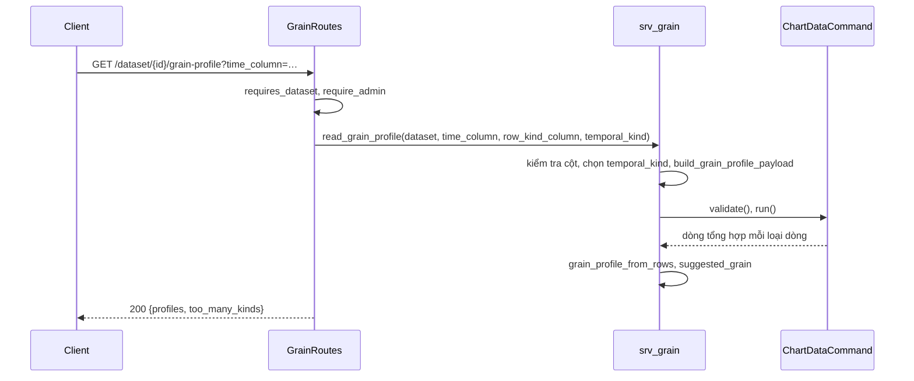

# `route_grain.py`: phát hiện grain

Route mixin `GrainRoutes` (`modules/data_dictionary/routes/route_grain.py`), ghép vào `SemanticLayerAPI`. Đường dẫn
tương đối với `{API}` (xem [README.md](README.md#đường-dẫn)). Logic nằm ở `services/srv_grain.py`. Đặc tả:
[docs/specs/grain-va-ngu-nghia-thoi-gian.md](../../../specs/grain-va-ngu-nghia-thoi-gian.md) mục 4.2.

| Method | Đường dẫn | Hàm | Ai gọi được | Commit |
| --- | --- | --- | --- | --- |
| GET | `/dataset/<dataset_id>/grain-profile` | `get_grain_profile` | Admin | Không |

Nút "Phát hiện grain" trong Data Dictionary gọi route này. Nó chỉ đọc và gợi ý: grain chỉ được lưu khi quản trị viên lưu
từ điển (`PUT /dataset/<id>/dictionary` với `dataset.grains`, xem [route-dictionary.md](route-dictionary.md)).

## GET `/dataset/<dataset_id>/grain-profile`

Với mỗi loại dòng, giá trị của cột thời gian rơi thế nào (số dòng, thời điểm đầu và cuối, số thời điểm khác nhau, số
ngày, số giá trị lệch giờ chẵn, lệch nửa đêm, lệch ngày đầu tháng) và grain gợi ý.

**Quyền**: `@permission_name("read")`, `require_admin()`. Truy vấn chạy qua ChartData với quyền người gọi, nên quyền
dataset và row-level security của Superset vẫn áp dụng.

**Input**: path `dataset_id`; query string, đọc cả lựa chọn chưa lưu trên form:

| Tham số | Ý nghĩa |
| --- | --- |
| `time_column` | Bắt buộc. Cột vật lý (không có `expression`) của dataset |
| `row_kind_column` | Tùy chọn. Cột vật lý phân biệt loại dòng |
| `temporal_kind` | Tùy chọn. `date` hoặc `timestamp` đang hiện trên form |

Giá trị `temporal_kind` được kiểm tra trước khi đọc cột; giá trị không hợp lệ trả 400 với thông báo nêu đúng
`temporal_kind`, không báo nhầm `time_column`.

Giá trị rỗng được coi là không có (`request.args.get(...) or None`).

**Luồng**:

1. `@handle_errors` → `@requires_dataset` → `require_admin()` → `ensure_dictionary_tables()`.
2. `read_grain_profile(dataset, time_column, row_kind_column, temporal_kind)`:
   1. `time_column` phải là cột của dataset không có `expression`; `row_kind_column` (nếu có) cũng vậy.
   2. Loại thời gian: tham số `temporal_kind`, không có thì `temporal_kind` của dòng từ điển
      (`ColumnDictionaryRepository.read_by_column_name`), không có nữa thì `default_temporal_kind(type, is_dttm)`. Không
      thuộc `TEMPORAL_KINDS` là 400.
   3. `build_grain_profile_payload(dataset, time_column, row_kind_column, temporal_kind)`: tên cột phải khớp
      `SIMPLE_IDENTIFIER` (`^[A-Za-z_][A-Za-z0-9_]*$`) vì chúng được ghép vào SQL. Một truy vấn ChartData gom theo
      `row_kind_column` (nếu có), `row_limit` = `MAX_ROW_KINDS + 1` (21), các metric SQL:
      `COUNT(*)` → `row_count`, `MIN` → `first_moment`, `MAX` → `last_moment`, `COUNT(DISTINCT t)` → `moments`,
      `COUNT(DISTINCT CAST(t AS DATE))` → `days`, `SUM(CASE WHEN EXTRACT(DAY FROM t) <> 1 …)` → `off_first_day`; thêm
      cho `timestamp`: `off_the_hour` (phút hoặc giây khác 0) và `off_midnight` (giờ, phút hoặc giây khác 0). Cột `date`
      không đếm hai giá trị sau vì PostgreSQL từ chối `EXTRACT(HOUR)` trên `date`.
   4. `ChartDataCommand(ChartDataQueryContextSchema().load(payload))`, `validate()`, `run()`. Lỗi có tên lớp chứa
      `access` / `forbidden` / `permission` / `security` (`is_superset_access_error`) → `DatasetAccessError` (403). Lỗi
      khác, hoặc kết quả có `error` → log và trả `None`.
   5. `grain_profile_from_rows(rows, row_kind_column)`: xét 20 dòng đầu, bỏ loại dòng có giá trị null hoặc rỗng; mỗi
      dòng thành một hồ sơ (số đếm qua `_count`, thời điểm qua `iso_moment`) kèm `suggested_grain`; sắp theo
      `row_kind_value`. `too_many_kinds` đúng khi truy vấn trả hơn 20 dòng.
3. `None` → 500 "Could not read the grain profile."; còn lại 200.

`suggested_grain(profile)`:

| Điều kiện (theo thứ tự) | Gợi ý |
| --- | --- |
| `row_count == 0` | `null` |
| Có giá trị lệch giờ chẵn | `instant` |
| Có giá trị lệch nửa đêm | `hour` |
| Mọi giá trị là ngày đầu tháng và có hơn một thời điểm | `month` |
| Còn lại | `day` |

Route không bao giờ gợi ý `week`, `quarter` hay `year`.

**Bảng**: đọc `tables`, `table_columns`, `text_to_bi_column_dictionary`; chạy một truy vấn tổng hợp trên database của
dataset. Không ghi, không seed.

**Response 200**:

```json
{
  "time_column": "thoi_diem", "row_kind_column": "loai_du_bao", "too_many_kinds": false,
  "profiles": [
    {"row_kind_value": "DU_BAO_GIO", "row_count": 4800, "first_moment": "2026-10-01T00:00:00",
     "last_moment": "2026-10-20T23:00:00", "moments": 480, "days": 20, "off_the_hour": 0, "off_midnight": 4600,
     "off_first_day": 4600, "suggested_grain": "hour"}
  ]
}
```

Không có `row_kind_column` thì `profiles` có một mục với `row_kind_value` null.

**Lỗi**:

| Status | Message | Nguồn |
| --- | --- | --- |
| 404 | "Dataset not found." | `requires_dataset` |
| 403 | "Admin access required." | `require_admin` |
| 400 | "time_column must be a physical column of this dataset." | thiếu hoặc sai `time_column` |
| 400 | "row_kind_column must be a physical column of this dataset." | sai `row_kind_column` |
| 400 | "time_column must be a date or timestamp column." | loại thời gian không phải `date` / `timestamp` |
| 400 | "Grain detection needs plainly named columns." | tên cột không phải định danh đơn giản |
| 403 | "Dataset and database access required." | Superset từ chối truy vấn |
| 500 | "Could not read the grain profile." | truy vấn lỗi |
| 500 | Lỗi migration | `ensure_dictionary_tables` → `@safe` |


