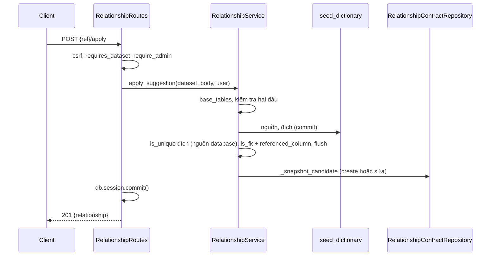
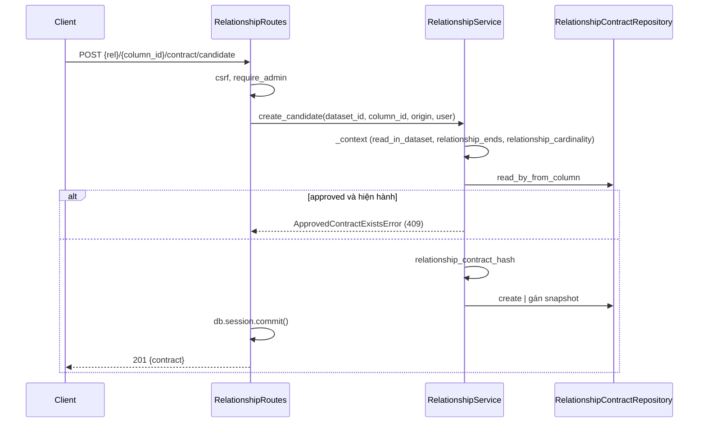
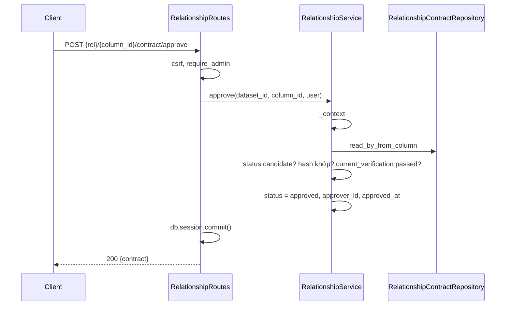
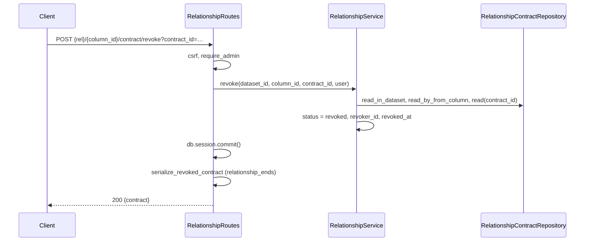

# `route_relationship.py`: quan hệ giữa các bảng và contract quan hệ

Route mixin `RelationshipRoutes` (`modules/data_dictionary/routes/route_relationship.py`), ghép vào `SemanticLayerAPI`.
Đường dẫn tương đối với `{API}` (xem [README.md](README.md#đường-dẫn)); trong code,
`prefix = "/dataset/<int:dataset_id>/relationships"`, dưới đây viết tắt là `{rel}`. Logic nằm ở
`services/srv_relationship.py` (`RelationshipService`), `srv_relationship_contract.py`, `srv_relationship_discovery.py`,
`srv_relationship_lookup.py`. Đặc tả: [docs/specs/schema-link.md](../../../specs/schema-link.md) mục 4.1. Khái niệm
lực lượng, mã băm và vòng đời contract ở [README.md](README.md#contract-quan-hệ-candidate--kiểm-tra-dữ-liệu--approved--revoked).

| Method | Đường dẫn | Hàm | Ai gọi được | Commit |
| --- | --- | --- | --- | --- |
| GET | `{rel}` (`?suggest=1`) | `list_relationships` | Admin | Không |
| POST | `{rel}/apply` | `apply_relationship_suggestion` | Admin | Có |
| POST | `{rel}/<column_id>/contract/candidate` | `create_relationship_contract_candidate` | Admin | Có |
| POST | `{rel}/<column_id>/verify` | `verify_relationship` | Admin | Có |
| POST | `{rel}/<column_id>/contract/approve` | `approve_relationship_contract` | Admin | Có |
| POST | `{rel}/<column_id>/contract/revoke` (`?contract_id=`) | `revoke_relationship_contract` | Admin | Có |

Tab "Quan hệ" của Data Dictionary gọi các route này (`relationships`, `relationshipApply`, `relationshipAction` trong
`frontend/src/features/semantic-layer/api.ts`). `<column_id>` là ID dòng `text_to_bi_column_dictionary` của cột khóa
ngoại, và phải thuộc `dataset_id` trên URL.

Bốn route có `<column_id>` không dùng `@requires_dataset`: chúng nhận `dataset_id`, `column_id` trần, gọi
`require_admin()` trước, rồi tìm cột bằng `ColumnDictionaryRepository.read_in_dataset(dataset_id, column_id)`. Dataset
không tồn tại vì vậy trả 404 của cột, không phải "Dataset not found.".

## Hình dạng chung

Một **quan hệ** (`RelationshipService.read_row(entry)`, `null` khi `relationship_ends` không dựng được hai đầu):

```json
{
  "column_id": 81, "from_dataset_id": 12, "from_dataset_name": "tb_quan_sat", "from_column": "tram_id",
  "to_dataset_id": 3, "to_dataset_name": "dm_tram", "to_column": "tram_id",
  "cardinality": "many_to_one", "problem": null, "contract": {"…": "…"}
}
```

`relationship_cardinality` lỗi thì `cardinality` là `null` và `problem` là message lỗi. `contract` là `null` khi cột chưa
có contract.

Một **contract** (`serialize_relationship_contract`):

```json
{
  "id": 4, "from_dataset_id": 12, "from_column": "tram_id", "to_dataset_id": 3, "to_column": "tram_id",
  "cardinality": "many_to_one", "status": "approved", "source": "database", "owner_id": 1,
  "approver_id": 1, "approved_at": "2026-10-26T08:00:00+00:00", "revoker_id": null, "revoked_at": null,
  "verification": {"target_rows": 30, "target_unique": true, "references": 4800, "orphans": 0, "orphan_ratio": 0.0,
                   "orphan_samples": [], "type_match": true, "passed": true},
  "verified_at": "2026-10-26T07:59:00+00:00", "current": true, "executable": false
}
```

- `verification` và `verified_at` chỉ có khi `verified_hash == contract_hash` (`current_verification`, `_verified`);
  không thì `null`.
- `current` = `relationship_is_approved_current(contract, source, target)`; `executable` luôn `false`.

## GET `{rel}`

Quan hệ đã khai báo của dataset, đi ra và đi vào, kèm contract; với `suggest`, thêm các quan hệ được gợi ý.

**Quyền**: `@permission_name("read")`, `require_admin()`.

**Input**: path `dataset_id`; chỉ `suggest=1` bật gợi ý. `suggest=0`, `false`, chuỗi khác hoặc không gửi đều tắt.

**Luồng**:

1. `@handle_errors` → `@requires_dataset` → `require_admin()` → `ensure_dictionary_tables()`.
2. `RelationshipService().read_all(dataset, suggest)`:
   1. Đọc metadata đã lưu, không seed hay commit.
   2. `outgoing`: `read_row` cho mỗi dòng từ điển của dataset có `is_fk`, bỏ `null`.
   3. `incoming`: `ColumnDictionaryRepository.read_referencing(ids)` (cột `is_fk` của dataset bất kỳ trỏ vào cột của
      dataset này), `read_row`, bỏ `null`.
   4. `is_base` = `dataset_type` của dataset dictionary là `base` (`BASE_DATASET`) và dataset không có `sql`.
   5. `suggest` và `is_base`: `_read_suggestions(dataset, outgoing)`:
      1. `base_tables(dataset.database_id)` (`read_datasets_of_type(database_id, "base")`, bỏ dataset ảo); không seed;
         `_table_keys` của mỗi bảng: cột active, không tính toán, kèm kiểu; `unique_columns` = cột
         `is_unique` cộng khóa chính khi bảng chỉ có một cột khóa chính.
      2. `dataset.database.get_foreign_keys(Table(table_name, schema))` cho **riêng** dataset này; lỗi thì log và
         `suggestion_note` = "Không đọc được khoá ngoại từ database; chỉ gợi ý theo tên cột.".
      3. `database_suggestions(keys, foreign_keys)`: khóa ngoại một cột của database, đích là một base table trong danh
         sách (cùng schema khi `referred_schema` trống); `naming_suggestions(keys)`: cột `*_id` / `*_key` trùng **tên**
         với một cột trong `unique_columns` của bảng khác và cùng họ kiểu (`types_match`).
      4. `merged_suggestions`: một gợi ý cho mỗi cặp cột, `sources` gộp và sắp theo `SOURCES`; sắp theo `from_column`
         rồi nguồn mạnh nhất.
      5. Giữ gợi ý đi ra từ dataset này và chưa khai báo y hệt (`from_column`, `to_dataset_id`, `to_column`); thêm
         `to_dataset_name` và `replaces` (cột nguồn đã có một quan hệ khai báo khác).

**Bảng**: đọc `text_to_bi_column_dictionary`, `text_to_bi_dataset_dictionary`, `text_to_bi_relationship_contract`,
`tables`, `table_columns`, `dbs`; không ghi metadata. Với `suggest`, đọc catalog khóa ngoại của database dữ liệu.

**Response 200**:

```json
{
  "dataset_id": 12, "is_base": true, "outgoing": [{"…": "quan hệ"}], "incoming": [],
  "suggestions": [{"from_dataset_id": 12, "from_column": "chi_so_id", "to_dataset_id": 7, "to_column": "chi_so_id",
                   "sources": ["database", "naming"], "to_dataset_name": "dm_chi_so_thoi_tiet", "replaces": false}],
  "suggestion_note": null
}
```

`suggestions` và `suggestion_note` chỉ có khi `suggest` bật và dataset là base table.

**Lỗi**:

| Status | Message | Nguồn |
| --- | --- | --- |
| 404 | "Dataset not found." | `requires_dataset` |
| 403 | "Admin access required." | `require_admin` |
| 500 | Lỗi migration hoặc lỗi đọc ngoài dự kiến | `@safe` |

## POST `{rel}/apply`

Khai báo một quan hệ được gợi ý vào Data Dictionary (đặt khóa ngoại trên cột nguồn) và chụp nó thành contract
`candidate`.

**Quyền**: `@permission_name("write")`, `@csrf_protected`, `require_admin()`.

**Input**: path `dataset_id`; header `X-CSRFToken`; body:

```json
{"source": "database", "from_column": "chi_so_id", "to_dataset_id": 7, "to_column": "chi_so_id"}
```

**Luồng**:

1. `@csrf_protected` → `@rollback_on_error` → `@handle_errors` → `@requires_dataset` → `require_admin()` →
   `ensure_dictionary_tables()`.
2. `RelationshipService().apply_suggestion(dataset, body, current_user.id)`:
   1. Body phải là object có `source` thuộc `SOURCES`.
   2. `to_dataset_id` phải là số nguyên, không nhận bool; cả hai dataset phải nằm trong `base_tables(dataset.database_id)`.
   3. `seed_dictionary` dataset nguồn và dataset đích (mỗi lần commit).
   4. `read_by_column_name` cột nguồn và cột đích; thiếu một là 400. Contract theo cột nguồn đang `approved` trả 409
      trước khi đổi khóa hoặc đích, yêu cầu thu hồi trước.
   5. Cột đích không thuộc `_table_keys(target).unique_columns`: nguồn `database` thì đặt `is_unique = True` cho cột
      đích (khóa ngoại của database chỉ trỏ được vào khóa); nguồn khác là 400.
   6. Đặt `is_fk = True`, `referenced_column = target_entry.id` cho cột nguồn; `flush()`.
   7. `relationship_ends(source_entry)` rồi `_snapshot_candidate(source, target, source, actor_id)` (xem
      [POST candidate](#post-relcolumn_idcontractcandidate)); `None` là `ApprovedContractExistsError` (409).
   8. Trả `read_row(source_entry)`.
3. `db.session.commit()`.

Khi cột nguồn đã có quan hệ khác (`replaces = true`), bản đang `approved` chặn thay đích bằng 409. Sau khi thu hồi,
quản trị viên mới có thể áp dụng gợi ý và tạo candidate cho đích mới.

**Bảng**: update `text_to_bi_column_dictionary` (`is_fk`, `referenced_column`, có thể `is_unique` của cột đích); insert
hoặc update `text_to_bi_relationship_contract`; đọc `tables`, `table_columns`, `dbs`, `text_to_bi_dataset_dictionary`.

**Response 201**: `{"relationship": {…quan hệ…}}`.

**Lỗi**:

| Status | Message | Nguồn |
| --- | --- | --- |
| 403 | "CSRF token không hợp lệ." | `csrf_protected` |
| 404 | "Dataset not found." | `requires_dataset` |
| 403 | "Admin access required." | `require_admin` |
| 400 | "The body needs from_column, to_dataset_id, to_column and a source." | body hoặc `source` sai |
| 400 | "Both ends must be base tables on the same database." | không phải base table cùng database |
| 400 | "Unknown source or target column." | cột không có dòng từ điển |
| 400 | "Declare the target column a key or unique before using it." | đích chưa là khóa, nguồn không phải `database` |
| 400 | Message của `relationship_cardinality` / `relationship_contract_hash` | quan hệ không hợp lệ |
| 409 | "Revoke the current approved contract before declaring another target." | đang có bản duyệt hiện hành, hoặc không dựng được hai đầu |
| 500 | "Could not save the change." | `rollback_on_error` |



## POST `{rel}/<column_id>/contract/candidate`

Chụp khóa ngoại đã khai báo trên cột thành contract `candidate` chờ duyệt.

**Quyền**: `@permission_name("write")`, `@csrf_protected`, `require_admin()`.

**Input**: path `dataset_id`, `column_id`; header `X-CSRFToken`; body tùy chọn `{"source": "database" | "dictionary" |
"naming"}`. Giá trị khác hoặc không có body được bỏ qua.

**Luồng**:

1. `@csrf_protected` → `@rollback_on_error` → `@handle_errors` → `require_admin()` → `ensure_dictionary_tables()`.
2. `RelationshipService().create_candidate(dataset_id, column_id, origin, current_user.id)`:
   1. `_context(dataset_id, column_id)`: `read_in_dataset` (không có là `ForeignKeyColumnNotFoundError`),
      `relationship_ends` (`None` là 400), `relationship_cardinality(*ends)`.
   2. `_snapshot_candidate(source, target, origin, actor_id)`:
      1. `relationship_cardinality`; `read_by_from_column(from_dataset_id, from_column)`.
      2. Contract có và `relationship_is_approved_current` → trả `None` → `ApprovedContractExistsError` (409).
      3. `relationship_contract_hash` tính **trước** khi contract mới vào session, để autoflush không chèn bản thiếu trường.
      4. Snapshot: `to_dataset_id`, `to_column`, `cardinality`, `contract_hash`, `source` (= `origin`, hoặc `source` cũ,
         hoặc `dictionary`), `status = "candidate"`, và đặt null `approver_id`, `approved_at`, `revoker_id`, `revoked_at`,
         `verification`, `verified_hash`, `verified_at`.
      5. Chưa có contract: `RelationshipContractRepository.create(...)` với `from_dataset_id`, `from_column`,
         `owner_id = actor_id` (không flush). Có rồi: gán snapshot lên contract cũ (giữ `id`; `owner_id = actor_id`).
3. `db.session.commit()`.

**Bảng**: insert hoặc update `text_to_bi_relationship_contract`; đọc `text_to_bi_column_dictionary`, `tables`,
`table_columns`, `dbs`.

**Response 201**: `{"contract": {…contract…}}`.

**Lỗi**:

| Status | Message | Nguồn |
| --- | --- | --- |
| 403 | "CSRF token không hợp lệ." / "Admin access required." | `csrf_protected`, `require_admin` |
| 404 | "Foreign-key dictionary column not found in this dataset." | `_context` |
| 400 | "The referenced dictionary column or dataset no longer exists." | `relationship_ends` trả `None` |
| 400 | "A relationship cannot connect a dataset to itself.", "Relationship contracts require physical datasets." | `relationship_cardinality` |
| 400 | "Relationship contracts require datasets on the same database." | `relationship_cardinality` |
| 400 | "Relationship columns must be active live physical columns.", "The source column must be a declared foreign key." | `relationship_cardinality` |
| 400 | "The relationship target must be a unique or single-column primary key." | `relationship_cardinality` |
| 409 | "Thu hồi bản đã duyệt trước khi tạo bản đề xuất mới." | `ApprovedContractExistsError` |
| 500 | "Could not save the change." | `rollback_on_error` |



## POST `{rel}/<column_id>/verify`

Kiểm tra dữ liệu trên warehouse có đúng quan hệ không và lưu kết quả lên contract.

**Quyền**: `@permission_name("write")`, `@csrf_protected`, `require_admin()`.

**Input**: path `dataset_id`, `column_id`; header `X-CSRFToken`. Không body.

**Luồng**:

1. `@csrf_protected` → `@rollback_on_error` → `@handle_errors` → `require_admin()` → `ensure_dictionary_tables()`.
2. `RelationshipService().verify(dataset_id, column_id)`:
   1. `_context(dataset_id, column_id)`.
   2. `read_by_from_column`; không có hoặc `revoked` → `RelationshipCandidateRequiredError` (404). Contract `candidate`
      và `approved` đều kiểm tra được.
   3. `contract_hash` khác mã băm của quan hệ hiện tại → 400.
   4. `verification_queries(...)` dựng ba truy vấn SQLAlchemy Core (`table()`, `column()`; tên bảng và cột không được ghép chuỗi vào SQL):
      - `uniqueness`: `target_rows` = `COUNT(*)`, `target_values` = `COUNT(đích)`, `target_distinct` =
        `COUNT(DISTINCT đích)` trên bảng đích;
      - `orphans`: `references` = số giá trị nguồn khác null, `orphans` = số giá trị đó không có ở đích (outer join);
      - `samples`: tối đa 5 giá trị mồ côi khác nhau.
   5. `types_match` trên kiểu cột Superset của hai đầu (cùng họ `type_family`: timestamp, date, number, text, boolean).
   6. `source.dataset.database.get_sqla_engine(schema=…)`, mở kết nối và transaction; PostgreSQL thì
      `SET LOCAL statement_timeout = 15000`. Chạy `uniqueness`; chỉ khi `target_values == target_distinct` mới chạy
      `orphans` và `samples`. Lỗi bất kỳ → log, trả `None`.
   7. `verification_result(...)`: `target_unique` = `target_values > 0` và bằng `target_distinct`; `orphan_ratio` làm
      tròn 4 chữ số; `passed` = `target_unique and type_match` (mồ côi không chặn).
   8. Lưu `verification` (JSON), `verified_hash = contract_hash`, `verified_at = now (UTC)`.
3. Kết quả không đạt: đặt `status=candidate`, xóa người/thời điểm duyệt, lưu kết quả rồi commit. Khi truy vấn lỗi,
   cũng bỏ duyệt và xóa kết quả kiểm tra cũ; route commit việc vô hiệu hóa rồi trả 500
   "Could not run the relationship check on the database.". Đây là thay đổi có chủ đích để ngừng sử dụng cạnh join.

Recheck đạt giữ bản duyệt; không đạt hoặc truy vấn lỗi đưa về candidate. Phía tiêu thụ cũng yêu cầu bằng chứng
`current_verification(...).passed` còn khớp, nên bản duyệt không có kiểm tra đạt không được dùng để join.

**Bảng**: update `text_to_bi_relationship_contract`; ba truy vấn đọc trên database dữ liệu.

**Response 200**: `{"contract": {…contract…}}` với `verification` mới.

**Lỗi**:

| Status | Message | Nguồn |
| --- | --- | --- |
| 403 | "CSRF token không hợp lệ." / "Admin access required." | `csrf_protected`, `require_admin` |
| 404 | "Foreign-key dictionary column not found in this dataset." | `_context` |
| 400 | Message của `relationship_ends` / `relationship_cardinality` | `_context` |
| 404 | "Create a candidate contract before checking the data." | chưa có contract hoặc đã `revoked` |
| 400 | "Relationship changed; create a new candidate before checking it." | mã băm đổi |
| 500 | "Could not run the relationship check on the database." | truy vấn lỗi hoặc quá 15 giây |
| 500 | "Could not save the change." | `rollback_on_error` |

```mermaid
sequenceDiagram
    participant C as Client
    participant R as RelationshipRoutes
    participant S as RelationshipService
    participant W as Warehouse
    C->>R: POST {rel}/{column_id}/verify
    R->>R: csrf, require_admin
    R->>S: verify(dataset_id, column_id)
    S->>S: _context, read_by_from_column, so contract_hash
    S->>W: SET LOCAL statement_timeout; uniqueness
    opt đích duy nhất
        S->>W: orphans, samples
    end
    S->>S: verification_result, lưu verification / verified_hash / verified_at
    R->>R: db.session.commit()
    R-->>C: 200 {contract}
```

## POST `{rel}/<column_id>/contract/approve`

Duyệt contract `candidate` còn khớp quan hệ hiện tại và đã qua kiểm tra dữ liệu.

**Quyền**: `@permission_name("write")`, `@csrf_protected`, `require_admin()`. Khi
`TEXT_TO_BI_REQUIRE_SECOND_REVIEWER=True`, người soạn (`owner_id`) không được tự duyệt; trả `RelationshipSelfApprovalError` (403).

**Input**: path `dataset_id`, `column_id`; header `X-CSRFToken`. Không body.

**Luồng**:

1. `@csrf_protected` → `@rollback_on_error` → `@handle_errors` → `require_admin()` → `ensure_dictionary_tables()`.
2. `RelationshipService().approve(dataset_id, column_id, current_user.id)`:
   1. `_context`; `read_by_from_column`; không có → `RelationshipContractNotFoundError` (404).
   2. `status != "candidate"` → 400.
   3. `contract_hash` khác `relationship_contract_hash(source, target, cardinality)` → 400.
   4. `current_verification(contract)` không có hoặc `passed` sai → 400.
   5. Kiểm tra người duyệt thứ hai rồi `status = "approved"`, `approver_id = actor_id`, `approved_at = now (UTC)`.
3. `db.session.commit()`.

Từ đây contract là cạnh của `/schema-graph` (`read_approved_between`, lọc bằng `relationship_is_approved_current`) và
xuất hiện trong `/semantic-catalog` (`read_approved`), miễn là nó còn hiện hành.

**Bảng**: update `text_to_bi_relationship_contract`.

**Response 200**: `{"contract": {…contract…}}`.

**Lỗi**:

| Status | Message | Nguồn |
| --- | --- | --- |
| 403 | "CSRF token không hợp lệ." / "Admin access required." | `csrf_protected`, `require_admin` |
| 404 | "Foreign-key dictionary column not found in this dataset." | `_context` |
| 400 | Message của `relationship_ends` / `relationship_cardinality` | `_context` |
| 404 | "Relationship contract not found for this foreign key." | chưa có contract |
| 400 | "Only a candidate relationship contract can be approved." | `status` khác `candidate` |
| 400 | "Relationship changed; create a new candidate before approval." | mã băm đổi |
| 400 | "Check the data first: the target column must hold each value once and the types must match." | chưa kiểm tra hoặc không đạt |
| 500 | "Could not save the change." | `rollback_on_error` |



## POST `{rel}/<column_id>/contract/revoke`

Thu hồi contract của khóa ngoại.

**Quyền**: `@permission_name("write")`, `@csrf_protected`, `require_admin()`.

**Input**: path `dataset_id`, `column_id`; header `X-CSRFToken`; query tùy chọn `contract_id` (`type=int`).

**Luồng**:

1. `@csrf_protected` → `@rollback_on_error` → `@handle_errors` → `require_admin()` → `ensure_dictionary_tables()`.
2. `RelationshipService().revoke(dataset_id, column_id, contract_id, current_user.id)`:
   1. `entry = read_in_dataset(dataset_id, column_id)`; có thì `contract = read_by_from_column(dataset_id,
      entry.column_name)`. Không gọi `_context`, nên thu hồi được cả khi quan hệ không còn hợp lệ (đích bị xóa, cột hết
      là khóa ngoại).
   2. Có `contract_id`: `read(contract_id)`; 404 nếu không có, nếu `entry` không còn, nếu contract thuộc dataset hay cột
      khác, hoặc nếu khác contract tìm theo cột. Không thì dùng nó.
   3. Không có contract → `RelationshipContractNotFoundError` (404).
   4. Chỉ `approved` được thu hồi; `candidate` và `revoked` trả 400 "Chỉ được thu hồi quan hệ đang được duyệt.".
      Sau kiểm tra, đặt `status = "revoked"`, `revoker_id = actor_id`, `revoked_at = now (UTC)`.
3. `db.session.commit()`.
4. `serialize_revoked_contract(contract, entry)`: dựng lại hai đầu bằng `relationship_ends(entry)`; không được thì chỉ
   trả các trường đã lưu với `current = false`.

**Bảng**: update `text_to_bi_relationship_contract`.

**Response 200**: `{"contract": {…contract…, "status": "revoked", "current": false}}`.

**Lỗi**:

| Status | Message | Nguồn |
| --- | --- | --- |
| 403 | "CSRF token không hợp lệ." / "Admin access required." | `csrf_protected`, `require_admin` |
| 404 | "Relationship contract not found for this foreign key." | không có cột, contract, hoặc `contract_id` không khớp |
| 500 | "Could not save the change." | `rollback_on_error` |


