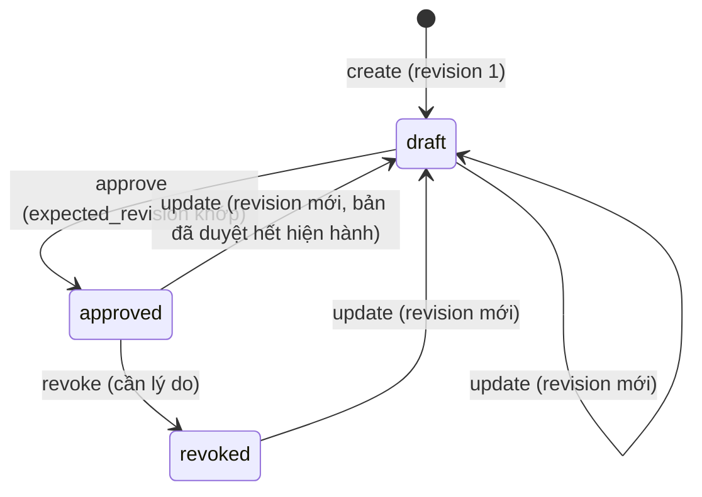

# Module `expert_rule_management`

Mô tả luồng xử lý các API của module quản lý expert rule (quy tắc chuyên gia) trong backend Semantic Layer:
`extensions/semantic-layer/backend/src/text_to_bi/superset_semantic_layer/modules/expert_rule_management/`. Module giữ
rule cùng các bản sửa (revision) và vòng đời duyệt, liên kết của mỗi bản tới dataset, thuật ngữ và metric kèm dấu vân
tay (fingerprint) của đối tượng được liên kết, nhóm rule tương đồng, gợi ý gom nhóm, nhập / xuất file, và danh sách rule
mà AI Agent được dùng.

Quy tắc chung về lỗi, decorator, transaction và quyền nằm ở [hanh-vi.md](../../hanh-vi.md); cấu trúc module nằm ở
[kien-truc.md](../../kien-truc.md). Đặc tả nghiệp vụ của gợi ý gom nhóm nằm ở
[docs/specs/goi-y-gom-nhom.md](../../../specs/goi-y-gom-nhom.md).

| Tài liệu | Route file trong `routes/` | API |
| --- | --- | --- |
| [route-expert-rule.md](route-expert-rule.md) | `route_expert_rule.py` | Danh sách, tùy chọn soạn, discover, lịch sử, tạo, sửa, duyệt, thu hồi, chuyển nhóm |
| [route-expert-rule-group.md](route-expert-rule-group.md) | `route_expert_rule_group.py` | Nhóm rule, gợi ý gom nhóm |
| [route-expert-rule-file.md](route-expert-rule-file.md) | `route_expert_rule_file.py` | Xuất file, xem trước và nhập file |

## Đường dẫn

Khác các module khác, route của module này không ghép vào `SemanticLayerAPI`. Ba route mixin `ExpertRuleRoutes`,
`ExpertRuleGroupRoutes`, `ExpertRuleFileRoutes` được ghép thành API riêng `ExpertRuleAPI`
(`routes/route_expert_rule_api.py`):

```python
@api(id="text_to_bi_expert_rule_api", name="Text to BI Expert Rules", resource_name="expert-rules")
class ExpertRuleAPI(ExpertRuleRoutes, ExpertRuleGroupRoutes, ExpertRuleFileRoutes, RestApi):
    class_permission_name = "text_to_bi_expert_rule_api"
```

`entrypoint.py` import `ExpertRuleAPI` để Superset đăng ký nó khi nạp extension. Superset đặt API dưới tiền tố
`/extensions/text-to-bi/superset-semantic-layer/expert-rules` (`EXPERT_RULES_API` trong
`frontend/src/features/semantic-layer/constants.ts`), và mọi route của module lại tự bắt đầu bằng `/expert-rules`, nên
đường dẫn đầy đủ lặp hai lần chữ `expert-rules`. Frontend (`expertRulesApi` trong `frontend/src/features/semantic-layer/api.ts`)
và AI Agent (`EXPERT_RULES_API` trong `ai-agents/.../modules/semantic_layer/services/client.py`) cùng dùng:

```text
{API} = /extensions/text-to-bi/superset-semantic-layer/expert-rules/expert-rules
```

Các đường dẫn trong tài liệu viết tương đối với `{API}`, ví dụ `GET {API}/discover`.

## Các lớp

```text
routes/       ExpertRuleRoutes, ExpertRuleGroupRoutes,       ← đọc request, kiểm tra quyền, commit, trả response
              ExpertRuleFileRoutes → ExpertRuleAPI
utils/        util_serializer.py                             ← đổi model thành JSON trả về
services/     ExpertRuleService, ExpertRuleEventService,     ← quy tắc nghiệp vụ, không đọc request, không commit
              ExpertRuleGroupService, srv_expert_rule_link,
              srv_expert_rule_validation, srv_expert_rule_sql,
              srv_expert_rule_file
repositories/ ExpertRuleRepository, ExpertRuleRevisionRepository,   ← mọi truy vấn vào năm bảng của module
              ExpertRuleLinkRepository, ExpertRuleEventRepository,
              ExpertRuleGroupRepository
models/       ExpertRuleGroup, ExpertRule, ExpertRuleRevision, ExpertRuleLink, ExpertRuleAuditEvent
```

- **Model** (`models/model_expert_rule.py`): năm bảng trong metadata database của Superset (xem mục [Bảng](#bảng)).
- **Repository** (`repositories/repo_expert_rule*.py`): kế thừa `BaseRepository`; `create` (qua `add`) và `update` flush
  ngay trừ khi gọi với `flush=False`, `delete` không flush. Link và event luôn được tạo với `flush=False`. Hai hàm khóa
  dòng: `ExpertRuleRepository.read_for_update` và `ExpertRuleRevisionRepository.read_current_for_update`
  (`populate_existing().with_for_update()`).
- **Dependency** (`dependencies.py`): `expert_rule_repository()`, `expert_rule_revision_repository()`,
  `expert_rule_link_repository()`, `expert_rule_event_repository()`, `expert_rule_group_repository()`, mỗi hàm gắn
  repository với `db.session` của request.
- **Service**:
  - `services/srv_expert_rule.py`: `ExpertRuleService` tạo, sửa, duyệt, thu hồi rule; đọc danh sách duyệt
    (`read_for_review`), danh sách cho AI Agent (`read_discoverable`), trạng thái hiển thị (`review_state`).
  - `services/srv_expert_rule_event.py`: `ExpertRuleEventService` ghi và đọc lịch sử; `read_author_id` tìm người soạn.
  - `services/srv_expert_rule_group.py`: `ExpertRuleGroupService` (tạo, sửa, xóa nhóm, `move_rule`, `place_rule`,
    `suggest`, `apply_suggestion`, `dismiss_suggestion`) và `rule_text` dựng đoạn văn để so nghĩa.
  - `services/srv_expert_rule_link.py`: tra cột (`column_resolver`), thuật ngữ (`glossary_links`), metric
    (`approved_metric`); fingerprint (`link_fingerprint`, `live_fingerprint`, `rule_links`); kiểm tra (`with_term_metrics`,
    `validate_semantic_links`, `rule_is_discoverable`, `linked_target_authorized`); tùy chọn trình soạn (`rule_options`).
  - `services/srv_expert_rule_validation.py`: kiểm tra và chuẩn hóa payload (`normalize_rule_payload`,
    `normalize_group_payload`, `checked_text`, `review_reason`, `expected_revision_of`, `group_id_of`, `without_group`,
    `content_hash`).
  - `services/srv_expert_rule_sql.py`: `contains_sql_or_control` dò cú pháp SQL / lệnh điều khiển bằng sqlglot.
  - `services/srv_expert_rule_file.py`: `export_rules`, `preview_rule_import`, `apply_rule_import`.
- **Serializer** (`utils/util_serializer.py`): `serialize_expert_rule`, `serialize_expert_rule_review_entry`,
  `serialize_discovered_rule`, `serialize_expert_rule_events`, `serialize_expert_rule_group`, `serialize_group_reference`.
- **Lỗi** (`exceptions.py`):

| Lớp | Gốc | Status | Message mặc định |
| --- | --- | --- | --- |
| `ExpertRuleValidationError` | `ValidationError` | 400 | (luôn truyền message) |
| `ExpertRuleConflictError` | `ConflictError` | 409 | "The expert rule changed; refresh and retry." |
| `ExpertRuleSelfApprovalError` | `SelfApprovalError` | 403 | "Người soạn rule không thể tự duyệt; cần một quản trị viên khác duyệt." |
| `ExpertRuleNotFoundError` | `NotFoundError` | 404 | "Expert rule not found." |
| `ExpertRuleGroupNotFoundError` | `NotFoundError` | 404 | "Không tìm thấy nhóm rule." |

Trạng thái duyệt dùng `ReviewStatus` chung (`common/schemas/status_enum.py`: `draft`, `approved`, `revoked`). Gợi ý gom
nhóm dùng lại `modules/glossary_management/services/srv_group_suggestion.py` (`suggest_groups`, `grouping_choice`,
`dismiss_suggestion`, `EXPERT_RULE_KIND = "expert_rule"`) và `srv_glossary_embedding.py` (`text_vectors`).

Ngoài các route dưới đây, phần phát hiện mâu thuẫn (`glossary_management/services/srv_contradiction_review.py`) đọc
rule qua `expert_rule_repository()`, `expert_rule_revision_repository()` và `expert_rule_link_repository()` của module này.

## Bảng

| Model | Bảng | Một dòng là |
| --- | --- | --- |
| `ExpertRuleGroup` | `text_to_bi_expert_rule_group` | Một nhóm rule tương đồng |
| `ExpertRule` | `text_to_bi_expert_rule` | Gốc của một rule: tên khóa, dataset, nhóm |
| `ExpertRuleRevision` | `text_to_bi_expert_rule_revision` | Một bản nội dung của rule cùng trạng thái duyệt |
| `ExpertRuleLink` | `text_to_bi_expert_rule_link` | Liên kết của một bản tới dataset, thuật ngữ hoặc metric |
| `ExpertRuleAuditEvent` | `text_to_bi_expert_rule_audit_event` | Một bước trong lịch sử rule |

- `text_to_bi_expert_rule_group`: unique trên `normalized_name`; `name`, `description`, cột audit của
  `AuditMixinNullable`.
- `text_to_bi_expert_rule`: unique trên `normalized_name` (tên của bản hiện tại, gom khoảng trắng và `casefold`);
  `dataset_id` FK `tables.id` `ON DELETE CASCADE`; `group_id` FK nhóm `ON DELETE SET NULL`. Nhóm nằm trên rule, không
  trên revision.
- `text_to_bi_expert_rule_revision`: unique trên `(rule_id, revision_number)`; check `status IN ('draft', 'approved',
  'revoked')`; `name`, `conditions`, `exceptions`, `examples` (JSON), `content_hash`, `is_current`, `lifecycle_version`,
  `approver_id`/`approved_at`, `revoker_id`/`revoked_at`; FK `rule_id` `ON DELETE CASCADE`.
- `text_to_bi_expert_rule_link`: unique trên `(revision_id, kind, target_id)`; check `kind IN ('dataset', 'glossary',
  'metric')`; `target_id` là ID trần (dataset, thuật ngữ hoặc metric Superset), `fingerprint`, `dataset_id` FK
  `tables.id` CASCADE, `revision_id` FK CASCADE.
- `text_to_bi_expert_rule_audit_event`: chỉ thêm, không sửa; check `event_type IN ('created', 'updated', 'approved',
  'revoked', 'moved')`; `reason` (tối đa 512 ký tự, cắt bớt khi dài hơn), `revision_number`, `lifecycle_version`,
  `occurred_at`, `actor_id`; FK `rule_id` và `revision_id` `ON DELETE CASCADE`. Xóa dataset kéo theo rule, revision,
  link và audit event của nó. Audit chỉ thêm trong vòng đời rule, không được giữ lại sau khi dataset bị xóa.

Bảng tạo bởi `ensure_dictionary_tables()` (`migrations.py`); route của `ExpertRuleAPI` không gọi hàm này và không chạy
DDL, nên bảng phải có sẵn từ lần mở Semantic Layer trước hoặc từ bootstrap.

Với PostgreSQL đã có bảng audit, migration trong `ensure_dictionary_tables()` kiểm tra hai FK `rule_id`, `revision_id`
và đổi sang `ON DELETE CASCADE` nếu chưa đúng. Model mới dùng CASCADE ngay khi tạo bảng. Migration nâng cấp FK này
chỉ áp dụng cho PostgreSQL; chưa có bước dựng lại bảng audit cũ trên SQLite.

Bảng ngoài module mà module đọc: `tables`, `sql_metrics`, `ab_user` (Superset); `text_to_bi_dataset_dictionary`,
`text_to_bi_column_dictionary` (Data Dictionary); `text_to_bi_glossary_term`, `text_to_bi_glossary_term_revision`,
`text_to_bi_glossary_term_link` (Glossary); `text_to_bi_metric_contract`, `text_to_bi_metric_definition`,
`text_to_bi_dataset_grain` (qua `approved_metric` → `query_defaults_for`). Gợi ý gom nhóm đọc
`text_to_bi_text_embedding` và `text_to_bi_group_suggestion_dismissal`; POST bỏ qua gợi ý ghi dismissal, GET không ghi vector mới.

## Nội dung một rule

Payload của trình soạn (schema 2), kiểm tra bởi `normalize_rule_payload`; chỉ nhận các khóa trong `CONTENT_FIELDS`
(`schema_version`, `name`, `dataset_id`, `conditions`, `exceptions`, `examples`, `glossary_term_ids`, `metric_ids`), cộng
`group_id` (tách ra bằng `without_group`) và, khi sửa, `expected_revision`:

```json
{
  "schema_version": 2,
  "name": "Mưa lớn",
  "dataset_id": 12,
  "group_id": 3,
  "glossary_term_ids": [5],
  "conditions": [{"field_ref": {"column_dictionary_id": 81}, "operator": "greater_than", "value_type": "number", "value": 50}],
  "exceptions": [{"when": "Vùng núi", "outcome": "Ngưỡng 70 mm"}],
  "examples": [{"question": "Hôm nay có mưa lớn không?", "intent": "Lượng mưa ngày > 50 mm"}]
}
```

- `name`: `checked_text` (gom khoảng trắng, 1..255 ký tự); `normalized_name` = gom khoảng trắng + `casefold`.
- `dataset_id`: số nguyên (không phải bool).
- `conditions`: 1..50 mục. Schema 2: đúng bốn khóa `field_ref`, `operator`, `value_type`, `value`; `operator` thuộc
  `CONDITION_OPERATORS` (`equals`, `not_equals`, `contains`, `not_contains`, `greater_than`, `greater_than_or_equal`,
  `less_than`, `less_than_or_equal`, `in`, `not_in`, `is_null`, `is_not_null`); `value_type` thuộc `string`, `number`,
  `boolean`, `null`, `array` và khớp kiểu `value`; `is_null` / `is_not_null` phải có `value` null. Cột phải là đúng một
  dòng `text_to_bi_column_dictionary` của dataset (`column_resolver` → `_resolve_column`). Schema 1 (file import):
  `{"field": "<tên cột>", "operator", "value"}`, tra cột theo tên và suy `value_type` từ `value`
  (`_legacy_value_type`). Kết quả luôn lưu ở schema 2.
- `exceptions`: 0..50 mục, đúng hai khóa `when`, `outcome`. `examples`: 1..50 mục, đúng hai khóa `question`, `intent`.
  Mỗi giá trị qua `checked_text` (tối đa 2000 ký tự).
- `glossary_term_ids`, `metric_ids`: danh sách số nguyên, tối đa 50, không trùng.
- `checked_text` từ chối ("Unsafe {field}.") văn bản chứa SQL hay lệnh điều khiển (`contains_sql_or_control`: ký tự
  `;`, `--`, `/*`, `*/`, `$$`, `#`, NUL, hoặc một vị trí token mà sqlglot đọc được thành câu lệnh SQL / lệnh điều khiển
  PostgreSQL), đường dẫn URL hoặc từ khóa bí mật (`api key`, `token`, `password`, `bearer`, …).

`with_term_metrics(payload)` chạy trước khi chuẩn hóa: khi `glossary_term_ids` là danh sách và `dataset_id` là số, nó
**ghi đè** `metric_ids` bằng các metric mà bản đang dùng của thuật ngữ liên kết trên cùng dataset
(`glossary_revision_repository().read_serving` → `glossary_link_repository().read_by_revision_dataset`, `kind == "metric"`)
và có bản duyệt còn hiệu lực (`approved_metric`). Metric của rule không bao giờ được chọn riêng.

`validate_semantic_links(values)`: dataset phải tồn tại ("Unknown dataset."); phải có ít nhất một thuật ngữ ("An expert
rule needs at least one approved glossary term."); mỗi thuật ngữ phải có bản đang dùng `approved` liên kết tới dataset
của rule ("Invalid glossary link."); mỗi metric phải có `approved_metric` cùng dataset ("Invalid metric link."). Tất cả
là 400.

## Vòng đời: rule, revision và `lifecycle_version`

Một rule (`text_to_bi_expert_rule`) có nhiều revision; đúng một revision có `is_current = true`. Nội dung (tên, điều
kiện, ngoại lệ, ví dụ, liên kết) nằm trên revision; tên khóa, dataset và nhóm nằm trên rule.

| Thao tác | Revision hiện tại | `revision_number` | `lifecycle_version` | Event |
| --- | --- | --- | --- | --- |
| Tạo (`create`) | Bản mới, `draft` | 1 | 1 | `created` |
| Sửa (`update`) | Bản cũ `is_current = false`; bản mới `draft` | +1 | bản cũ + 1 | `updated` |
| Duyệt (`approve`) | Cùng bản, `draft` → `approved` | giữ | +1 | `approved` |
| Thu hồi (`revoke`) | Cùng bản, `approved` → `revoked` | giữ | +1 | `revoked` |
| Chuyển nhóm (`place_rule`) | Không đổi | giữ | giữ | `moved` |



- `revision_number` đếm **bản nội dung**: chỉ tăng khi sửa, nên duyệt và thu hồi không đổi nó.
- `lifecycle_version` là token khóa lạc quan (optimistic concurrency): tăng ở mọi thao tác đổi trạng thái hoặc nội dung
  (sửa, duyệt, thu hồi), và nối tiếp qua các revision (bản mới nhận `lifecycle_version` của bản cũ + 1). Client gửi giá
  trị đã đọc trong `expected_revision`; `ExpertRuleService._locked_current` khóa dòng rule (`read_for_update`) và revision
  hiện tại (`read_current_for_update`), rồi trả 409 "The expert rule changed; refresh and retry." nếu
  `lifecycle_version` khác. Chuyển nhóm không đổi `lifecycle_version`, nên một lượt duyệt đang mở vẫn hợp lệ sau khi
  rule được chuyển nhóm.
- Response của mọi thao tác trả cả hai: `revision` (= `revision_number`) và `lifecycle_version`. Tên trường
  `expected_revision` dù vậy so với `lifecycle_version`, không phải `revision_number`.
- Sửa một rule đang `approved` tạo bản nháp mới và đưa bản đã duyệt ra khỏi hiện hành: rule không còn được AI Agent
  dùng cho tới khi bản nháp được duyệt.
- Sửa không đổi được dataset ("An expert rule cannot move datasets."). Đổi tên chuyển luôn `normalized_name` của rule,
  nên tên cũ được giải phóng.
- Khi `TEXT_TO_BI_REQUIRE_SECOND_REVIEWER = True`, người soạn bản (người thực hiện event `created` / `updated` mới nhất
  của revision, `ExpertRuleEventService.read_author_id`) không tự duyệt được.

## Fingerprint liên kết và trạng thái `outdated`

Mỗi revision có một dòng `text_to_bi_expert_rule_link` cho dataset, cho mỗi thuật ngữ và cho mỗi metric
(`rule_links(values)`), tạo cùng lúc với revision trong `ExpertRuleService._create_revision`. Mỗi dòng lưu
`fingerprint = link_fingerprint(kind, target_id, dataset_id)`: SHA-256 của `compact_json` một danh sách định danh:

| `kind` | Nguồn | Danh sách được băm |
| --- | --- | --- |
| `dataset` | `get_dataset(dataset_id)` | `[kind, target_id, dataset_id, None, None]` (dataset không có `status`, `is_current`) |
| `glossary` | `glossary_links(term_id)`, mục cùng `dataset_id` | `[kind, term_id, dataset_id, status, True, content_hash của bản thuật ngữ, fingerprint liên kết thuật ngữ]` |
| `metric` | `approved_metric(metric_id)` | `[kind, metric_id, dataset_id, status, True, metric_contract_hash(...)]` |

Không tìm thấy nguồn (dataset bị xóa, thuật ngữ không còn bản đang dùng, metric không còn bản duyệt khớp) thì
fingerprint là `None`.

Trước khi duyệt, `ExpertRuleService.approve` đọc lại link của bản nháp và đối chiếu từng fingerprint đã lưu với
`live_fingerprint`. Không có link, fingerprint rỗng hoặc không khớp trả 400 "Liên kết của rule đã thay đổi; lưu lại bản
nháp trước khi duyệt."; status, `lifecycle_version` và audit duyệt chưa thay đổi. Người soạn cần lưu lại bản nháp để
tính lại link rồi xem xét duyệt lại. Đối tượng liên kết đổi sau khi duyệt vẫn có thể làm rule thành `outdated` lúc đọc.

- `glossary_links(term_id)` đọc bản đang dùng (`read_serving`: bản đã quyết định mới nhất, khi nó còn `approved`); bản
  nháp đang chờ duyệt của thuật ngữ không thay nó, nên sửa thuật ngữ chưa làm rule cũ đi.
- `approved_metric(metric_id)` đọc `MetricContractRepository.read_by_metric`, tìm metric trong `dataset.metrics`, lấy
  `query_defaults_for` và chỉ trả khi `contract_is_approved_current` đúng.

`rule_is_discoverable(revision, links)` đúng khi revision `approved`, `is_current`, có ít nhất một link và mọi
`live_fingerprint(link)` (tính lại lúc đọc) bằng `link.fingerprint` đã lưu. `ExpertRuleService.review_state` dùng nó cho
trạng thái hiển thị:

| `state` | Khi nào |
| --- | --- |
| `draft` | Revision `draft` |
| `revoked` | Revision `revoked` |
| `approved` | Revision `approved` và `rule_is_discoverable` đúng |
| `outdated` | Revision `approved` nhưng một fingerprint đã đổi: thuật ngữ được duyệt lại hoặc thu hồi, metric đổi công thức, giá trị mặc định hay bị thu hồi |

`outdated` không phải giá trị lưu trong bảng; nó được tính mỗi lần đọc. Rule `outdated` ra khỏi discover cho tới khi
quản trị viên sửa (tạo revision mới, fingerprint tính lại) rồi duyệt lại.

## Discover cho AI Agent

`GET {API}/discover` (xem [route-expert-rule.md](route-expert-rule.md#get-discover)) là nguồn rule của AI Agent:
`load_semantic_catalog` trong `ai-agents/.../modules/semantic_layer/services/catalog.py` gọi nó song song với
`/semantic-query/semantic-catalog` của AI Agent và `/glossary/discovery` của Semantic Layer. Adapter giải bọc public v1,
chuyển tiếp cookie của người dùng và cache 60 giây theo
người dùng (`cached_semantic_catalog`). `flatten_catalog` đọc từ mỗi rule `id`, `name`, `dataset_id`, `conditions`
(đọc tên cột từ `column_names`), bộ lọc (`rule_filters`, dựa trên `condition_columns`), `exceptions`, `examples`,
`metric_ids`, `glossary_term_ids`.

`ExpertRuleService.read_discoverable` chỉ trả rule thỏa cả ba:

1. Revision hiện tại `approved` (`ExpertRuleRevisionRepository.read_all_approved_current`).
2. Người gọi đọc được dataset của rule (`can_access_dataset`, tức `security_manager.raise_for_access`), và mọi đối tượng
   được liên kết qua `linked_target_authorized` (đóng khi lỗi: dataset của link đọc được; metric còn `approved_metric`;
   thuật ngữ còn liên kết tới dataset của link).
3. `rule_is_discoverable`: mọi fingerprint còn khớp.

## Khung chung của một route

Mọi route của `ExpertRuleAPI` đi qua cùng một chuỗi decorator, từ ngoài vào trong:

1. `@expose` khai báo method và đường dẫn.
2. `@protect()` và `@permission_name("read" | "write")` của Flask-AppBuilder: chưa đăng nhập hoặc thiếu permission
   `can_read` / `can_write` trên `text_to_bi_expert_rule_api` thì FAB trả lỗi trước khi vào hàm. Nhóm quyền "Semantic
   Layer Viewer" và "Semantic Layer Query" chỉ được cấp `can_read` trên API này (`access_control/services/roles.py`);
   mọi route ghi còn gọi `require_admin()` trong thân hàm.
3. `@safe`: lỗi không ai bắt được thành 500.
4. Route POST / PUT / DELETE: `@csrf_protected` (403 "CSRF token không hợp lệ." khi header `X-CSRFToken` sai) rồi
   `@rollback_on_error` (rollback, 500 "Could not save the change."), bao gồm `/file/preview`.
5. `@handle_errors` (`core/database.py`): bắt `SemanticLayerError`, rollback, trả `status` và `message` của lỗi.
6. Trong thân hàm: kiểm tra vai trò (`require_admin`, `require_semantic_layer_view` hoặc `require_semantic_layer_query`
   của `core/security.py`), đọc body, gọi service, `db.session.commit()` nếu ghi, serialize. Không route nào gọi
   `ensure_dictionary_tables()`.

Route tạo / sửa / duyệt / thu hồi rule commit qua helper `_committed(save)` của `route_expert_rule.py`: gọi `save()`
rồi `db.session.commit()` trong cùng một `try`; `IntegrityError` (thường là trùng `normalized_name` do hai request chạy
song song) thành 400 "Could not save the expert rule.". Kết quả trả về qua `serialize_expert_rule(revision)`:

```json
{"id": 7, "revision": 2, "lifecycle_version": 3, "schema_version": 2, "status": "draft", "name": "Mưa lớn",
 "conditions": [], "exceptions": [], "examples": []}
```

`id` là ID của rule (`revision.rule_id`), không phải của revision; `schema_version` luôn là 2.

Body của các route này đọc bằng `_body()`: `request.get_json(silent=True)` không phải object là 400 "Request body must
be an object.".

Route chuyển nhóm cũng dùng `_body()` và bắt buộc có đúng trường `group_id`. Trùng tên rule được phát hiện trước khi
lưu trả 400 "An expert rule with this name already exists."; trùng tên gặp khi flush / commit cũng trả 400 qua
`_committed`, với message "Could not save the expert rule.". Trùng tên nhóm vẫn trả 409; xung đột `lifecycle_version`
của rule cũng trả 409.

## Danh mục file

| File | Nội dung |
| --- | --- |
| `models/model_expert_rule.py` | Năm model, `AUDIT_EVENT_TYPES`, `LINK_KINDS` |
| `repositories/repo_expert_rule.py` | `ExpertRuleRepository`: `read`, `read_all` (kèm nhóm), `read_fresh`, `read_by_normalized_name`, `read_in_group`, `read_for_update` |
| `repositories/repo_expert_rule_revision.py` | `ExpertRuleRevisionRepository`: `read_current`, `read_current_for_update`, `read_all_current`, `read_all`, `read_all_approved_current` |
| `repositories/repo_expert_rule_link.py` | `ExpertRuleLinkRepository`: `read_by_revision`, `read_for_revisions` (gom link theo revision) |
| `repositories/repo_expert_rule_event.py` | `ExpertRuleEventRepository`: `read_history`, `read_latest_authoring` |
| `repositories/repo_expert_rule_group.py` | `ExpertRuleGroupRepository`: `read`, `read_all`, `read_by_normalized_name`, `update`, `delete` |
| `dependencies.py` | Năm hàm tạo repository |
| `exceptions.py` | Năm lớp lỗi của module |
| `services/srv_expert_rule.py` | `ExpertRuleService` |
| `services/srv_expert_rule_event.py` | `ExpertRuleEventService` |
| `services/srv_expert_rule_group.py` | `ExpertRuleGroupService`, `rule_text`, `OPERATOR_WORDS` |
| `services/srv_expert_rule_link.py` | Tra cứu, fingerprint, kiểm tra liên kết, `rule_options` |
| `services/srv_expert_rule_validation.py` | Kiểm tra và chuẩn hóa payload, `content_hash` |
| `services/srv_expert_rule_sql.py` | `contains_sql_or_control` |
| `services/srv_expert_rule_file.py` | Xuất, xem trước, nhập file CSV / XLSX |
| `routes/route_expert_rule.py` | `ExpertRuleRoutes`, `_body`, `_committed` |
| `routes/route_expert_rule_group.py` | `ExpertRuleGroupRoutes` |
| `routes/route_expert_rule_file.py` | `ExpertRuleFileRoutes` |
| `routes/route_expert_rule_api.py` | `ExpertRuleAPI` |
| `utils/util_serializer.py` | Các hàm `serialize_*` |

## Cập nhật sửa lỗi 2026-11-12

- Xóa dataset kéo theo rule, revision, link và audit event; migration PostgreSQL đổi hai FK audit từ RESTRICT sang CASCADE.
- Duyệt bản nháp kiểm tra fingerprint của mọi link. Link đổi hoặc mất trả 400, giữ bản nháp để người soạn lưu lại và xem xét.
- Trùng tên rule trả 400 cả khi phát hiện trước và khi flush/commit. Xung đột lifecycle tiếp tục trả 409.
- Audit của rule không tồn tại trả 404.
- Chuyển nhóm bắt buộc body object có đúng trường `group_id`; null là yêu cầu bỏ nhóm tường minh.
- PUT nhóm giữ tên và mô tả khi trường tương ứng bị bỏ qua; description null xóa mô tả.
- GET gợi ý không ghi embedding mới hay commit; đọc cache hiện có, tính vector thiếu trong bộ nhớ.
- Bỏ qua gợi ý trùng dùng savepoint: xung đột unique trả kết quả đã có, không làm hỏng transaction ngoài.
- Preview file có rollback_on_error như các POST khác.
- Danh sách đọc rule/dataset/link theo lô; phần serialize vẫn cần đo số query trên runtime sau khi hoàn tất refactor module.

Kiểm chứng tại lần sửa lỗi: 15 test hồi quy trong `test_expert_rule_regressions.py` đã qua, gồm xóa dataset có audit
trên SQLite với FK bật. Chưa xác minh migration nâng cấp FK trên PostgreSQL hiện có. Kiểm tra đầy đủ và triển khai còn
bị chặn bởi import đường dẫn module cũ trong mã đang refactor; bundle chưa được triển khai khi compatibility chưa qua.
