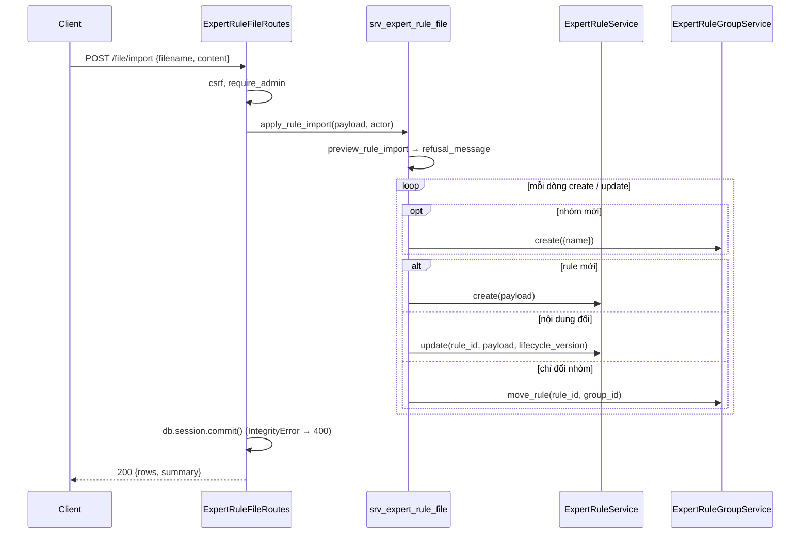

# `route_expert_rule_file.py`: xuất và nhập rule bằng file

Route mixin `ExpertRuleFileRoutes` (`modules/expert_rule_management/routes/route_expert_rule_file.py`), ghép vào
`ExpertRuleAPI`. Đường dẫn tương đối với `{API}` (xem [README.md](README.md#đường-dẫn)); trong code,
`prefix = "/expert-rules/file"`. Logic nằm ở `services/srv_expert_rule_file.py`; đọc và ghi CSV / XLSX dùng chung
`common/utils/table_file.py`.

| Method | Đường dẫn | Hàm | Ai gọi được | Commit |
| --- | --- | --- | --- | --- |
| GET | `/file?format=csv\|xlsx` | `export_expert_rule_file` | Admin | Không |
| POST | `/file/preview` | `preview_expert_rule_file` | Admin | Không |
| POST | `/file/import` | `import_expert_rule_file` | Admin | Có |

## Định dạng file

Cột (`RULE_HEADERS`): `name`, `dataset`, `group`, `glossary_terms`, `conditions`, `exceptions`, `examples`. Bắt buộc
(`REQUIRED_RULE_HEADERS`): `name`, `dataset`, `glossary_terms`, `conditions`, `examples`. Tên cột so khớp không phân
biệt hoa thường và khoảng trắng.

| Cột | Nội dung một ô |
| --- | --- |
| `name` | Tên rule; là khóa so khớp với rule có sẵn (`normalized_name`) |
| `dataset` | `table_name` của dataset Superset; phải là duy nhất trong các dataset không thuộc database nội bộ (`business_datasets_by_name`) |
| `group` | Tên nhóm; ô trống là bỏ khỏi nhóm; tên chưa có thì import tạo nhóm mới; thiếu cả cột thì giữ nhóm |
| `glossary_terms` | Tên thuật ngữ, cách nhau bởi `;` (`split_list`); tra bằng `glossary_term_repository().read_by_normalized_name` |
| `conditions` | Mỗi dòng `<cột> \| <toán tử> \| <giá trị>`; giá trị đọc như JSON nếu được (số, `true`, danh sách), không thì là chữ; trống là `null` |
| `exceptions` | Mỗi dòng `<khi nào> => <kết quả>`; thiếu cả cột thì giữ ngoại lệ của bản hiện tại |
| `examples` | Mỗi dòng `<câu hỏi> => <cách hiểu>` |

Metric không có cột: chúng suy từ thuật ngữ bằng `with_term_metrics` như trình soạn. Giới hạn file
(`table_file.py`): tối đa 1 MB, 1000 dòng dữ liệu; CSV UTF-8 (có BOM hoặc không) hoặc cp1258, dấu phân cách `,` `;` hoặc
tab; XLSX đọc sheet đầu tiên.

## GET `/file?format=csv|xlsx`

Bản hiện tại của mọi rule dưới dạng file mà import đọc lại được nguyên vẹn.

**Quyền**: `@permission_name("read")`, `require_admin()`. Không lọc theo quyền dataset.

**Input**: query `format` (`csv` mặc định, hoặc `xlsx`).

**Luồng**:

1. `@handle_errors` → `require_admin()`.
2. `export_rules(request.args.get("format", "csv"))`:
   1. `expert_rule_revision_repository().read_all_current()`; với mỗi revision, `expert_rule_repository().read(rule_id)`
      (bỏ nếu không có), `get_dataset(rule.dataset_id)`, `column_resolver(rule.dataset_id)`.
   2. Một dòng: tên revision; `table_name` (hoặc `#<dataset_id>`); tên nhóm của rule; tên thuật ngữ của link `glossary`
      (`join_list`, theo ID); mỗi điều kiện qua `_condition_line` (`column_name` từ Data Dictionary, toán tử, giá trị:
      chữ không đọc được như JSON để nguyên, còn lại `json.dumps`); ngoại lệ và ví dụ nối bằng `=>`.
   3. Sắp theo tên, `write_table(RULE_HEADERS, rows, format, "expert-rule", ExpertRuleValidationError)`: CSV UTF-8 có
      BOM hoặc XLSX (openpyxl, dòng đầu in đậm, ô xuống dòng), mã hóa base64.

Rule ở mọi trạng thái (`draft`, `approved`, `revoked`) đều được xuất; trạng thái không có trong file.

**Bảng**: đọc `text_to_bi_expert_rule_revision`, `text_to_bi_expert_rule`, `text_to_bi_expert_rule_group`,
`text_to_bi_expert_rule_link`, `text_to_bi_glossary_term`, `text_to_bi_dataset_dictionary`,
`text_to_bi_column_dictionary`, `tables`. Không ghi.

**Response 200**:

```json
{"filename": "expert-rule.csv", "media_type": "text/csv;charset=utf-8", "content": "<base64>"}
```

**Lỗi**:

| Status | Message | Nguồn |
| --- | --- | --- |
| 403 | "Admin access required." | `require_admin` |
| 400 | "Định dạng file phải là csv hoặc xlsx." | `write_table` |
| 400 | "Máy chủ chưa tạo được file XLSX; hãy dùng file CSV." | thiếu openpyxl |

## POST `/file/preview`

Kết quả import của từng dòng; không lưu gì.

**Quyền**: `@permission_name("write")`, `@csrf_protected`, `require_admin()`. Route có `@rollback_on_error` để rollback
session khi có lỗi ngoài dự kiến, dù preview không lưu dữ liệu.

**Input**: header `X-CSRFToken`; body `{"filename": "expert-rule.xlsx", "content": "<base64>"}`.

**Luồng**:

1. `@csrf_protected` → `@rollback_on_error` → `@handle_errors`.
2. `require_admin()`.
3. `preview_rule_import(request.get_json(silent=True))`:
   1. `business_datasets_by_name()`: dataset Superset theo `table_name`, bỏ dataset của database nội bộ.
   2. `read_table(payload, RULE_HEADERS, REQUIRED_RULE_HEADERS, ExpertRuleValidationError)`: giải base64, nhận XLSX theo
      chữ ký `PK` hoặc đuôi `.xlsx`, kiểm tra cột, bỏ dòng trống; lỗi của cả file là 400 cho cả request.
   3. Mỗi dòng thành một `ImportRow(row=<số dòng, tiêu đề là 1>, key=<name>)`. Trong một `try` bắt `SemanticLayerError`:
      1. Tên đã xuất hiện ở dòng trước: lỗi "Rule trùng tên với dòng N.".
      2. `_plan_rule(item, cells, datasets)`:
         1. `dataset_named(cells["dataset"], …)`: không có hoặc nhiều dataset cùng tên là lỗi.
         2. `expert_rule_repository().read_by_normalized_name(...)` và `read_current`; rule có sẵn trên dataset khác là
            lỗi "Rule đã gắn với một dataset khác; …".
         3. Dựng payload schema 1: `conditions` qua `_condition` (đúng dạng, toán tử trong `CONDITION_OPERATORS`, cột có
            trong Data Dictionary của dataset), `exceptions` / `examples` qua `_pairs`, `glossary_term_ids` qua `_term_id`;
            rồi `with_term_metrics`.
         4. `normalize_rule_payload(payload, column_resolver(dataset.id))`, `validate_semantic_links(values)`: cùng kiểm
            tra như trình soạn (xem [README.md](README.md#nội-dung-một-rule)).
         5. Có cột `group`: ô trống là `group_id = None`; tên có sẵn
            (`expert_rule_group_repository().read_by_normalized_name`) là ID của nhóm; chưa có thì
            `plan.new_group = normalize_group_payload({"name": …})["name"]`.
         6. Quyết định `action`:

            | Trường hợp | `action` | `message` |
            | --- | --- | --- |
            | Chưa có rule | `create` | "Tạo rule mới, chờ duyệt." |
            | Có rule, không có revision hiện tại | lỗi | "Rule không có phiên bản hiện hành để sửa." |
            | Không trường nào đổi | `unchanged` | `null` |
            | Chỉ `group` đổi | `update` | "Chỉ chuyển nhóm; trạng thái duyệt giữ nguyên." |
            | Nội dung đổi, bản hiện tại `approved` | `update` | "Tạo bản nháp mới chờ duyệt; bản đã duyệt ngừng được dùng cho tới khi bản nháp được duyệt." |
            | Nội dung đổi, bản hiện tại `draft` / `revoked` | `update` | "Tạo bản nháp mới chờ duyệt." |

            Có nhóm mới thì thêm " Tạo nhóm mới «…»." vào `message`. `changes` liệt kê trường đổi trong `name`,
            `conditions`, `exceptions`, `examples`, `glossary_terms`, `metrics`, `group`.
      3. Lỗi: `action = "error"`, `changes = []`, `message = _rule_message(str(error))`: dịch thông điệp tiếng Anh của
         trình soạn sang tiếng Việt (`RULE_MESSAGES`, mẫu "Invalid …" / "Unsafe …" với `FIELD_LABELS`).
4. `import_report(rows)`.

**Bảng**: đọc `tables`, `dbs`, `text_to_bi_expert_rule`, `text_to_bi_expert_rule_revision`, `text_to_bi_expert_rule_link`,
`text_to_bi_expert_rule_group`, `text_to_bi_dataset_dictionary`, `text_to_bi_column_dictionary`, bảng Glossary và bảng
metric. Không ghi, không commit.

**Response 200**:

```json
{
  "rows": [
    {"row": 2, "key": "Mưa lớn", "action": "update", "message": "Tạo bản nháp mới chờ duyệt.", "changes": ["conditions"]},
    {"row": 3, "key": "Nắng nóng", "action": "error", "message": "Không có thuật ngữ «Nắng gắt».", "changes": []}
  ],
  "summary": {"create": 0, "update": 1, "unchanged": 0, "error": 1}
}
```

Lỗi của từng dòng nằm trong `rows`, response vẫn 200.

**Lỗi** (của cả request):

| Status | Message | Nguồn |
| --- | --- | --- |
| 403 | "CSRF token không hợp lệ.", "Admin access required." | `csrf_protected`, `require_admin` |
| 400 | Lỗi cả file: thiếu nội dung, quá 1 MB hoặc 1000 dòng, không đọc được, trống, cột lạ / lặp / thiếu (xem dưới) | `read_table` |
| 500 | "Could not save the change." | `rollback_on_error` (rollback khi lỗi ngoài dự kiến) |

Thông điệp của `read_table`: "Chọn một file CSV hoặc XLSX để tải lên.", "File vượt quá 1 MB.", "Không đọc được nội dung
file.", "File trống.", "File có hơn 1000 dòng; chia nhỏ file rồi tải lên lần lượt.", "File có cột không hỗ trợ: …",
"File có cột bị lặp tên.", "File thiếu cột: …", "File không có dòng dữ liệu nào.", "Không đọc được file CSV.", "Không
đọc được file XLSX.", "Máy chủ chưa đọc được file XLSX; hãy dùng file CSV.".

## POST `/file/import`

Tạo và cập nhật rule của file thành bản nháp trong một transaction; một dòng lỗi thì không lưu gì. Import không bao giờ
duyệt rule.

**Quyền**: `@permission_name("write")`, `@csrf_protected`, `require_admin()`.

**Input**: như `/file/preview`.

**Luồng**:

1. `@csrf_protected` → `@rollback_on_error` → `@handle_errors`.
2. `require_admin()`.
3. Trong một `try` bắt `IntegrityError`: `apply_rule_import(request.get_json(silent=True), current_user.id)` rồi
   `db.session.commit()`:
   1. `rows = preview_rule_import(payload)` (chạy lại toàn bộ kiểm tra của preview).
   2. `refusal_message(rows)`: có dòng `error` là 400 cho cả request.
   3. Với mỗi dòng không `unchanged`, theo thứ tự trong file:
      1. Có `plan.new_group`: tạo một lần cho mỗi tên (`casefold`) bằng `ExpertRuleGroupService.create({"name": …})`,
         đặt `group_id` vào payload.
      2. Chưa có rule: `ExpertRuleService.create(payload, actor_id)` (revision 1, `draft`, event `created`, có thể
         kèm nhóm).
      3. Nội dung đổi: `ExpertRuleService.update(rule_id, payload, plan.revision.lifecycle_version, actor_id)` (revision
         mới `draft`, event `updated`, có thể `moved`). `lifecycle_version` lấy từ lần preview trong cùng request.
      4. Chỉ đổi nhóm: `ExpertRuleGroupService.move_rule(rule_id, group_id, actor_id)` (event `moved`).
4. `import_report(rows)`.

**Bảng**: insert / update `text_to_bi_expert_rule`, `text_to_bi_expert_rule_revision`; insert
`text_to_bi_expert_rule_link`, `text_to_bi_expert_rule_audit_event`, `text_to_bi_expert_rule_group`. Một commit duy nhất
ở cuối.

**Response 200**: cùng dạng với `/file/preview` (`rows`, `summary`), không có dòng `error`.

**Lỗi**:

| Status | Message | Nguồn |
| --- | --- | --- |
| 403 | CSRF, admin | decorator, `require_admin` |
| 400 | Lỗi file như `/file/preview` | `read_table` |
| 400 | "File có N dòng lỗi; sửa các dòng đó rồi tải lên lại. Chưa có thay đổi nào được lưu." | `refusal_message` |
| 409 / 404 / 400 | Lỗi của `create`, `update`, `move_rule`, `ExpertRuleGroupService.create` | dữ liệu đổi giữa lúc preview và lúc ghi |
| 400 | "Không lưu được các rule trong file; tải lại trang rồi thử lại." | `IntegrityError` khi flush hoặc commit |
| 500 | "Could not save the change." | `rollback_on_error` |


