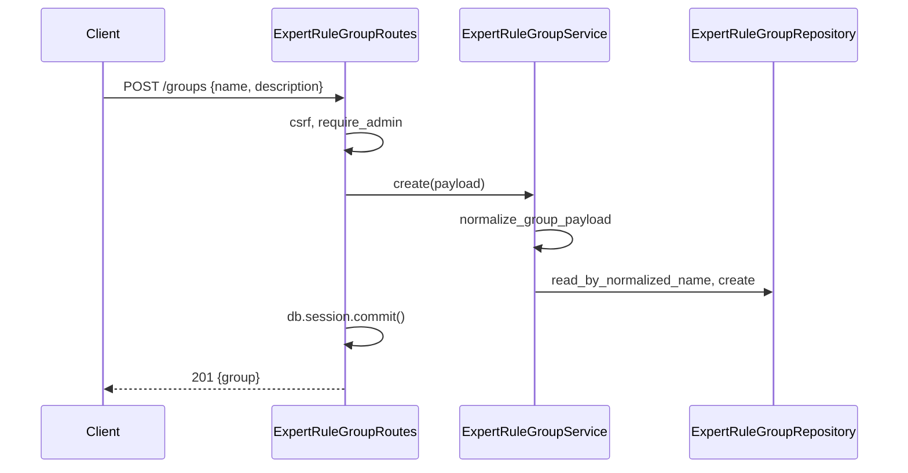
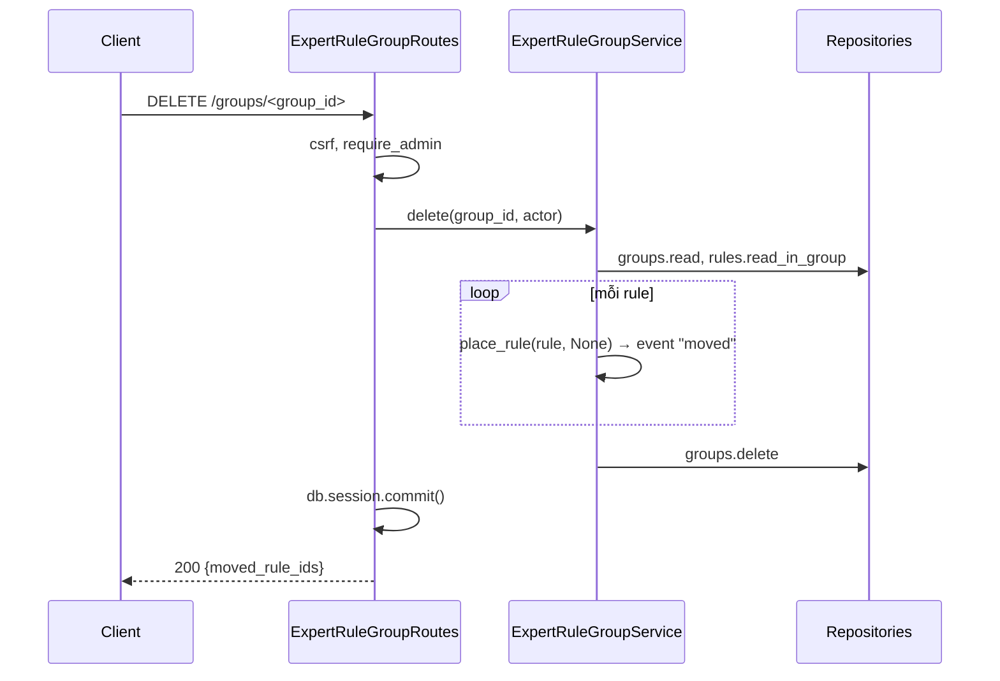
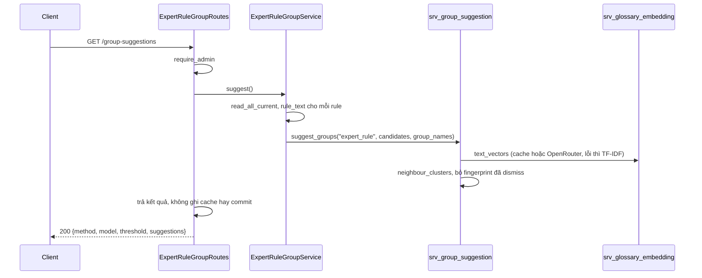
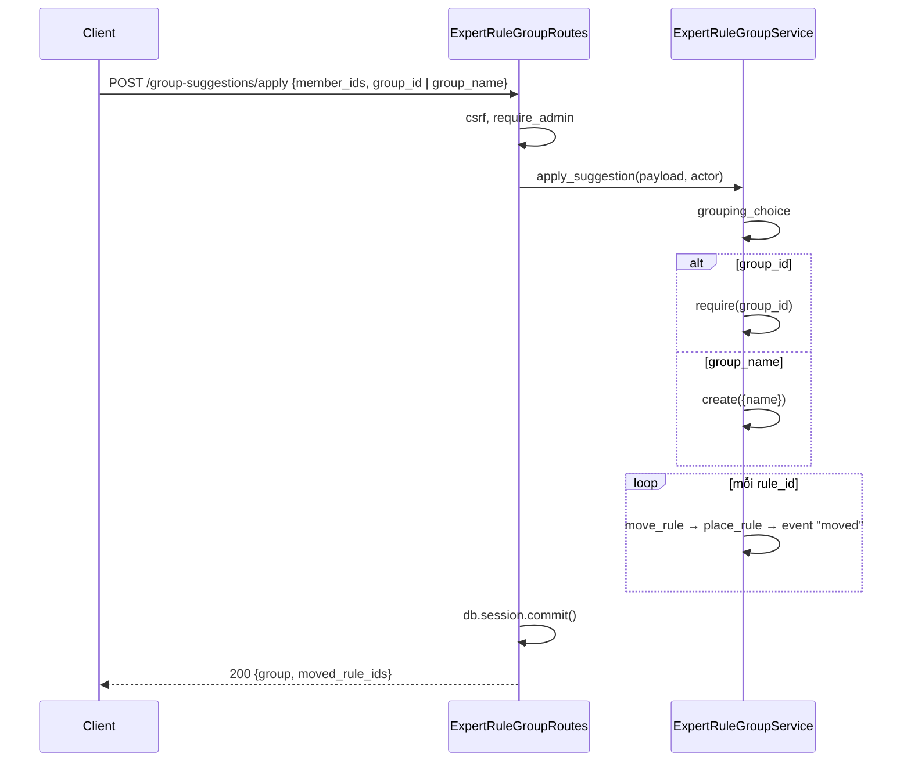

# `route_expert_rule_group.py`: nhóm rule và gợi ý gom nhóm

Route mixin `ExpertRuleGroupRoutes` (`modules/expert_rule_management/routes/route_expert_rule_group.py`), ghép vào
`ExpertRuleAPI`. Đường dẫn tương đối với `{API}` (xem [README.md](README.md#đường-dẫn)); trong code,
`prefix = "/expert-rules/groups"` và `suggestion_prefix = "/expert-rules/group-suggestions"`.

| Method | Đường dẫn | Hàm | Ai gọi được | Commit |
| --- | --- | --- | --- | --- |
| POST | `/groups` | `create_expert_rule_group` | Admin | Có |
| PUT | `/groups/<int:group_id>` | `update_expert_rule_group` | Admin | Có |
| DELETE | `/groups/<int:group_id>` | `delete_expert_rule_group` | Admin | Có |
| GET | `/group-suggestions` | `read_expert_rule_group_suggestions` | Admin | Không |
| POST | `/group-suggestions/apply` | `apply_expert_rule_group_suggestion` | Admin | Có |
| POST | `/group-suggestions/dismiss` | `dismiss_expert_rule_group_suggestion` | Admin | Có |

Danh sách nhóm không có route riêng: nó đi kèm `GET {API}` (`groups`, xem
[route-expert-rule.md](route-expert-rule.md#get-api)). Chuyển một rule sang nhóm khác là `PUT /<rule_id>/group` ở cùng
file đó.

Nhóm nằm trên `text_to_bi_expert_rule.group_id`, không nằm trên revision, không vào `content_hash` hay fingerprint. Vì
vậy tạo, sửa, xóa nhóm và chuyển rule không cần duyệt, không đổi `lifecycle_version` và giữ nguyên trạng thái duyệt;
mỗi lần rule đổi nhóm được ghi một event `moved` (`ExpertRuleGroupService.place_rule`).

## Payload của nhóm

`normalize_group_payload(payload)` (`services/srv_expert_rule_validation.py`):

Khi tạo, chuẩn hóa trực tiếp body và bắt buộc có `name`. Khi sửa, service kiểm tra body là object, ghép các trường
được gửi vào tên và mô tả hiện có rồi mới chuẩn hóa; trường bị bỏ qua giữ nguyên.

- Body phải là object chỉ có `name` và / hoặc `description`; khác đi là 400 "Nhóm rule chỉ có tên và mô tả.".
- `name` là chuỗi không rỗng ("Nhập tên nhóm rule."), qua `checked_text(..., MAX_NAME=255)`: gom khoảng trắng, không
  SQL / URL / bí mật ("Invalid name.", "Unsafe name.").
- `description` là `null` hoặc chuỗi ("Mô tả nhóm rule không hợp lệ."); chuỗi không rỗng qua `checked_text` (tối đa
  2000 ký tự), chuỗi trắng thành `null`.
- Trả `{"name", "normalized_name": name.casefold(), "description"}`.

## POST `/groups`

Tạo nhóm rule.

**Quyền**: `@permission_name("write")`, `@csrf_protected`, `require_admin()`.

**Input**: header `X-CSRFToken`; body `{"name": "Mưa", "description": "Rule về lượng mưa"}`.

**Luồng**:

1. `@csrf_protected` → `@rollback_on_error` → `@handle_errors`.
2. `require_admin()`.
3. `ExpertRuleGroupService().create(request.get_json(silent=True))`:
   1. `normalize_group_payload(payload)`.
   2. `ExpertRuleGroupRepository.read_by_normalized_name(...)` có rồi là 409.
   3. `ExpertRuleGroupRepository.create(values)` (flush); `IntegrityError` lúc flush cũng là 409.
4. `db.session.commit()`.
5. `serialize_expert_rule_group(group)`.

**Bảng**: insert `text_to_bi_expert_rule_group`.

**Response 201**: `{"group": {"id": 3, "name": "Mưa", "description": "Rule về lượng mưa"}}`.

**Lỗi**:

| Status | Message | Nguồn |
| --- | --- | --- |
| 403 | "CSRF token không hợp lệ.", "Admin access required." | `csrf_protected`, `require_admin` |
| 400 | "Nhóm rule chỉ có tên và mô tả.", "Nhập tên nhóm rule.", "Mô tả nhóm rule không hợp lệ.", "Invalid / Unsafe name.", … | `normalize_group_payload` |
| 409 | "Đã có nhóm rule cùng tên." | trùng `normalized_name` |
| 500 | "Could not save the change." | `rollback_on_error` |



## PUT `/groups/<int:group_id>`

Đổi tên hoặc mô tả nhóm; rule trong nhóm giữ nguyên và không cần duyệt lại.

**Quyền**: `@permission_name("write")`, `@csrf_protected`, `require_admin()`.

**Input**: path `group_id`; header `X-CSRFToken`; body object chỉ chứa `name` và / hoặc `description`. Trường bỏ qua
giữ nguyên; `{"name": "Tên mới"}` chỉ đổi tên, `{"description": null}` xóa mô tả. Body `{}` giữ nguyên cả hai trường.

**Luồng**:

1. `@csrf_protected` → `@rollback_on_error` → `@handle_errors`.
2. `require_admin()`.
3. `ExpertRuleGroupService().update(group_id, request.get_json(silent=True))`:
   1. `require(group_id)` → `ExpertRuleGroupRepository.read`; không có là 404.
   2. Kiểm tra payload là object; ghép `{"name": group.name, "description": group.description, **payload}` rồi gọi
      `normalize_group_payload(...)`. Trường không hỗ trợ vẫn bị từ chối.
   3. `read_by_normalized_name(...)` trả nhóm khác là 409.
   4. `ExpertRuleGroupRepository.update(group, values)` (flush); `IntegrityError` là 409.
4. `db.session.commit()`.
5. `serialize_expert_rule_group(group)`.

**Bảng**: update `text_to_bi_expert_rule_group`.

**Response 200**: `{"group": {"id", "name", "description"}}`.

**Lỗi**: 403 CSRF / admin; 404 "Không tìm thấy nhóm rule."; 400 như POST `/groups`; 409 "Đã có nhóm rule cùng tên.";
500 "Could not save the change.".

## DELETE `/groups/<int:group_id>`

Xóa nhóm; các rule trong nhóm thành chưa phân nhóm và giữ trạng thái duyệt.

**Quyền**: `@permission_name("write")`, `@csrf_protected`, `require_admin()`.

**Input**: path `group_id`; header `X-CSRFToken`. Không có body.

**Luồng**:

1. `@csrf_protected` → `@rollback_on_error` → `@handle_errors`.
2. `require_admin()`.
3. `ExpertRuleGroupService().delete(group_id, current_user.id)`:
   1. `require(group_id)` (404).
   2. `ExpertRuleRepository.read_in_group(group.id)` (theo `id`).
   3. Với mỗi rule: `place_rule(rule, None, actor_id)`: gán `group = None`, `group_id = None`, ghi event `moved`
      (`"<tên nhóm> → Chưa phân nhóm"`) trên revision hiện tại.
   4. `ExpertRuleGroupRepository.delete(group)` (không flush).
4. `db.session.commit()`.

**Bảng**: update `text_to_bi_expert_rule.group_id`; insert `text_to_bi_expert_rule_audit_event` (`moved`); delete
`text_to_bi_expert_rule_group`.

**Response 200**: `{"moved_rule_ids": [7, 9]}`.

**Lỗi**: 403 CSRF / admin; 404 "Không tìm thấy nhóm rule."; 500 "Could not save the change.".



## GET `/group-suggestions`

Gợi ý nhóm cho rule chưa phân nhóm có nghĩa gần nhau. Route chỉ đọc cache embedding hiện có; vector thiếu được tính
trong bộ nhớ, không thêm dòng cache và không commit.
Đặc tả ở [docs/specs/goi-y-gom-nhom.md](../../../specs/goi-y-gom-nhom.md).

**Quyền**: `@permission_name("read")`, `require_admin()`. Không lọc theo quyền dataset.

**Input**: không có.

**Luồng**:

1. `@handle_errors` → `require_admin()`.
2. `ExpertRuleGroupService().suggest()`:
   1. `ExpertRuleRevisionRepository.read_all_current()`; với mỗi revision, `ExpertRuleRepository.read(rule_id)` (bỏ nếu
      không có).
   2. Tên thuật ngữ: link `glossary` của revision (`ExpertRuleLinkRepository.read_by_revision`) →
      `glossary_term_repository().read(target_id).canonical_name`.
   3. Mỗi điều kiện thành chữ bằng `_condition_text`: tên cột (`display_name` hoặc `column_name` của
      `column_dictionary_repository().get`), từ của toán tử (`OPERATOR_WORDS`, ví dụ `greater_than` → "lớn hơn") và giá
      trị.
   4. `rule_text(name, term_names, conditions, examples)`:
      `"<tên>. Thuật ngữ: <…>. Điều kiện: <…>. Câu hỏi: <câu hỏi> (<cách hiểu>); …"`; ngoại lệ không được đưa vào.
   5. `GroupingCandidate(rule.id, revision.name, text, rule.group_id)` cho mọi rule, kể cả rule đã có nhóm (làm mốc).
   6. `group_names` từ `ExpertRuleGroupRepository.read_all()`.
   7. `suggest_groups(EXPERT_RULE_KIND, candidates, group_names)` (`glossary_management/services/srv_group_suggestion.py`):
      1. `text_vectors(texts)` (`srv_glossary_embedding.py`): có `OPENROUTER_API_KEY` và `OPENROUTER_EMBEDDING_MODEL` thì
         đọc vector đã cache trong `text_to_bi_text_embedding` theo `(model, sha256(text))`, gọi `{OPENROUTER_BASE_URL}/embeddings`
         cho phần thiếu (lô 64, timeout 20 giây), giữ kết quả trong bộ nhớ; gọi lỗi thì dùng TF-IDF
         (`tfidf_vectors`), không ghi gì.
      2. Ngưỡng `THRESHOLDS[method]`: 0.70 với `embedding`, 0.25 với `tfidf`.
      3. `similarity_matrix`, `neighbour_clusters` (average linkage; nhóm có sẵn là cụm cố định, hai nhóm có sẵn không
         gộp; chỉ giữ cụm có rule chưa phân nhóm và, khi không có nhóm đích, ít nhất hai rule như vậy).
      4. `_suggestion` cho mỗi cụm: `fingerprint = suggestion_fingerprint(group_id, member_ids)`; bỏ gợi ý có
         fingerprint trong `group_suggestion_dismissal_repository().read_fingerprints("expert_rule")`.
      5. Sắp theo `similarity` giảm dần, rồi `proposed_name`.
3. Trả kết quả, không gọi `db.session.commit()` hay lưu vector mới.

**Bảng**: đọc `text_to_bi_expert_rule_revision`, `text_to_bi_expert_rule`, `text_to_bi_expert_rule_link`,
`text_to_bi_glossary_term`, `text_to_bi_column_dictionary`, `text_to_bi_expert_rule_group`,
`text_to_bi_group_suggestion_dismissal`, `text_to_bi_text_embedding`. Không ghi dữ liệu.

**Response 200**:

```json
{
  "method": "embedding",
  "model": "openai/text-embedding-3-small",
  "threshold": 0.7,
  "suggestions": [{
    "fingerprint": "<64 ký tự hex>",
    "group": null,
    "proposed_name": "Mưa lớn",
    "similarity": 0.781,
    "members": [{"id": 7, "name": "Mưa lớn", "similarity": 0.781,
                 "closest": {"id": 9, "name": "Mưa rất lớn", "similarity": 0.781}}],
    "group_members": []
  }]
}
```

`group` là `{id, name}` khi gợi ý đưa rule vào nhóm có sẵn, `null` khi đề xuất nhóm mới (tên là rule gần các rule kia
nhất). `group_members` là các rule đã ở nhóm đích. `model` là `null` với `tfidf`.

**Lỗi**: 403 "Admin access required."; lỗi ngoài dự kiến (ví dụ lỗi database) qua `@safe` thành 500.



## POST `/group-suggestions/apply`

Chuyển các rule quản trị viên giữ lại vào nhóm có sẵn hoặc nhóm mới; không cần duyệt.

**Quyền**: `@permission_name("write")`, `@csrf_protected`, `require_admin()`.

**Input**: header `X-CSRFToken`; body `{"member_ids": [7, 9], "group_id": 3}` hoặc
`{"member_ids": [7, 9], "group_name": "Mưa lớn"}`.

**Luồng**:

1. `@csrf_protected` → `@rollback_on_error` → `@handle_errors`.
2. `require_admin()`.
3. `ExpertRuleGroupService().apply_suggestion(payload, current_user.id)`:
   1. `grouping_choice(payload, ExpertRuleValidationError)`: `member_ids` là danh sách số nguyên, 1..500 phần tử (bỏ
      trùng, giữ thứ tự); `group_id` (số nguyên) nếu có, không thì `group_name` chuỗi không rỗng.
   2. Có `group_id`: `require(group_id)` (404). Không: `create({"name": group_name})` (409 nếu trùng tên).
   3. Với mỗi `rule_id`: `move_rule(rule_id, group.id, actor_id)` (khóa dòng rule, 404 nếu không có, ghi `moved` khi
      đổi nhóm).
4. `db.session.commit()`.

Gợi ý không bị kiểm tra lại: rule nào trong `member_ids` cũng được chuyển, kể cả rule đang ở nhóm khác. Một rule không
tồn tại làm cả request lỗi và không lưu gì.

**Bảng**: insert `text_to_bi_expert_rule_group` (khi nhóm mới); update `text_to_bi_expert_rule.group_id`; insert
`text_to_bi_expert_rule_audit_event`.

**Response 200**: `{"group": {"id", "name", "description"}, "moved_rule_ids": [7, 9]}`.

**Lỗi**:

| Status | Message | Nguồn |
| --- | --- | --- |
| 403 | CSRF, admin | decorator, `require_admin` |
| 400 | "Gợi ý gom nhóm không hợp lệ.", "Chọn ít nhất một mục để gom nhóm.", "Nhóm không hợp lệ.", "Nhập tên nhóm mới." | `grouping_choice` |
| 400 | Lỗi tên nhóm như POST `/groups` | `normalize_group_payload` |
| 409 | "Đã có nhóm rule cùng tên." | nhóm mới trùng tên |
| 404 | "Không tìm thấy nhóm rule.", "Expert rule not found." | `require`, `move_rule` |
| 500 | "Could not save the change." | `rollback_on_error` |



## POST `/group-suggestions/dismiss`

Bỏ qua một gợi ý để nó không hiện lại.

**Quyền**: `@permission_name("write")`, `@csrf_protected`, `require_admin()`.

**Input**: header `X-CSRFToken`; body `{"fingerprint": "<64 ký tự hex thường>"}` (lấy từ `GET /group-suggestions`).

**Luồng**:

1. `@csrf_protected` → `@rollback_on_error` → `@handle_errors`.
2. `require_admin()`.
3. `ExpertRuleGroupService.dismiss_suggestion(payload, current_user.id)` (staticmethod) →
   `dismiss_suggestion("expert_rule", payload, actor_id, ExpertRuleValidationError)`:
   1. `fingerprint` phải khớp `[0-9a-f]{64}`.
   2. Chưa có trong `read_fingerprints("expert_rule")` thì gọi repository `create` với `kind`, `fingerprint`,
      `dismissed_by`, `dismissed_at`; có rồi thì không ghi gì.
   3. Repository mở savepoint bằng `session.begin_nested()`, thêm dòng và flush ngay. Nếu request khác đã lưu cùng
      `(kind, fingerprint)`, rollback savepoint rồi đọc và trả dòng đã có. Nếu không tìm thấy dòng trùng, ném lại lỗi.
4. `db.session.commit()`.

Fingerprint không được đối chiếu với một gợi ý đang có. Gợi ý cùng nhóm đích và cùng tập rule sẽ không hiện lại; khi
tập rule đổi, fingerprint đổi và gợi ý có thể hiện lại.

**Bảng**: đọc và insert `text_to_bi_group_suggestion_dismissal` (unique `(kind, fingerprint)`).

**Response 200**: `{"fingerprint": "<64 ký tự hex>"}`.

Hai request bỏ qua cùng gợi ý được xử lý như một lần bỏ qua; cả hai có thể trả 200. Savepoint giữ transaction ngoài
khả dụng, route vẫn sở hữu commit cuối cùng.

**Lỗi**: 403 CSRF / admin; 400 "Gợi ý gom nhóm không hợp lệ."; lỗi ngoài dự kiến trả 500 "Could not save the change.".
