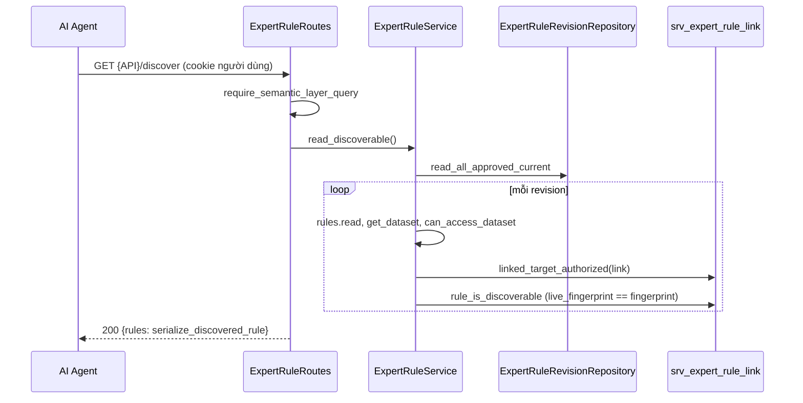
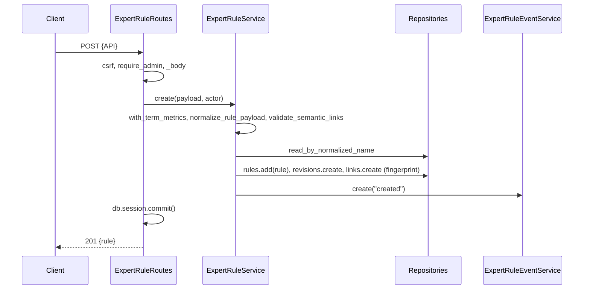
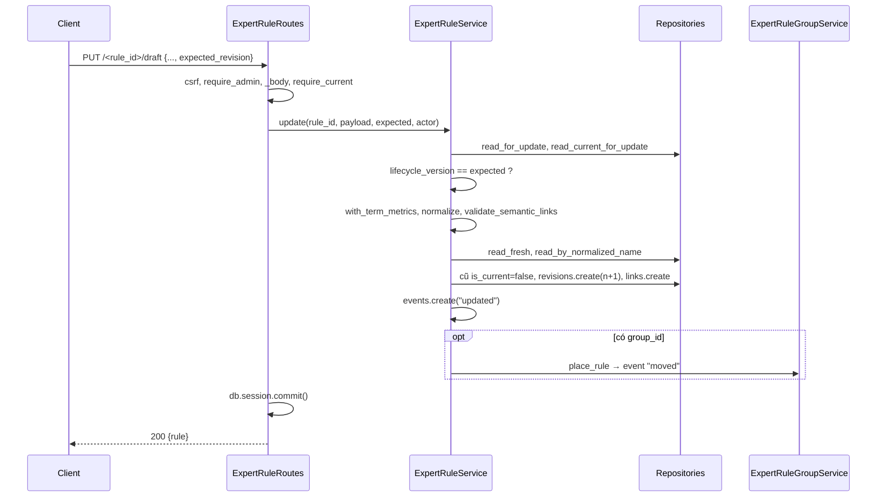
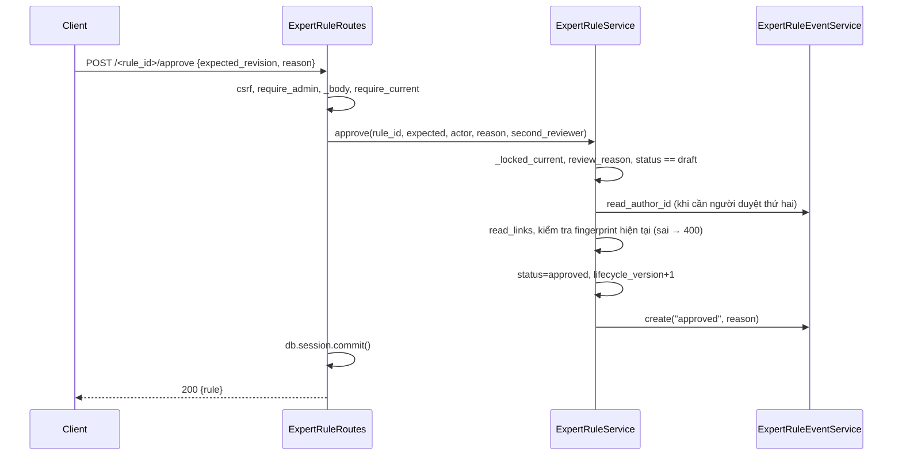
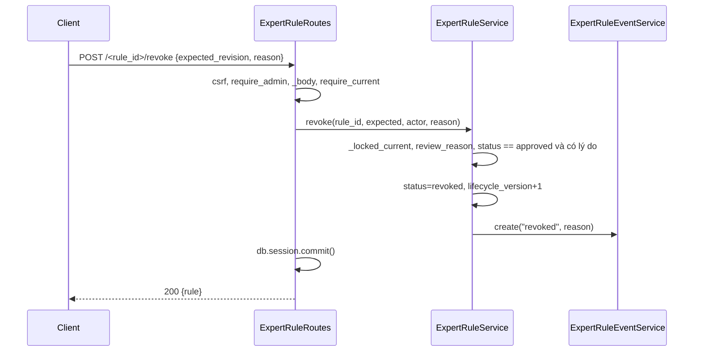
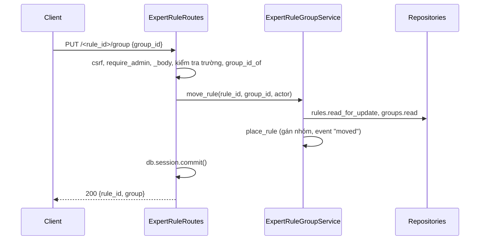

# `route_expert_rule.py`: rule, vòng đời duyệt và discover

Route mixin `ExpertRuleRoutes` (`modules/expert_rule_management/routes/route_expert_rule.py`), ghép vào `ExpertRuleAPI`.
Đường dẫn tương đối với `{API}` (xem [README.md](README.md#đường-dẫn)); trong code, mọi đường dẫn bắt đầu bằng
`prefix = "/expert-rules"`.

| Method | Đường dẫn | Hàm | Ai gọi được | Commit |
| --- | --- | --- | --- | --- |
| GET | `{API}` | `read_expert_rules` | Admin, "Semantic Layer Viewer" | Không |
| GET | `/options` | `read_expert_rule_options` | Admin, "Semantic Layer Viewer" | Không |
| GET | `/discover` | `read_discoverable_expert_rules` | Admin, "Semantic Layer Query" | Không |
| GET | `/<int:rule_id>/audit` | `read_expert_rule_events` | Admin, "Semantic Layer Viewer" + quyền dataset | Không |
| POST | `{API}` | `create_expert_rule` | Admin | Có |
| PUT | `/<int:rule_id>/draft` | `update_expert_rule` | Admin | Có |
| POST | `/<int:rule_id>/approve` | `approve_expert_rule` | Admin | Có |
| POST | `/<int:rule_id>/revoke` | `revoke_expert_rule` | Admin | Có |
| PUT | `/<int:rule_id>/group` | `move_expert_rule` | Admin | Có |

Vòng đời của revision, ý nghĩa `revision_number` / `lifecycle_version` và trạng thái `outdated` nằm ở
[README.md](README.md#vòng-đời-rule-revision-và-lifecycle_version). Helper `_body()` và `_committed(save)` mô tả ở
[README.md](README.md#khung-chung-của-một-route).

## GET `{API}`

Mọi rule với bản hiện tại và trạng thái duyệt, cho trang "Expert Rules"; người xem cũng đọc được.

**Quyền**: `@permission_name("read")`, `require_semantic_layer_view()`. Rule trên dataset người gọi không đọc được bị
lọc bỏ (không báo lỗi).

**Input**: không có.

**Luồng**:

1. `@handle_errors` → `require_semantic_layer_view()`.
2. `user_name = user_names()` (module `superset`): hàm tra tên người dùng có cache trong request.
3. `ExpertRuleService().read_for_review()`:
   1. `ExpertRuleRevisionRepository.read_all()`: mọi revision của mọi rule, sắp theo `revision_number`.
   2. Giữ một revision mỗi rule: bản `is_current`, nếu không có thì bản cuối cùng đọc được.
   3. `ExpertRuleRepository.read_all()` đọc các rule cùng nhóm bằng `joinedload`; `get_datasets(...)` đọc các dataset
      theo lô. Tra hai danh sách theo ID; giữ khi rule tồn tại và dataset không còn hoặc `can_access_dataset(dataset)` đúng.
4. `ExpertRuleLinkRepository.read_for_revisions(...)` đọc link của các revision đã chọn trong một truy vấn, gom theo
   `revision_id`. Với mỗi `(rule, revision)`, lấy danh sách link đã gom, rồi
   `serialize_expert_rule_review_entry(rule, revision, links, user_name)`:
   - `serialize_expert_rule(revision)` (xem README);
   - `dataset_id`, `dataset_name` (`table_name` của `get_dataset`), `group` (`serialize_group_reference(rule.group)`:
     `{id, name}` hoặc `null`);
   - `state = ExpertRuleService.review_state(revision, links)`: tính lại fingerprint của mọi link (`live_fingerprint`);
   - `column_names`: `{"<column_dictionary_id>": column_name(id)}` cho mỗi cột trong `conditions` (`display_name` hoặc
     `column_name` của `text_to_bi_column_dictionary`, không có thì `#id`);
   - `glossary_terms`: `[{id, name}]` cho link `glossary` (`glossary_term_name`: `canonical_name`);
   - `metrics`: `[{id, name}]` cho link `metric`, tên từ `verbose_name` / `metric_name` của `dataset.metrics`;
   - `author_id` (`ExpertRuleEventService.read_author_id` → `ExpertRuleEventRepository.read_latest_authoring`: actor của
     event `created` / `updated` mới nhất của revision), `author_name`, `approver_name`, `approved_at`, `revoker_name`,
     `revoked_at` (ISO 8601 qua `iso_datetime`).
5. Sắp `rules` theo `name.casefold()`.
6. `ExpertRuleGroupService().read_all()` → `ExpertRuleGroupRepository.read_all()` (theo tên), mỗi nhóm qua
   `serialize_expert_rule_group`: `{id, name, description}`.

**Bảng**: đọc `text_to_bi_expert_rule_revision`, `text_to_bi_expert_rule`, `text_to_bi_expert_rule_link`,
`text_to_bi_expert_rule_audit_event`, `text_to_bi_expert_rule_group`, `tables`, `sql_metrics`, `ab_user`,
`text_to_bi_column_dictionary`, bảng Glossary và bảng metric (khi tính fingerprint). Không ghi.

**Response 200**:

```json
{
  "rules": [{"id": 7, "revision": 2, "lifecycle_version": 3, "schema_version": 2, "status": "approved",
             "name": "Mưa lớn", "conditions": [], "exceptions": [], "examples": [], "dataset_id": 12,
             "dataset_name": "fact_tong_hop_thoi_tiet", "group": {"id": 3, "name": "Mưa"}, "state": "outdated",
             "column_names": {"81": "Lượng mưa"}, "glossary_terms": [{"id": 5, "name": "Mưa lớn"}],
             "metrics": [{"id": 40, "name": "Lượng mưa"}], "author_id": 1, "author_name": "Admin",
             "approver_name": "Admin", "approved_at": "2026-11-10T08:00:00+00:00", "revoker_name": null,
             "revoked_at": null}],
  "groups": [{"id": 3, "name": "Mưa", "description": null}],
  "current_user_id": 1,
  "require_second_reviewer": false
}
```

`require_second_reviewer` là `second_reviewer_required()` (`TEXT_TO_BI_REQUIRE_SECOND_REVIEWER` trong
`superset_config`).

**Lỗi**: 403 `SemanticLayerViewRequiredError`.

Rule, dataset và link đã được đọc theo lô. Serializer vẫn tra tác giả, tên cột, thuật ngữ và fingerprint; chưa có kết quả
đo số truy vấn trên runtime để khẳng định đã loại hết N+1.

## GET `/options`

Những gì trình soạn rule được tham chiếu, theo dataset: cột Data Dictionary, thuật ngữ và metric đã duyệt.

**Quyền**: `@permission_name("read")`, `require_semantic_layer_view()`. Dataset người gọi không đọc được bị bỏ qua.

**Input**: không có.

**Luồng**:

1. `@handle_errors` → `require_semantic_layer_view()`.
2. `rule_options()` (`services/srv_expert_rule_link.py`):
   1. `glossary_revision_repository().read_all_serving()`: bản đang dùng của mọi thuật ngữ. Với mỗi bản,
      `glossary_link_repository().read_by_revision(revision.id)`, gom theo `dataset_id` thành
      `{id: term_id, name: glossary_term_name(term_id), metric_ids, column_names}`; `metric_ids` là link `metric` có
      `approved_metric(...)`, `column_names` là `column_name` của link `column`, cả hai đã sắp.
   2. `dataset_dictionary_repository().all()`; với mỗi dòng, `get_dataset(dictionary.id)`, bỏ nếu không có hoặc không
      `can_access_dataset`.
   3. Mỗi dataset: `columns` từ `column_dictionary_repository().list_for_dataset(dataset.id)` (`id`, `column_name`,
      `display_name`, `data_type`); `glossary_terms` của dataset sắp theo tên; `metrics` là `dataset.metrics` có
      `approved_metric(metric.id)`, `{id, name}`.
   4. Sắp dataset theo `table_name.casefold()`.

**Bảng**: đọc `text_to_bi_glossary_term_revision`, `text_to_bi_glossary_term_link`, `text_to_bi_glossary_term`,
`text_to_bi_dataset_dictionary`, `text_to_bi_column_dictionary`, `tables`, `sql_metrics`, `text_to_bi_metric_contract`,
`text_to_bi_metric_definition`, `text_to_bi_dataset_grain`. Không ghi.

**Response 200**:

```json
{"datasets": [{"id": 12, "name": "fact_tong_hop_thoi_tiet",
               "columns": [{"id": 81, "column_name": "luong_mua", "display_name": "Lượng mưa", "data_type": "FLOAT"}],
               "glossary_terms": [{"id": 5, "name": "Mưa lớn", "metric_ids": [40], "column_names": ["luong_mua"]}],
               "metrics": [{"id": 40, "name": "Lượng mưa"}]}]}
```

**Lỗi**: 403 `SemanticLayerViewRequiredError`.

## GET `/discover`

Rule đã duyệt, còn hợp lệ, trên dataset người gọi được đọc. AI Agent gọi route này bằng cookie của người dùng (xem
[README.md](README.md#discover-cho-ai-agent)).

**Quyền**: `@permission_name("read")`, `require_semantic_layer_query()`; quyền dataset Superset lọc từng rule.

**Input**: không có.

**Luồng**:

1. `@handle_errors` → `require_semantic_layer_query()`.
2. `ExpertRuleService().read_discoverable()`:
   1. `ExpertRuleRevisionRepository.read_all_approved_current()`: revision `status = approved`, `is_current`.
   2. Với mỗi revision: `ExpertRuleRepository.read(rule_id)`, `get_dataset(rule.dataset_id)`; bỏ nếu không có dataset
      hoặc `can_access_dataset` sai.
   3. `ExpertRuleLinkRepository.read_by_revision(revision.id)`.
   4. Giữ khi mọi link qua `linked_target_authorized(link)` và `rule_is_discoverable(revision, links)` đúng (mọi
      fingerprint còn khớp).
3. `serialize_discovered_rule(rule, revision, links)` cho mỗi rule:
   - `serialize_expert_rule(revision)`;
   - `dataset_id`, `group` (`{id, name}` hoặc `null`);
   - `metric_ids`, `glossary_term_ids`: `target_id` của link `metric` / `glossary`, đã sắp;
   - `column_names`: tên hiển thị của từng cột trong `conditions`;
   - `condition_columns`: `{"<column_dictionary_id>": physical_column(id)}`, tên cột vật lý để AI Agent lọc metric.

**Bảng**: đọc `text_to_bi_expert_rule_revision`, `text_to_bi_expert_rule`, `text_to_bi_expert_rule_link`, `tables`,
`sql_metrics`, `text_to_bi_column_dictionary`, bảng Glossary và bảng metric. Không ghi.

**Response 200**:

```json
{
  "schema_version": 1,
  "result": {
    "rules": [
      {
        "id": 7,
        "revision": 2,
        "lifecycle_version": 3,
        "schema_version": 2,
        "status": "approved",
        "name": "Mưa lớn",
        "conditions": [
          {
            "field_ref": {
              "column_dictionary_id": 81
            },
            "operator": "greater_than",
            "value_type": "number",
            "value": 50
          }
        ],
        "exceptions": [],
        "examples": [],
        "dataset_id": 12,
        "group": null,
        "metric_ids": [
          40
        ],
        "glossary_term_ids": [
          5
        ],
        "column_names": {
          "81": "Lượng mưa"
        },
        "condition_columns": {
          "81": "luong_mua"
        }
      }
    ]
  }
}
```

**Lỗi**: 403 `SemanticLayerQueryRequiredError`.



## GET `/<int:rule_id>/audit`

Lịch sử của một rule, cũ nhất trước.

**Quyền**: `@permission_name("read")`, `require_semantic_layer_view()`, rồi `ExpertRuleService().read_rule_readable`.

**Input**: path `rule_id`.

**Luồng**:

1. `@handle_errors` → `require_semantic_layer_view()`.
2. `ExpertRuleService().read_rule_readable(rule_id)`: `ExpertRuleRepository.read`; không có rule thì ném
   `ExpertRuleNotFoundError` (404). Sau đó `get_dataset(rule.dataset_id)`; dataset không có hoặc `can_access_dataset`
   đúng thì cho đọc. Không có quyền dataset là `DatasetAccessError` (403).
3. `ExpertRuleEventService().read_history(rule_id)` → `ExpertRuleEventRepository.read_history`: event theo `rule_id`, sắp
   theo `id` tăng dần.
4. `serialize_expert_rule_events(events, user_names())`.

**Bảng**: đọc `text_to_bi_expert_rule`, `tables`, `text_to_bi_expert_rule_audit_event`, `ab_user`. Không ghi.

**Response 200**:

```json
{"audit": [{"action": "created", "revision": 1, "lifecycle_version": 1, "actor_id": 1, "actor_name": "Admin",
            "reason": null, "occurred_at": "2026-11-10T08:00:00+00:00"},
           {"action": "moved", "revision": 1, "lifecycle_version": 1, "actor_id": 1, "actor_name": "Admin",
            "reason": "Chưa phân nhóm → Mưa", "occurred_at": "2026-11-10T08:05:00+00:00"}]}
```

`action` ∈ `created`, `updated`, `approved`, `revoked`, `moved`. `rule_id` không tồn tại trả 404, không trả danh sách rỗng.

**Lỗi**: 403 `SemanticLayerViewRequiredError`, 403 "Dataset and database access required." (`DatasetAccessError`),
404 "Expert rule not found.".

## POST `{API}`

Tạo rule mới với bản nháp đầu tiên.

**Quyền**: `@permission_name("write")`, `@csrf_protected`, `require_admin()`.

**Input**: header `X-CSRFToken`; body JSON là nội dung rule (xem [README.md](README.md#nội-dung-một-rule)), có thể kèm
`group_id` (số hoặc `null`). `metric_ids` của client bị thay bằng metric suy từ thuật ngữ.

**Luồng**:

1. `@csrf_protected` → `@rollback_on_error` → `@handle_errors`.
2. `require_admin()`, `payload = _body()`.
3. `_committed(lambda: ExpertRuleService().create(payload, current_user.id))`:
   1. `with_term_metrics(payload)`: đặt `metric_ids`.
   2. `group_id_of(payload)`.
   3. `column_resolver(payload.get("dataset_id"))`: từ chối giá trị không phải số nguyên hoặc là bool bằng 400
      "Invalid dataset_id." trước khi truy vấn; sau đó `dataset_dictionary_repository().get(dataset_id)`; không có dòng
      Data Dictionary thì resolver luôn trả `None`, mọi điều kiện sẽ lỗi.
   4. `normalize_rule_payload(without_group(payload), resolver)`.
   5. `validate_semantic_links(values)`.
   6. `ExpertRuleRepository.read_by_normalized_name(...)` có rồi là 400.
   7. Dựng `ExpertRule(normalized_name, dataset_id)`; có `group_id` thì `rule.group = ExpertRuleGroupService.require(...)`.
   8. `ExpertRuleRepository.add(rule)` (flush, có `rule.id`).
   9. `_create_revision(rule.id, 1, 1, values)`: `ExpertRuleRevisionRepository.create` (flush) với `content_hash(values)`,
      `status = draft`, `is_current = true`; mỗi mục của `rule_links(values)` (dataset, thuật ngữ, metric, kèm
      `link_fingerprint`) qua `ExpertRuleLinkRepository.create(..., flush=False)`.
   10. `ExpertRuleEventService.create(revision, "created", actor_id)` (`flush=False`).
   11. `db.session.commit()`; `IntegrityError` ở flush hoặc commit là 400.
4. `serialize_expert_rule(revision)`.

**Bảng**: insert `text_to_bi_expert_rule`, `text_to_bi_expert_rule_revision`, `text_to_bi_expert_rule_link`,
`text_to_bi_expert_rule_audit_event`; đọc `text_to_bi_expert_rule_group`, `text_to_bi_dataset_dictionary`,
`text_to_bi_column_dictionary`, bảng Glossary, bảng metric, `tables`.

**Response 201**: `{"rule": {...}}` theo `serialize_expert_rule`, `status = "draft"`, `revision = 1`,
`lifecycle_version = 1`.

**Lỗi**:

| Status | Message | Nguồn |
| --- | --- | --- |
| 403 | "CSRF token không hợp lệ.", "Admin access required." | `csrf_protected`, `require_admin` |
| 400 | "Request body must be an object." | `_body` |
| 400 | "Nhóm rule không hợp lệ." | `group_id_of` |
| 400 | "Unsupported expert-rule fields.", "Invalid dataset_id.", "Invalid conditions.", "Invalid condition field reference.", "Unsafe {field}.", … | `normalize_rule_payload` |
| 400 | "Unknown dataset.", "An expert rule needs at least one approved glossary term.", "Invalid glossary link.", "Invalid metric link." | `validate_semantic_links` |
| 400 | "An expert rule with this name already exists." | trùng `normalized_name` |
| 404 | "Không tìm thấy nhóm rule." | `ExpertRuleGroupService.require` |
| 400 | "Could not save the expert rule." | `IntegrityError` trong `_committed` |
| 500 | "Could not save the change." | `rollback_on_error` |

Đủ các thông điệp của `normalize_rule_payload`: "Unsupported expert-rule fields.", "Invalid dataset_id.", "Invalid
schema_version.", "Invalid name.", "Invalid conditions.", "Invalid legacy conditions.", "Invalid condition field
reference.", "Column resolver is required.", "Invalid exceptions.", "Invalid examples.", "Invalid glossary_term_ids." /
"Invalid metric_ids.", "Duplicate glossary_term_ids." / "Duplicate metric_ids.", và "Invalid {field}." / "Unsafe
{field}." của `checked_text` với `field` là `name`, `exceptions.when`, `exceptions.outcome`, `examples.question`,
`examples.intent`.



## PUT `/<int:rule_id>/draft`

Lưu chỉnh sửa thành revision nháp mới chờ duyệt. `group_id` trong body chuyển nhóm ngay, ngoài bản nháp.

**Quyền**: `@permission_name("write")`, `@csrf_protected`, `require_admin()`.

**Input**: path `rule_id`; header `X-CSRFToken`; body JSON là nội dung rule đầy đủ, cộng `expected_revision` (bắt buộc,
số nguyên, là `lifecycle_version` client đã đọc) và `group_id` tùy chọn. Frontend gửi
`{...payload, expected_revision: rule.lifecycle_version}`.

**Luồng**:

1. `@csrf_protected` → `@rollback_on_error` → `@handle_errors`.
2. `require_admin()`, `payload = _body()`.
3. `ExpertRuleService().require_current(rule_id)`: `read_current` không có là 404.
4. `_committed(lambda: rules.update(rule_id, payload, expected_revision_of(payload), current_user.id))`:
   1. `expected_revision_of(payload)`: thiếu hoặc không phải số nguyên là 400.
   2. `_locked_current(rule_id, expected)`: `read_current` (404 nếu không có), `ExpertRuleRepository.read_for_update`
      và `ExpertRuleRevisionRepository.read_current_for_update` (`SELECT … FOR UPDATE`); `lifecycle_version` khác là 409.
   3. Bản hiện tại ở cả ba trạng thái `draft`, `approved`, `revoked` đều sửa được; không có bước chặn theo status.
   4. `content = with_term_metrics(payload bỏ "expected_revision")`; `group_given = "group_id" in content`;
      `group_id_of(content)`, có thì `ExpertRuleGroupService.require`.
   5. `normalize_rule_payload(without_group(content), column_resolver(dataset_id))`, `validate_semantic_links(values)`.
   6. `ExpertRuleRepository.read_fresh(rule_id)`; `dataset_id` khác của rule là 400.
   7. Tên chuẩn hóa đổi: `read_by_normalized_name` có rule khác là 400; không thì gán `rule.normalized_name` mới.
   8. `revision.is_current = False`; `_create_revision(rule_id, revision_number + 1, lifecycle_version + 1, values)`
      (flush, lưu luôn thay đổi của bản cũ); link mới với fingerprint tính lại.
   9. `ExpertRuleEventService.create(next_revision, "updated", actor_id)`.
   10. `group_given`: `ExpertRuleGroupService.place_rule(rule, group, actor_id)`; nhóm khác nhóm hiện tại thì gán
       `rule.group` / `rule.group_id` và ghi event `moved` trên revision hiện tại (bản mới) với lý do
       `"<nhóm cũ> → <nhóm mới>"` ("Chưa phân nhóm" khi không có nhóm).
   11. `db.session.commit()`.
5. `serialize_expert_rule(next_revision)`.

**Bảng**: update `text_to_bi_expert_rule_revision` (bản cũ), `text_to_bi_expert_rule` (`normalized_name`, `group_id`);
insert `text_to_bi_expert_rule_revision`, `text_to_bi_expert_rule_link`, `text_to_bi_expert_rule_audit_event`
(`updated`, có thể thêm `moved`). Khóa dòng rule và revision hiện tại tới commit.

**Response 200**: `{"rule": {...}}`, `status = "draft"`, `revision` và `lifecycle_version` đều tăng 1.

**Lỗi**:

| Status | Message | Nguồn |
| --- | --- | --- |
| 403 | CSRF, admin | decorator, `require_admin` |
| 400 | "Request body must be an object." | `_body` |
| 404 | "Expert rule not found." | `require_current`, `_locked_current` |
| 400 | "expected_revision is required." | `expected_revision_of` |
| 409 | "The expert rule changed; refresh and retry." | `lifecycle_version` khác `expected_revision` |
| 400 | Lỗi nội dung như POST `{API}` | `normalize_rule_payload`, `validate_semantic_links` |
| 404 | "Không tìm thấy nhóm rule." | `group_id` không có |
| 400 | "An expert rule cannot move datasets." | đổi `dataset_id` |
| 400 | "An expert rule with this name already exists." | đổi sang tên đã có |
| 400 | "Could not save the expert rule." | `IntegrityError` |
| 500 | "Could not save the change." | `rollback_on_error` |



## POST `/<int:rule_id>/approve`

Duyệt bản nháp hiện tại.

**Quyền**: `@permission_name("write")`, `@csrf_protected`, `require_admin()`; khi `second_reviewer_required()`, người
soạn revision không tự duyệt được.

**Input**: path `rule_id`; header `X-CSRFToken`; body `{"expected_revision": 3, "reason": "ghi chú" | null}`.
`reason` qua `review_reason`: `null` là không ghi chú; chuỗi phải qua `checked_text` (1..512 ký tự sau khi gom khoảng
trắng, không SQL / URL / bí mật), nên chuỗi rỗng là lỗi.

**Luồng**:

1. `@csrf_protected` → `@rollback_on_error` → `@handle_errors`.
2. `require_admin()`, `payload = _body()`, `require_current(rule_id)`.
3. `_committed(lambda: rules.approve(rule_id, expected_revision_of(payload), current_user.id, payload.get("reason"),
   second_reviewer_required()))`:
   1. `_locked_current(rule_id, expected)` (404 / 409 như PUT `/draft`).
   2. `review_reason(reason)`.
   3. `status != draft` là 400.
   4. `require_second_reviewer` và `ExpertRuleEventService.read_author_id(revision) == actor_id` là 403.
   5. `read_links(revision)`: phải có link; mọi fingerprint đã lưu phải có giá trị và bằng `live_fingerprint(link)`.
      Thiếu link, mất đối tượng hoặc fingerprint thay đổi là 400; chưa đổi status hay ghi event duyệt.
   6. `status = approved`, `approver_id`, `approved_at = now(UTC)`, `lifecycle_version += 1`.
   7. `ExpertRuleEventService.create(revision, "approved", actor_id, reason)`.
   8. `db.session.commit()`.
4. `serialize_expert_rule(revision)`.

Duyệt kiểm tra lại fingerprint đã lưu với đối tượng hiện tại. Nếu thuật ngữ hoặc metric đã đổi sau khi lưu bản nháp,
request bị từ chối và bản nháp được giữ nguyên; người soạn cần lưu lại bản nháp để cập nhật link rồi xem xét duyệt lại.

**Bảng**: update `text_to_bi_expert_rule_revision`; insert `text_to_bi_expert_rule_audit_event`; đọc event để tìm người
soạn, link của revision và các nguồn tính fingerprint (dataset, thuật ngữ, metric). Khóa dòng rule và revision tới commit.

**Response 200**: `{"rule": {...}}`, `status = "approved"`, `lifecycle_version` tăng 1, `revision` giữ nguyên.

**Lỗi**:

| Status | Message | Nguồn |
| --- | --- | --- |
| 403 | CSRF, admin | decorator, `require_admin` |
| 400 | "Request body must be an object.", "expected_revision is required." | `_body`, `expected_revision_of` |
| 404 | "Expert rule not found." | `require_current`, `_locked_current` |
| 409 | "The expert rule changed; refresh and retry." | `lifecycle_version` khác |
| 400 | "Invalid reason.", "Unsafe reason." | `review_reason` |
| 400 | "Cannot approve this expert rule." | revision không phải `draft` |
| 400 | "Liên kết của rule đã thay đổi; lưu lại bản nháp trước khi duyệt." | thiếu link, fingerprint rỗng hoặc không còn khớp |
| 403 | "Người soạn rule không thể tự duyệt; cần một quản trị viên khác duyệt." | `ExpertRuleSelfApprovalError` |
| 500 | "Could not save the change." | `rollback_on_error` |



## POST `/<int:rule_id>/revoke`

Thu hồi rule đã duyệt; bắt buộc có lý do. Rule bị thu hồi vẫn là bản hiện tại, sửa được để gửi duyệt lại.

**Quyền**: `@permission_name("write")`, `@csrf_protected`, `require_admin()`.

**Input**: path `rule_id`; header `X-CSRFToken`; body `{"expected_revision": 4, "reason": "lý do"}`.

**Luồng**:

1. `@csrf_protected` → `@rollback_on_error` → `@handle_errors`.
2. `require_admin()`, `payload = _body()`, `require_current(rule_id)`.
3. `_committed(lambda: rules.revoke(rule_id, expected_revision_of(payload), current_user.id, payload.get("reason")))`:
   1. `_locked_current(rule_id, expected)`.
   2. `review_reason(reason)`.
   3. `status != approved` hoặc lý do rỗng / `null` là 400.
   4. `status = revoked`, `revoker_id`, `revoked_at = now(UTC)`, `lifecycle_version += 1`.
   5. `ExpertRuleEventService.create(revision, "revoked", actor_id, reason)`.
   6. `db.session.commit()`.
4. `serialize_expert_rule(revision)`.

Rule `outdated` vẫn có `status = approved` nên thu hồi được.

**Bảng**: update `text_to_bi_expert_rule_revision`; insert `text_to_bi_expert_rule_audit_event`.

**Response 200**: `{"rule": {...}}`, `status = "revoked"`, `lifecycle_version` tăng 1.

**Lỗi**:

| Status | Message | Nguồn |
| --- | --- | --- |
| 403 | CSRF, admin | decorator, `require_admin` |
| 400 | "Request body must be an object.", "expected_revision is required." | `_body`, `expected_revision_of` |
| 404 | "Expert rule not found." | `require_current`, `_locked_current` |
| 409 | "The expert rule changed; refresh and retry." | `lifecycle_version` khác |
| 400 | "Invalid reason.", "Unsafe reason." | `review_reason` |
| 400 | "Cannot revoke this expert rule." | revision không `approved`, hoặc thiếu lý do |
| 500 | "Could not save the change." | `rollback_on_error` |



## PUT `/<int:rule_id>/group`

Chuyển rule vào một nhóm, hoặc bỏ khỏi mọi nhóm với `group_id: null`. Không cần duyệt, không đổi `lifecycle_version`
và trạng thái duyệt.

**Quyền**: `@permission_name("write")`, `@csrf_protected`, `require_admin()`.

**Input**: path `rule_id`; header `X-CSRFToken`; body `{"group_id": 3}` hoặc `{"group_id": null}`. Body đọc qua
`_body()` và bắt buộc có đúng trường `group_id`. Thiếu body, JSON sai dạng hoặc không phải object trả 400; thiếu
`group_id` hoặc có trường khác cũng trả 400. Chỉ `group_id: null` mới yêu cầu bỏ nhóm.

**Luồng**:

1. `@csrf_protected` → `@rollback_on_error` → `@handle_errors`.
2. `require_admin()`.
3. `payload = _body()`; kiểm tra có đúng trường `group_id`, rồi `group_id_of(payload)`.
4. `ExpertRuleGroupService().move_rule(rule_id, group_id, current_user.id)`:
   1. `ExpertRuleRepository.read_for_update(rule_id)`; không có là 404.
   2. `group_id` khác `None`: `require(group_id)` (404 nếu không có).
   3. `place_rule(rule, group, actor_id)`: cùng nhóm hiện tại thì không làm gì; khác thì gán `rule.group`,
      `rule.group_id`, đọc `ExpertRuleRevisionRepository.read_current(rule.id)` và, nếu có, ghi event `moved` với lý do
      `"<nhóm cũ> → <nhóm mới>"`.
5. `db.session.commit()`.

**Bảng**: update `text_to_bi_expert_rule.group_id`; insert `text_to_bi_expert_rule_audit_event` (`moved`); đọc
`text_to_bi_expert_rule_group`, `text_to_bi_expert_rule_revision`.

**Response 200**:

```json
{"rule_id": 7, "group": {"id": 3, "name": "Mưa"}}
```

`group` là `null` khi rule không còn thuộc nhóm nào.

**Lỗi**:

| Status | Message | Nguồn |
| --- | --- | --- |
| 403 | CSRF, admin | decorator, `require_admin` |
| 400 | "Nhóm rule không hợp lệ." | `group_id_of` (không phải số nguyên) |
| 400 | "Request body must be an object." | `_body` |
| 400 | "Cần cung cấp group_id; dùng null để bỏ nhóm." | thiếu `group_id` hoặc có trường không hỗ trợ |
| 404 | "Expert rule not found." | `move_rule` |
| 404 | "Không tìm thấy nhóm rule." | `require` |
| 500 | "Could not save the change." | `rollback_on_error` |


