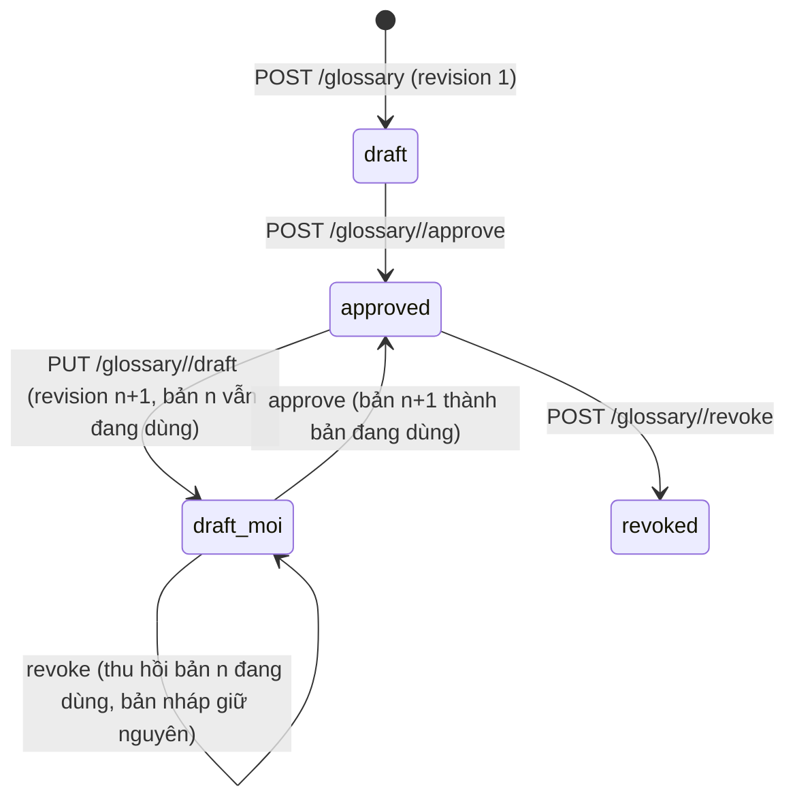

# Module `glossary_management`

Mô tả luồng xử lý các API của module quản lý thuật ngữ nghiệp vụ trong backend Semantic Layer:
`extensions/semantic-layer/backend/src/text_to_bi/superset_semantic_layer/modules/glossary_management/`. Module giữ
thuật ngữ cùng các bản sửa (revision) và vòng đời duyệt, liên kết của thuật ngữ tới dataset, cột và metric, nhóm thuật
ngữ cùng nghĩa, gợi ý gom nhóm bằng embedding, import / export file, và việc phát hiện thuật ngữ, expert rule, metric
mâu thuẫn nhau.

Quy tắc chung về lỗi, decorator, transaction và quyền nằm ở [hanh-vi.md](../../hanh-vi.md); cấu trúc module nằm ở
[kien-truc.md](../../kien-truc.md). Đặc tả nghiệp vụ của gợi ý gom nhóm nằm ở
[docs/specs/goi-y-gom-nhom.md](../../../specs/goi-y-gom-nhom.md), của phát hiện mâu thuẫn ở
[docs/specs/phat-hien-mau-thuan.md](../../../specs/phat-hien-mau-thuan.md).

| Tài liệu | Route file | API |
| --- | --- | --- |
| [route-glossary-term.md](route-glossary-term.md) | `route_glossary_term.py` | Đọc, tạo, sửa, duyệt, thu hồi |
| [route-glossary-group.md](route-glossary-group.md) | `route_glossary_group.py` | Nhóm thuật ngữ, gợi ý gom nhóm |
| [route-glossary-file.md](route-glossary-file.md) | `route_glossary_file.py` | Xuất file, xem trước import, import |
| [route-contradiction.md](route-contradiction.md) | `route_contradiction.py` | Kiểm tra mâu thuẫn, bỏ qua mâu thuẫn |

## Đường dẫn

Bốn route mixin `GlossaryTermRoutes`, `GlossaryGroupRoutes`, `GlossaryFileRoutes` và `ContradictionRoutes` được ghép
vào `SemanticLayerAPI` (`registry.py`, `resource_name="semantic-layer"`,
`class_permission_name="text_to_bi_semantic_layer_api"`). Superset đặt API của extension dưới tiền tố mà frontend
(`SEMANTIC_LAYER_API` trong `frontend/src/features/semantic-layer/constants.ts`) và AI Agent
(`modules/semantic_layer/services/catalog.py` gọi `/glossary/discovery`) cùng dùng:

```text
{API} = /extensions/text-to-bi/superset-semantic-layer/semantic-layer
```

Các đường dẫn trong tài liệu viết tương đối với `{API}`.

## Các lớp

```text
routes/       GlossaryTermRoutes, GlossaryGroupRoutes,           ← đọc request, kiểm tra quyền, commit, trả response
              GlossaryFileRoutes, ContradictionRoutes
utils/        util_serializer.py                                 ← đổi model thành JSON trả về
services/     GlossaryTermService, GlossaryGroupService,         ← quy tắc nghiệp vụ, không đọc request, không commit
              GlossaryEventService, srv_glossary_link,
              srv_glossary_validation, srv_glossary_file,
              srv_glossary_embedding, srv_group_suggestion,
              srv_contradiction_*
repositories/ GlossaryTermRepository, GlossaryRevisionRepository, ← mọi truy vấn vào chín bảng của module
              GlossaryLinkRepository, GlossaryEventRepository,
              GlossaryGroupRepository, TextEmbeddingRepository,
              GroupSuggestionDismissalRepository,
              ContradictionRepository, ContradictionJudgementRepository
models/       model_glossary.py, model_grouping.py, model_contradiction.py
```

Model:

- `models/model_glossary.py`: `GlossaryTermGroup`, `GlossaryTerm`, `GlossaryTermRevision`, `GlossaryTermLink`,
  `GlossaryTermAuditEvent`.
- `models/model_grouping.py`: `TextEmbedding` (cache vector), `GroupSuggestionDismissal`; dùng chung với expert rule.
- `models/model_contradiction.py`: `Contradiction`, `ContradictionJudgement`.

Repository và dependency:

- `repositories/repo_*.py`: một repository mỗi model, kế thừa `BaseRepository`. `create(values, flush=True)` và
  `update` flush ngay; `delete` không flush. `read_for_update` / `read_current_for_update` khóa dòng (`FOR UPDATE`).
- `dependencies.py`: `glossary_term_repository()`, `glossary_revision_repository()`, `glossary_link_repository()`,
  `glossary_event_repository()`, `glossary_group_repository()`, `text_embedding_repository()`,
  `group_suggestion_dismissal_repository()`, `contradiction_repository()`, `contradiction_judgement_repository()`, mỗi
  hàm gắn repository với `db.session`.

Service:

- `srv_glossary_term.py`: `GlossaryTermService` (tạo, đọc, sửa thành bản nháp, duyệt, thu hồi) và
  `checked_term_content`.
- `srv_glossary_group.py`: `GlossaryGroupService` (tạo, sửa, xóa nhóm, `move_term`, `place_term`, gợi ý) và
  `term_text`.
- `srv_glossary_event.py`: `GlossaryEventService` (ghi, đọc lịch sử, `read_author_id`).
- `srv_glossary_link.py`: `validated_links`, `link_fingerprint`, `link_is_live`, `metric_approved`, `link_options`,
  `revision_readable`, `term_readable`, `discoverable_glossary_terms`.
- `srv_glossary_validation.py`: `normalize_glossary_payload`, `normalize_group_payload`, `expected_revision_of`,
  `review_reason`, `group_id_of`, `content_hash`, `normalized_name`.
- `srv_glossary_file.py`: `export_terms`, `preview_term_import`, `apply_term_import`.
- `srv_glossary_embedding.py`: `text_vectors`, embedding OpenRouter có cache, dự phòng TF-IDF.
- `srv_group_suggestion.py`: `suggest_groups`, `suggestion_fingerprint`, `dismiss_suggestion`, `grouping_choice`.
- `srv_contradiction_review.py`: `refresh_contradictions`, `contradictions_for_review`, `mark_contradiction_dismissed`.
- `srv_contradiction_detection.py`: kiểm bằng quy tắc (`detect`) và chọn cặp gửi AI (`semantic_candidates`).
- `srv_contradiction_judgement.py`: `semantic_judge`, `judge_candidates`, `semantic_findings` (gọi mô hình chat).
- `srv_contradiction_lifecycle.py`: `reconcile`, `dismissal_reason`, `found_by`.
- `srv_contradiction_conditions.py`, `srv_contradiction_thresholds.py`: đọc điều kiện rule và ngưỡng số trong văn bản.

Serializer `utils/util_serializer.py`: `serialize_glossary_term`, `serialize_glossary_revision`,
`serialize_glossary_review_entry`, `serialize_glossary_events`, `serialize_glossary_group`, `serialize_group_reference`,
`serialize_contradiction`, `serialize_users`.

Lỗi `exceptions.py`, kế thừa `common/exceptions`:

| Lớp | Status | Message mặc định |
| --- | --- | --- |
| `GlossaryValidationError` | 400 | Theo từng chỗ ném |
| `GlossaryConflictError` | 409 | Theo từng chỗ ném |
| `GlossarySelfApprovalError` | 403 | "Người soạn thuật ngữ không thể tự duyệt; cần một quản trị viên khác duyệt." |
| `GlossaryTermNotFoundError` | 404 | "Glossary term not found." |
| `GlossaryTermGroupNotFoundError` | 404 | "Không tìm thấy nhóm thuật ngữ." |
| `ContradictionValidationError` | 400 | Theo từng chỗ ném |
| `ContradictionNotFoundError` | 404 | "Không tìm thấy mâu thuẫn; bấm “Kiểm tra lại” để cập nhật danh sách." |
| `ContradictionCheckConflictError` | 409 | "Một lượt kiểm tra khác vừa lưu kết quả; bấm “Kiểm tra lại”." |

Trạng thái duyệt dùng `ReviewStatus` chung (`common/schemas/status_enum.py`): `draft`, `approved`, `revoked`.

## Bảng

Tên bảng do `BaseModel.__tablename__` sinh: `text_to_bi_` cộng tên lớp viết snake_case.

| Model | Bảng `text_to_bi_…` | Nội dung |
| --- | --- | --- |
| `GlossaryTermGroup` | `glossary_term_group` | `name`, unique `normalized_name`, `description`; cột audit Superset |
| `GlossaryTerm` | `glossary_term` | Gốc: `canonical_name`, unique `normalized_name`, `steward_id`, `group_id` |
| `GlossaryTermRevision` | `glossary_term_revision` | `definition`, `synonyms`, `content_hash`, `status`, `is_current` |
| `GlossaryTermLink` | `glossary_term_link` | Liên kết của revision: `kind`, `dataset_id`, `column_name`, `metric_id` |
| `GlossaryTermAuditEvent` | `glossary_term_audit_event` | Lịch sử chỉ thêm: `event_type`, `reason`, `actor_id` |
| `TextEmbedding` | `text_embedding` | Cache vector theo (`model`, `content_hash`) của văn bản |
| `GroupSuggestionDismissal` | `group_suggestion_dismissal` | Gợi ý bị bỏ qua theo (`kind`, `fingerprint`) |
| `Contradiction` | `contradiction` | Một dòng mỗi `pair_key`: `kind`, `items`, `evidence`, `status`, lý do bỏ qua |
| `ContradictionJudgement` | `contradiction_judgement` | Kết luận của mô hình AI theo `fingerprint` của cặp |

Ràng buộc đáng nhớ:

- `glossary_term.steward_id` FK `ab_user` (SET NULL); `group_id` FK nhóm (SET NULL).
- `glossary_term_revision`: unique (`term_id`, `revision_number`); check `status` ∈ `draft`, `approved`, `revoked`;
  `approver_id`, `approved_at`, `revoker_id`, `revoked_at`; FK thuật ngữ CASCADE.
- `glossary_term_link`: check `kind` ∈ `dataset`, `column`, `metric`; unique (`revision_id`, `link_key`); lưu
  `fingerprint`; FK `tables.id`, `sql_metrics.id`, revision, cùng CASCADE.
- `glossary_term_audit_event`: check `event_type` ∈ `created`, `updated`, `approved`, `revoked`, `moved`; FK thuật ngữ
  và revision CASCADE.
- `group_suggestion_dismissal`: check `kind` ∈ `glossary`, `expert_rule`; unique (`kind`, `fingerprint`).
- `contradiction`: unique `pair_key`; check `status` ∈ `open`, `dismissed`. `contradiction_judgement`: unique
  `fingerprint`.

Bảng của Superset mà module đọc (qua module `superset` hoặc quan hệ của `SqlaTable`): `tables`, `table_columns`,
`sql_metrics`, `dbs`, `ab_user`. Bảng của module khác mà module đọc: `text_to_bi_metric_contract` và
`text_to_bi_metric_definition` (qua `MetricContractService` để biết metric còn được duyệt), các bảng expert rule và
`text_to_bi_column_dictionary` (chỉ khi kiểm tra mâu thuẫn).

## Thuật ngữ, revision và bản đang dùng

Một thuật ngữ có ba lớp dữ liệu:

- **Gốc** (`GlossaryTerm`): tên, người phụ trách, nhóm. Tên chuẩn hóa (`normalized_name`: gộp khoảng trắng,
  `casefold`) không đổi sau khi tạo. Người phụ trách được ghi thẳng lên gốc khi sửa; nhóm thuộc gốc chứ không thuộc
  revision, nên chuyển nhóm không cần duyệt và không đổi trạng thái duyệt.
- **Revision** (`GlossaryTermRevision`): định nghĩa, từ đồng nghĩa, liên kết. Mỗi lần sửa tạo revision mới số kế tiếp ở
  trạng thái `draft`, đặt `is_current = True` cho nó và `False` cho bản cũ. Chỉ có một bản hiện tại.
- **Bản đang dùng** (serving): `GlossaryRevisionRepository.read_serving(term_id)` lấy revision `approved` hoặc
  `revoked` có số lớn nhất; nếu nó là `approved` thì đó là bản AI Agent dùng, nếu là `revoked` thì thuật ngữ không có
  bản đang dùng. Bản nháp chờ duyệt không thay bản đang dùng; duyệt bản nháp thì thay, thu hồi thì chấm dứt.



`expected_revision` của mọi route ghi lên revision là số revision hiện tại client đã đọc. `_locked_current` khóa dòng
thuật ngữ (`read_for_update`, `SELECT … FOR UPDATE`), khóa và đọc lại bản hiện tại (`read_current_for_update`), và trả
409 "The glossary term changed; refresh and retry." khi số không khớp.

### Liên kết

`validated_links(links, get_dataset, metric_is_approved)` gắn mỗi liên kết vào đối tượng đang có:

- `dataset`: dataset có thật; không được kèm `column_name` hay `metric_id`.
- `column`: cột có `column_name` đó, `is_active is True`, không có `expression` (cột vật lý).
- `metric`: metric có `metric_id` trong `dataset.metrics`, và `metric_is_approved(dataset, metric)` đúng. Ở trình soạn
  đó là `metric_approved`: `MetricContractService.read` có contract và `contract_is_approved_current` đúng.
- Trùng (`kind`, `dataset_id`, `column_name`, `metric_id`) là 400 "Duplicate glossary link.".

Mỗi liên kết lưu `link_fingerprint`: SHA-256 của kind, dataset ID, catalog, schema, bảng, SQL, `connection_identity`
của database và, với cột / metric, tên, `is_active` / ID, `expression`. `link_is_live(link)` so fingerprint hiện tại với
fingerprint đã lưu, và với metric còn đòi `metric_approved`. Một revision `approved` có liên kết không còn sống hiện
`state = "outdated"` ở danh sách.

### Quyền đọc theo dataset

- `revision_readable(revision_id)`: mọi dataset còn tồn tại mà revision liên kết tới đều qua `can_access_dataset`
  (`security_manager.raise_for_access`). Dataset đã bị xóa không chặn.
- `term_readable(term_id)`: thuật ngữ không có bản hiện tại, hoặc bản hiện tại `revision_readable`.

## Khung chung của một route

Mọi route của module đi qua cùng một chuỗi decorator, từ ngoài vào trong:

1. `@expose` khai báo method và đường dẫn.
2. `@protect()` và `@permission_name("read" | "write")` của Flask-AppBuilder: chưa đăng nhập hoặc thiếu permission
   `can_read` / `can_write` trên `text_to_bi_semantic_layer_api` thì FAB trả lỗi trước khi vào hàm.
3. `@safe`: lỗi không ai bắt được (ví dụ `RuntimeError` của `ensure_dictionary_tables`) thành 500.
4. Route thay đổi dữ liệu: `@csrf_protected` (403 "CSRF token không hợp lệ." khi header `X-CSRFToken` sai) rồi
   `@rollback_on_error` (rollback, 500 "Could not save the change."). `POST {API}/glossary/file/preview` có CSRF nhưng
   không có `rollback_on_error` vì nó không ghi.
5. `@handle_errors` (`core/database.py`): bắt `SemanticLayerError`, rollback, trả `status` và `message` của lỗi.
6. Trong thân hàm: kiểm tra vai trò (`require_admin`, `require_semantic_layer_view` hoặc `require_semantic_layer_query`
   của `core/security.py`), `ensure_dictionary_tables()`, đọc body bằng `request.get_json(silent=True)` (body không
   phải JSON thành `None`), gọi service, `db.session.commit()` nếu ghi, serialize.

Module không có decorator `requires_*`: thuật ngữ, nhóm và mâu thuẫn được tìm trong service, nên kiểm tra vai trò luôn
chạy trước và người không có quyền nhận 403 dù bản ghi có tồn tại hay không.

| Kiểm tra | Ai qua | Lỗi 403 |
| --- | --- | --- |
| `require_admin()` | Vai trò `Admin` | "Admin access required." |
| `require_semantic_layer_view()` | `Admin`, `can_view` ("Semantic Layer Viewer") | `SemanticLayerViewRequiredError` |
| `require_semantic_layer_query()` | `Admin`, `can_query` ("Semantic Layer Query") | `SemanticLayerQueryRequiredError` |

`can_view` và `can_query` là permission trên view menu "Text to BI Semantic Layer". `second_reviewer_required()` đọc
`TEXT_TO_BI_REQUIRE_SECOND_REVIEWER` của `superset_config`, mặc định `False`.

## Service module khác gọi vào

- AI Agent gọi public API `/glossary/discovery` qua HTTP để ghép semantic catalog; service `discoverable_glossary_terms`
  và việc kiểm tra thuật ngữ đã duyệt vẫn thuộc module này.
- Module `expert_rule_management`: `srv_expert_rule_link.py` dùng repository thuật ngữ, revision và liên kết;
  `srv_expert_rule_group.py` dùng `glossary_term_repository` và `srv_group_suggestion` (`EXPERT_RULE_KIND`,
  `GroupingCandidate`, `dismiss_suggestion`, …); `srv_expert_rule_file.py` dùng `glossary_term_repository`.
- Ngược lại, kiểm tra mâu thuẫn (`srv_contradiction_review.py`) đọc expert rule qua
  `expert_rule_management.dependencies`.
- `migrations.py` import model và `AUDIT_EVENT_TYPES` để tạo bảng.
