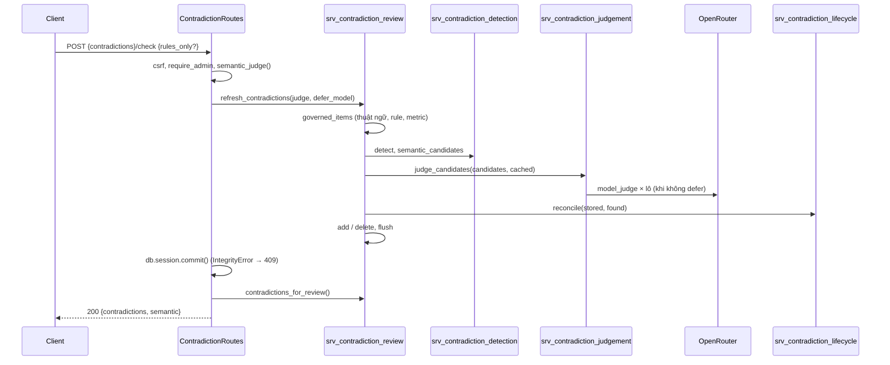
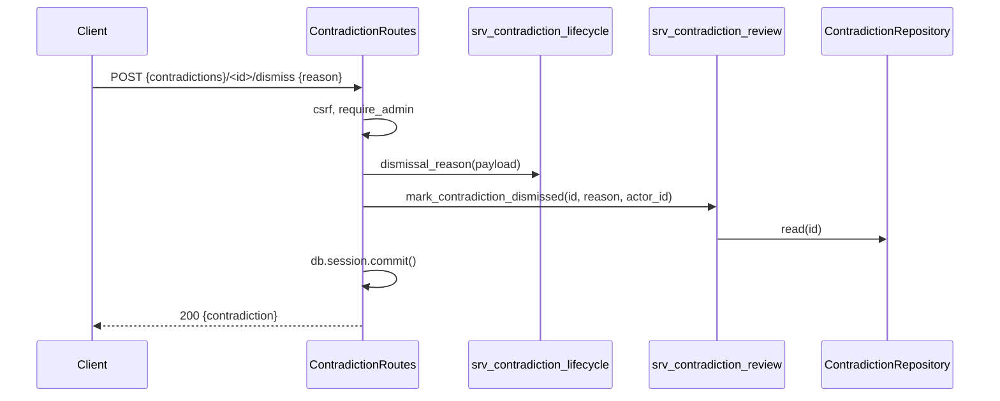

# `route_contradiction.py`: phát hiện mâu thuẫn

Route mixin `ContradictionRoutes` (`modules/glossary_management/routes/route_contradiction.py`). Mọi đường dẫn có tiền
tố `{API}/contradictions` (xem [README.md](README.md#đường-dẫn)); dưới đây viết tắt là `{contradictions}`.

| Method | Đường dẫn | Hàm | Ai gọi được | Commit |
| --- | --- | --- | --- | --- |
| POST | `{contradictions}/check` | `check_contradictions` | Admin | Có |
| POST | `{contradictions}/<int:contradiction_id>/dismiss` | `dismiss_contradiction` | Admin | Có |

Không có route chỉ đọc danh sách: màn "Mâu thuẫn" luôn kiểm tra lại khi mở, để danh sách khớp nội dung hiện tại. Đặc tả
nghiệp vụ nằm ở [docs/specs/phat-hien-mau-thuan.md](../../../specs/phat-hien-mau-thuan.md).

## Các kiểu mâu thuẫn

| `kind` | `found_by` | Khi nào |
| --- | --- | --- |
| `term_name_clash` | `rule` | Hai thuật ngữ khác nhóm cùng nhận một từ làm tên hoặc từ đồng nghĩa |
| `rule_conditions_empty` | `rule` | Điều kiện trên một cột của rule không bao giờ cùng đúng |
| `rule_rule_same_term` | `rule` | Hai rule cùng dataset cùng định nghĩa một thuật ngữ, điều kiện khác nhau |
| `rule_rule_overlap` | `rule` | Hai rule cho hai thuật ngữ trên cùng các cột, giao nhau mà không lồng nhau |
| `rule_term_threshold` | `rule` | Ngưỡng của rule khác ngưỡng mà định nghĩa thuật ngữ nó gắn nêu |
| `rule_example_threshold` | `rule` | Câu hỏi mẫu hoặc ý định nêu ngưỡng khác điều kiện của chính rule |
| `term_term_meaning` | `ai` | Hai thuật ngữ liên quan có định nghĩa trái nhau |
| `term_metric_meaning` | `ai` | Công thức metric không tính đúng điều thuật ngữ liên kết nó định nghĩa |
| `rule_term_meaning` | `ai` | Rule trái định nghĩa thuật ngữ nó gắn |
| `rule_rule_meaning` | `ai` | Hai rule cùng dataset, chung thuật ngữ hoặc cột điều kiện, phủ định nhau |

Kiểu `rule` do `name_clashes`, `empty_rules`, `rule_pairs`, `rule_term_thresholds`, `example_thresholds` của
`srv_contradiction_detection.py` tìm. Kiểu `ai` do mô hình chat kết luận trên các cặp `semantic_candidates` chọn: hai
thuật ngữ chung cột hoặc metric, chung nhóm, hay nhắc tên nhau trong định nghĩa; thuật ngữ với metric nó liên kết; rule
với thuật ngữ nó gắn; hai rule cùng dataset chung thuật ngữ hoặc cột điều kiện.

Ngưỡng trong văn bản được đọc bằng `stated_interval` (`srv_contradiction_thresholds.py`: các cụm "trên", "từ … trở
lên", "không quá", "từ … đến …", `>=`, … trong mệnh đề đầu), điều kiện rule bằng `rule_domains`
(`srv_contradiction_conditions.py`).

## POST `{contradictions}/check`

Kiểm tra lại mọi thuật ngữ và expert rule hiện tại, cập nhật bảng mâu thuẫn và trả danh sách, mục đang mở trước.

**Quyền**: `@permission_name("write")`, `@csrf_protected`, `require_admin()`.

**Input**: header `X-CSRFToken`; body JSON tùy chọn `{"rules_only": true}`. Chỉ giá trị `true` (kiểu `bool`) bật chế độ
này; body khác hoặc không có là kiểm tra đủ. Màn hình gọi `rules_only` trước để hiện ngay kết quả kiểm bằng quy tắc,
rồi gọi lại không có cờ để hỏi mô hình AI.

**Luồng**:

1. `@csrf_protected` → `@rollback_on_error` → `@handle_errors` → `require_admin()` → `ensure_dictionary_tables()`.
2. `semantic_judge()`: `model_judge` khi có `OPENROUTER_API_KEY`, không thì `None`.
3. `refresh_contradictions(judge, defer_model=rules_only)` (`srv_contradiction_review.py`):
   1. `governed_items()`:
      - `_governed_terms()`: mỗi thuật ngữ (`GlossaryTermRepository.read_all`) có bản hiện tại ở `draft` hoặc
        `approved` thành một `TermItem` (tên, định nghĩa, `content_hash`, từ đồng nghĩa, nhóm, cột và metric liên kết).
      - `_governed_rules()`: `expert_rule_revision_repository().read_all_current()` và
        `expert_rule_repository().read(rule_id)` của module `expert_rule_management`, giữ bản `draft` / `approved`;
        nhãn cột điều kiện đọc từ `column_dictionary_repository()` của Data Dictionary; thuật ngữ gắn đọc từ
        `expert_rule_link_repository().read_by_revision`, liên kết `kind == "glossary"`.
      - `_linked_metrics()`: mỗi metric thuật ngữ liên kết (`get_dataset`, `dataset.metrics`), `content_hash` là
        SHA-256 của tên, tên hiển thị và công thức.
   2. `detect(terms, rules)`: chạy sáu kiểm tra quy tắc, mỗi (`kind`, các mục) một kết quả.
   3. `semantic_candidates(terms, rules, metrics, findings)`: chọn các cặp gửi AI, bỏ cặp đã bị kiểm tra quy tắc đánh
      dấu (trừ cặp thuật ngữ – metric). Mỗi cặp có
      `fingerprint = content_fingerprint(kind, [(loại, id, content_hash), …])`.
   4. `ContradictionJudgementRepository.read_by_fingerprints(fingerprints)`: kết luận đã cache.
   5. `judge_candidates(candidates, cached, judge, defer)` (`srv_contradiction_judgement.py`):
      - mọi cặp đã có kết luận: `checked`;
      - không có `judge`: `unavailable`, thông điệp "Chưa cấu hình OPENROUTER_API_KEY …";
      - `defer`: `deferred`, không gọi AI;
      - còn lại: lấy tối đa 24 cặp, chia lô 6 cặp, gọi `model_judge` song song bằng `ThreadPoolExecutor`. Mỗi lô gửi
        `judge_request` (JSON các cặp với câu hỏi theo `KIND_QUESTIONS`) cho agent LangChain dùng
        `get_judgement_chat_model()` (timeout 45 giây, thử lại 1 lần) với `response_format=PairVerdicts`;
        `parse_verdicts` bỏ cặp trả sai. Lỗi của một lô bị ghi log và bỏ qua (`_judged_safely`). Kết quả: `failed` khi
        mọi lô lỗi và không có kết luận mới, `pending` khi còn cặp chưa kiểm, không thì `checked`.
   6. `outcome.status == "checked"` thì `ContradictionJudgementRepository.delete_except(fingerprints)` xóa kết luận
      của cặp không còn là ứng viên. Mỗi kết luận mới `add(ContradictionJudgement(...), flush=False)`.
   7. `found = findings + semantic_findings(candidates, verdicts)` (cặp AI kết luận mâu thuẫn).
   8. `reconcile(ContradictionRepository.read_all(), found, Contradiction(**values), now)`
      (`srv_contradiction_lifecycle.py`):
      - `pair_key` chưa có: thêm dòng `open`, `detected_at = now`;
      - có rồi mà `fingerprint` khác (một mục đã đổi nội dung): mở lại (`open`, `detected_at = now`) và xóa lý do,
        người, lúc bỏ qua;
      - có rồi và cùng `fingerprint`: giữ `status` (dòng `dismissed` vẫn bị bỏ qua), cập nhật `items`, `evidence`,
        `explanation`;
      - dòng đã lưu không còn được phát hiện: xóa.
   9. `ContradictionRepository.delete` / `add(flush=False)` rồi `flush()`.
4. `db.session.commit()`. `IntegrityError` trong bước 3 hoặc commit (hai lượt kiểm tra cùng thêm một `pair_key` hay
   `fingerprint`) thành `ContradictionCheckConflictError` (409).
5. `contradictions_for_review()`: mọi dòng, sắp `open` trước `dismissed`, rồi theo thứ tự `kind` ở bảng trên, rồi `id`;
   mỗi dòng qua `serialize_contradiction(row, user_names())`.

**Bảng**: đọc `text_to_bi_glossary_term`, `text_to_bi_glossary_term_revision`, `text_to_bi_glossary_term_link`,
bảng revision, rule và liên kết của expert rule, `text_to_bi_column_dictionary`, `tables`, `sql_metrics`, `ab_user`;
đọc, insert, delete `text_to_bi_contradiction_judgement`; đọc, insert, update, delete `text_to_bi_contradiction`.

**Response 200**:

```json
{
  "contradictions": [
    {
      "id": 7, "kind": "rule_term_threshold", "found_by": "rule", "status": "open",
      "items": [{"type": "rule", "id": 3, "name": "Mưa to"}, {"type": "term", "id": 4, "name": "Mưa to"}],
      "evidence": ["Thuật ngữ “Mưa to”: “…” → …", "Rule “Mưa to”: …"],
      "explanation": "Điều kiện của rule khác định nghĩa của thuật ngữ nó gắn (…)…",
      "detected_at": "2026-11-12T03:00:00+00:00",
      "dismiss_reason": null, "dismissed_by_name": null, "dismissed_at": null
    }
  ],
  "semantic": {"status": "pending", "unchecked": 5, "message": "Còn 5 cặp chưa được AI kiểm tra; …"}
}
```

- `items[].type` ∈ `term`, `rule`, `metric`; tên là tên lúc phát hiện.
- `evidence` là các dòng bằng chứng của kiểm tra quy tắc, hoặc hai đoạn văn đã gửi AI với kiểu `ai`.
- `semantic.status` ∈ `checked`, `pending`, `unavailable`, `failed`, `deferred`; `message` là `null` với `checked` và
  `deferred`.

**Lỗi**:

| Status | Message | Nguồn |
| --- | --- | --- |
| 403 | "CSRF token không hợp lệ." / "Admin access required." | `csrf_protected`, `require_admin` |
| 409 | "Một lượt kiểm tra khác vừa lưu kết quả; bấm “Kiểm tra lại”." | `ContradictionCheckConflictError` |
| 500 | "Could not save the change." | lỗi ngoài dự kiến, `rollback_on_error` |

Lỗi của mô hình AI không thành lỗi HTTP: nó chỉ đổi `semantic.status`.



## POST `{contradictions}/<int:contradiction_id>/dismiss`

Chấp nhận một mâu thuẫn kèm lý do. Nó giữ `dismissed` tới khi nội dung một trong các mục đổi (fingerprint đổi), khi đó
lượt kiểm tra sau mở lại nó.

**Quyền**: `@permission_name("write")`, `@csrf_protected`, `require_admin()`.

**Input**: path `contradiction_id`; header `X-CSRFToken`; body `{"reason": "…"}`: bắt buộc, gộp khoảng trắng, không
rỗng, tối đa 512 ký tự.

**Luồng**:

1. `@csrf_protected` → `@rollback_on_error` → `@handle_errors` → `require_admin()` → `ensure_dictionary_tables()`.
2. `dismissal_reason(payload)`.
3. `mark_contradiction_dismissed(contradiction_id, reason, current_user.id)`: `ContradictionRepository.read`; không có
   là 404; gán `status = "dismissed"`, `dismiss_reason`, `dismissed_by`, `dismissed_at`. Dòng đã `dismissed` bị ghi đè
   lý do và người bỏ qua.
4. `db.session.commit()`.
5. `serialize_contradiction(row, user_names())`.

**Bảng**: update `text_to_bi_contradiction`; đọc `ab_user`.

**Response 200**: `{"contradiction": {...}}` cùng hình dạng một phần tử của `contradictions` ở trên.

**Lỗi**:

| Status | Message | Nguồn |
| --- | --- | --- |
| 403 | "CSRF token không hợp lệ." / "Admin access required." | `csrf_protected`, `require_admin` |
| 400 | "Nhập lý do bỏ qua mâu thuẫn." / "Lý do bỏ qua dài quá 512 ký tự." | `dismissal_reason` |
| 404 | "Không tìm thấy mâu thuẫn; bấm “Kiểm tra lại” để cập nhật danh sách." | `ContradictionNotFoundError` |
| 500 | "Could not save the change." | `rollback_on_error` |


