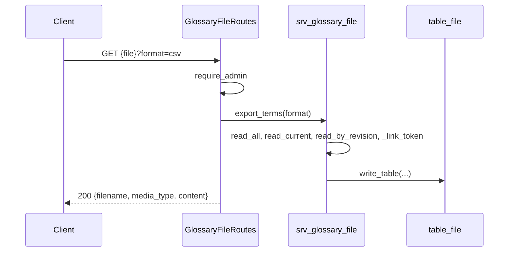
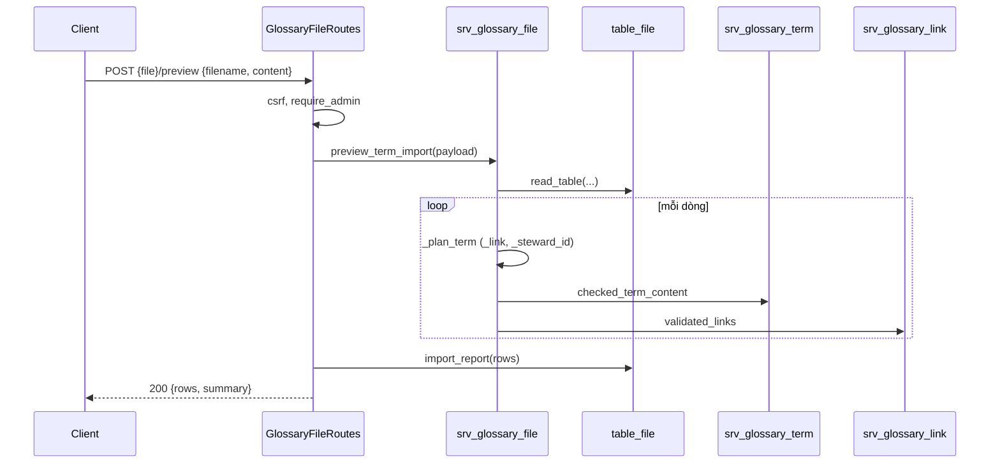
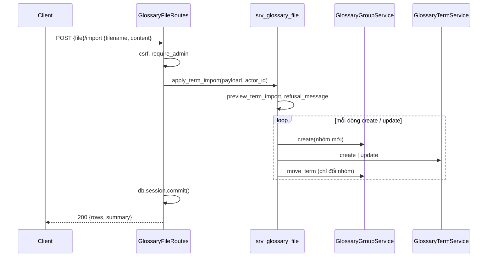

# `route_glossary_file.py`: xuất và import file thuật ngữ

Route mixin `GlossaryFileRoutes` (`modules/glossary_management/routes/route_glossary_file.py`). Mọi đường dẫn có tiền
tố `{API}/glossary/file` (xem [README.md](README.md#đường-dẫn)); dưới đây viết tắt là `{file}`.

| Method | Đường dẫn | Hàm | Ai gọi được | Commit |
| --- | --- | --- | --- | --- |
| GET | `{file}` | `export_glossary_file` | Admin | Không |
| POST | `{file}/preview` | `preview_glossary_file` | Admin | Không |
| POST | `{file}/import` | `import_glossary_file` | Admin | Có |

Service nằm ở `services/srv_glossary_file.py`; phần đọc và ghi CSV / XLSX dùng chung với expert rule nằm ở
`common/utils/table_file.py`. File đi qua JSON dưới dạng base64, không phải multipart.

## Định dạng file

| Cột | Bắt buộc | Nội dung |
| --- | --- | --- |
| `canonical_name` | Có | Tên thuật ngữ; khóa để tìm thuật ngữ có sẵn (so theo `normalized_name`) |
| `definition` | Có | Định nghĩa |
| `synonyms` | Không | Từ đồng nghĩa cách nhau bằng `;` |
| `group` | Không | Tên nhóm; ô trống là bỏ khỏi nhóm; tên chưa có thì import tạo nhóm mới |
| `steward` | Không | `username` Superset của người phụ trách; ô trống là không có |
| `links` | Có | `dataset:<bảng>`, `column:<bảng>.<cột>` hoặc `metric:<bảng>.<metric>`, cách nhau bằng `;` |

- Tên cột so không phân biệt hoa thường và khoảng trắng. Cột không có trong file thì giữ giá trị đang có (từ đồng
  nghĩa, người phụ trách, nhóm của thuật ngữ có sẵn).
- `<bảng>` là `table_name` của dataset Superset, tách khỏi cột / metric ở dấu chấm cuối. Chỉ dataset không nội bộ
  (`business_datasets_by_name`) được nhận; tên trùng nhiều dataset là lỗi.
- `read_table` (`table_file.py`) đọc body `{"filename", "content": <base64>}`: tối đa 1 MB, tối đa 1.000 dòng dữ liệu;
  XLSX nhận theo chữ ký `PK` hoặc đuôi `.xlsx`; CSV đọc UTF-8 (có BOM) hoặc cp1258, chuẩn hóa NFC, tự đoán dấu phân cách
  `,`, `;` hoặc tab; dòng trống bị bỏ; số dòng trong báo cáo là số dòng trên bảng tính (tiêu đề là dòng 1).

## GET `{file}`

Bản hiện tại của mọi thuật ngữ dưới dạng CSV hoặc XLSX, đúng mẫu mà import đọc lại.

**Quyền**: `@permission_name("read")`, `require_admin()`. Không lọc theo quyền dataset.

**Input**: query `format` = `csv` (mặc định) hoặc `xlsx`.

**Luồng**:

1. `@handle_errors` → `require_admin()` → `ensure_dictionary_tables()`.
2. `export_terms(request.args.get("format", "csv"))`:
   1. `GlossaryTermRepository.read_all()` (theo tên); mỗi thuật ngữ `GlossaryRevisionRepository.read_current`, bỏ
      thuật ngữ không có bản hiện tại.
   2. Mỗi dòng: tên, định nghĩa, từ đồng nghĩa nối bằng `; `, tên nhóm, `username` của người phụ trách (`get_user`),
      liên kết của `GlossaryLinkRepository.read_by_revision` qua `_link_token` (dataset không còn ghi `#<id>`, metric
      không còn ghi `#<metric_id>`).
   3. `write_table(TERM_HEADERS, rows, format, "thuat-ngu", GlossaryValidationError)`: CSV UTF-8 có BOM, dòng `\r\n`;
      XLSX qua openpyxl, tiêu đề in đậm, cố định dòng đầu.

**Bảng**: đọc `text_to_bi_glossary_term`, `text_to_bi_glossary_term_revision`, `text_to_bi_glossary_term_link`,
`text_to_bi_glossary_term_group`, `ab_user`, `tables`, `sql_metrics`. Không ghi.

**Response 200**:

```json
{"filename": "thuat-ngu.csv", "media_type": "text/csv;charset=utf-8", "content": "<base64>"}
```

**Lỗi**:

| Status | Message | Nguồn |
| --- | --- | --- |
| 403 | "Admin access required." | `require_admin` |
| 400 | "Định dạng file phải là csv hoặc xlsx." | `write_table` |
| 400 | "Máy chủ chưa tạo được file XLSX; hãy dùng file CSV." | không import được openpyxl |



## POST `{file}/preview`

Kết quả import của từng dòng, kiểm tra như trình soạn. Không lưu gì.

**Quyền**: `@permission_name("write")`, `@csrf_protected`, `require_admin()`. Route không có `rollback_on_error`.

**Input**: header `X-CSRFToken`; body `{"filename": "thuat-ngu.xlsx", "content": "<base64>"}`.

**Luồng**:

1. `@csrf_protected` → `@handle_errors` → `require_admin()` → `ensure_dictionary_tables()`.
2. `preview_term_import(payload)`:
   1. `business_datasets_by_name()`: dataset không nội bộ theo `table_name`.
   2. `read_table(payload, TERM_HEADERS, REQUIRED_TERM_HEADERS, GlossaryValidationError)`; lỗi cấp file là 400 cho cả
      request.
   3. Mỗi dòng thành một `ImportRow(row, key=canonical_name)`. Tên chuẩn hóa trùng một dòng trước là lỗi dòng
      "Thuật ngữ trùng với dòng N.". Còn lại `_plan_term(item, cells, datasets)`:
      1. Tìm thuật ngữ bằng `read_by_normalized_name` và bản hiện tại của nó.
      2. Dựng payload như trình soạn: `synonyms` (`split_list`), `steward_id` (`_steward_id`:
         `security_manager.find_user(username=…)`), `links` (`_link`: tra dataset bằng `dataset_named`, cột phải active
         và không tính toán, metric phải có trong dataset); cột vắng mặt lấy giá trị đang lưu.
      3. `checked_term_content(payload)`.
      4. `validated_links(values["links"], get_dataset, metric_is_approved)`, với `metric_is_approved` nới hơn trình
         soạn: metric không còn duyệt vẫn được nhận nếu bản hiện tại đã liên kết nó, để file xuất ra import lại được.
      5. Cột `group`: tên nhóm có sẵn (`GlossaryGroupRepository.read_by_normalized_name`) thành `group_id`; tên chưa
         có thì `plan.new_group` (kiểm tra bằng `normalize_group_payload`); ô trống thành `group_id = null`.
      6. Quyết định `action`:
         - chưa có thuật ngữ hoặc bản hiện tại: `create`, "Tạo thuật ngữ mới, chờ duyệt.";
         - so `definition`, `synonyms`, `steward`, `links` (theo kind, dataset, cột, metric) và `group` với bản đang
           lưu; không đổi gì: `unchanged`;
         - chỉ đổi nhóm: `update`, "Chỉ chuyển nhóm; trạng thái duyệt giữ nguyên.";
         - đổi nội dung: `update`, "Tạo bản nháp mới chờ duyệt." (thêm "bản đã duyệt vẫn được dùng…" khi
           `read_serving` có bản). Đổi nội dung mà có metric không còn duyệt là lỗi dòng.
         - Có nhóm mới thì thêm " Tạo nhóm mới «…»." vào thông điệp.
   4. Lỗi `SemanticLayerError` của một dòng thành `action = "error"`; thông điệp tiếng Anh của trình soạn được dịch
      qua `TERM_MESSAGES`, các thông điệp khác giữ nguyên.
3. `import_report(rows)`: `rows` và `summary` đếm từng `action`.

**Bảng**: đọc `text_to_bi_glossary_term`, `text_to_bi_glossary_term_revision`, `text_to_bi_glossary_term_link`,
`text_to_bi_glossary_term_group`, `ab_user`, `tables`, `table_columns`, `sql_metrics`, `dbs`,
`text_to_bi_metric_contract`, `text_to_bi_metric_definition`. Không ghi, không commit.

**Response 200**:

```json
{
  "rows": [
    {"row": 2, "key": "Mưa to", "action": "update", "message": "Tạo bản nháp mới chờ duyệt.",
     "changes": ["definition", "links"]},
    {"row": 3, "key": "Nắng nóng", "action": "error", "message": "Không có dataset «fact_x».", "changes": []}
  ],
  "summary": {"create": 0, "update": 1, "unchanged": 0, "error": 1}
}
```

`changes` là tên trường đổi: `definition`, `synonyms`, `steward`, `links`, `group`. Dòng `create` có `changes` rỗng.

**Lỗi** (lỗi của cả request; lỗi từng dòng nằm trong `rows`):

| Status | Message | Nguồn |
| --- | --- | --- |
| 403 | "CSRF token không hợp lệ." / "Admin access required." | `csrf_protected`, `require_admin` |
| 400 | "Chọn một file CSV hoặc XLSX để tải lên." | body thiếu `content` |
| 400 | "File vượt quá 1 MB." / "File có hơn 1000 dòng; …" | `read_table` |
| 400 | "Không đọc được nội dung file." / "Không đọc được file CSV." / "Không đọc được file XLSX." | `read_table` |
| 400 | "File trống." / "File không có dòng dữ liệu nào." | `read_table` |
| 400 | "File có cột không hỗ trợ: …" / "File có cột bị lặp tên." / "File thiếu cột: …" | `read_table` |
| 500 | Lỗi ngoài dự kiến | `@safe` |



## POST `{file}/import`

Áp dụng file trong một transaction: tạo thuật ngữ mới, tạo bản nháp mới cho thuật ngữ đổi nội dung, chuyển nhóm cho
thuật ngữ chỉ đổi nhóm. Một dòng lỗi thì không lưu gì. Thuật ngữ đã duyệt vẫn dùng bản đã duyệt tới khi bản nháp được
duyệt.

**Quyền**: `@permission_name("write")`, `@csrf_protected`, `require_admin()`.

**Input**: header `X-CSRFToken`; body như preview.

**Luồng**:

1. `@csrf_protected` → `@rollback_on_error` → `@handle_errors` → `require_admin()` → `ensure_dictionary_tables()`.
2. `apply_term_import(payload, current_user.id)`:
   1. `preview_term_import(payload)` chạy lại toàn bộ kiểm tra.
   2. `refusal_message(rows)`: có dòng `error` là 400 và không ghi gì.
   3. Mỗi dòng không phải `unchanged`:
      - có `plan.new_group`: `GlossaryGroupService.create({"name": …})` một lần cho mỗi tên chuẩn hóa, rồi đặt
        `group_id` của payload;
      - thuật ngữ mới: `GlossaryTermService.create(payload, actor_id)` (revision 1 `draft`, sự kiện `created`);
      - đổi nội dung: `GlossaryTermService.update(term_id, payload, plan.revision_number, actor_id)` (revision kế tiếp
        `draft`, sự kiện `updated`, có thể `moved`);
      - chỉ đổi nhóm: `GlossaryGroupService.move_term(term_id, group_id, actor_id)` (sự kiện `moved`).
      Các service này kiểm tra lại như trình soạn, kể cả `metric_approved` chặt và khóa `FOR UPDATE`.
3. `db.session.commit()` một lần.
4. `import_report(rows)`.

**Bảng**: insert `text_to_bi_glossary_term_group`, `text_to_bi_glossary_term`, `text_to_bi_glossary_term_revision`,
`text_to_bi_glossary_term_link`, `text_to_bi_glossary_term_audit_event`; update `text_to_bi_glossary_term`
(`steward_id`, `group_id`), `text_to_bi_glossary_term_revision.is_current`; đọc như preview.

**Response 200**: `{"rows": [...], "summary": {...}}` như preview, mô tả những gì đã lưu.

**Lỗi**: như preview, và thêm:

| Status | Message | Nguồn |
| --- | --- | --- |
| 400 | "File có N dòng lỗi; sửa các dòng đó rồi tải lên lại. Chưa có thay đổi nào được lưu." | `refusal_message` |
| 409 | "The glossary term changed; refresh and retry." | thuật ngữ đổi giữa lúc đọc và lúc ghi |
| 409 | "A glossary term with this canonical name already exists." | request khác vừa tạo cùng tên |
| 409 | "Đã có nhóm thuật ngữ cùng tên." | request khác vừa tạo nhóm cùng tên |
| 500 | "Could not save the change." | `rollback_on_error` |


