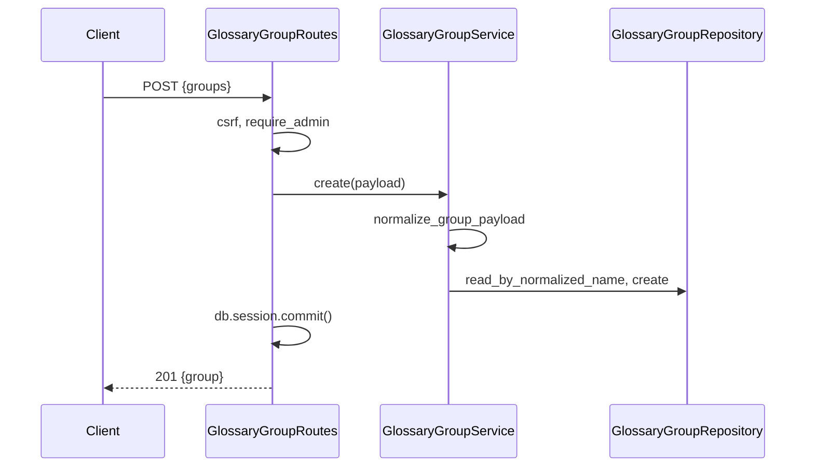
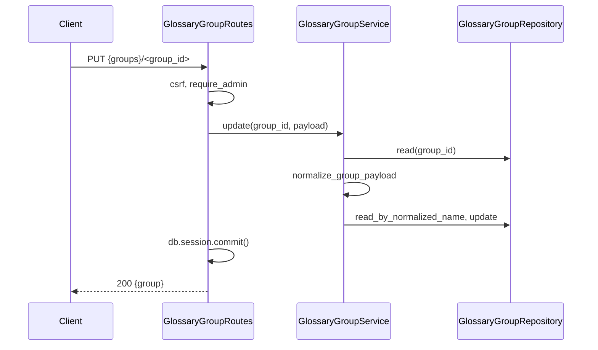
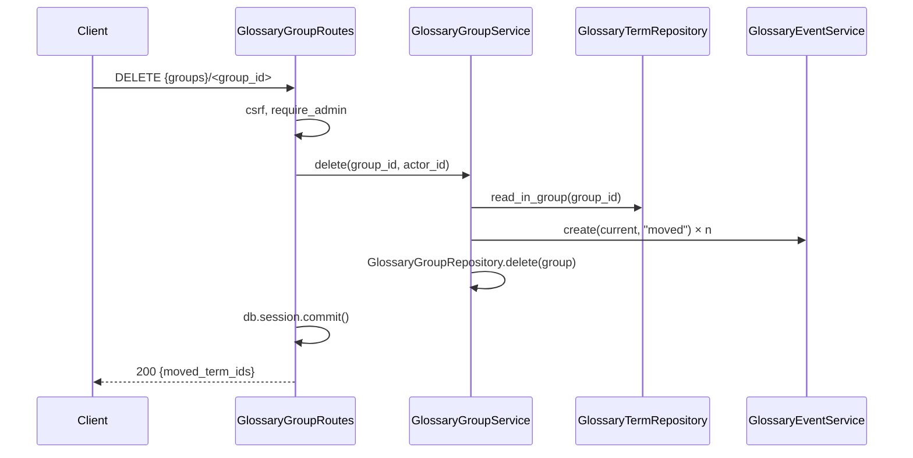
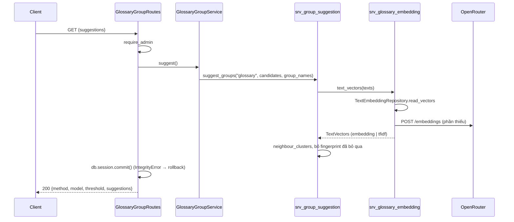
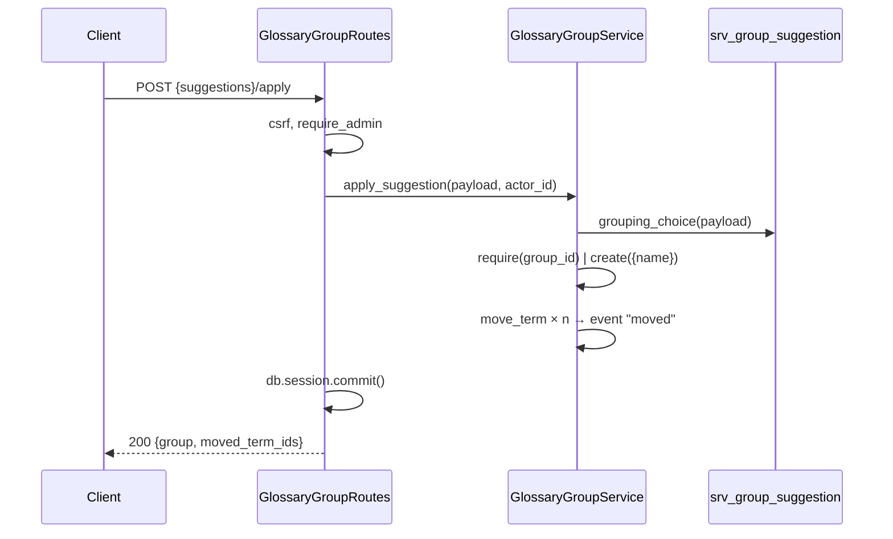
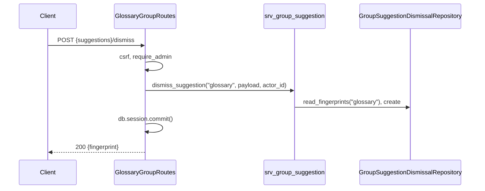

# `route_glossary_group.py`: nhóm thuật ngữ và gợi ý gom nhóm

Route mixin `GlossaryGroupRoutes` (`modules/glossary_management/routes/route_glossary_group.py`). Đường dẫn có tiền tố
`{API}/glossary/groups` (viết tắt `{groups}`) hoặc `{API}/glossary/group-suggestions` (viết tắt `{suggestions}`), xem
[README.md](README.md#đường-dẫn).

| Method | Đường dẫn | Hàm | Ai gọi được | Commit |
| --- | --- | --- | --- | --- |
| POST | `{groups}` | `create_glossary_group` | Admin | Có |
| PUT | `{groups}/<int:group_id>` | `update_glossary_group` | Admin | Có |
| DELETE | `{groups}/<int:group_id>` | `delete_glossary_group` | Admin | Có |
| GET | `{suggestions}` | `read_glossary_group_suggestions` | Admin | Có (lệnh commit cũ; service không ghi vector mới) |
| POST | `{suggestions}/apply` | `apply_glossary_group_suggestion` | Admin | Có |
| POST | `{suggestions}/dismiss` | `dismiss_glossary_group_suggestion` | Admin | Có |

Danh sách nhóm không có route riêng: nó nằm trong `groups` của GET `{API}/glossary`
([route-glossary-term.md](route-glossary-term.md#get-glossary)). Nhóm thuộc gốc thuật ngữ, không thuộc revision, nên mọi
thao tác ở đây không tạo revision, không đổi trạng thái duyệt; mỗi lần một thuật ngữ đổi nhóm là một sự kiện `moved`.

## Body của một nhóm

`normalize_group_payload(payload)` (`srv_glossary_validation.py`):

| Trường | Kiểu | Quy tắc |
| --- | --- | --- |
| `name` | string, bắt buộc | Gộp khoảng trắng, không rỗng, ≤ 255 ký tự; duy nhất theo `normalized_name` |
| `description` | string \| null | `strip`, rỗng thành `null`, tối đa 10.000 ký tự |

Body không phải object hoặc có khóa khác hai khóa trên là 400 "Nhóm thuật ngữ chỉ có tên và mô tả.".

## POST `{groups}`

Tạo nhóm thuật ngữ.

**Quyền**: `@permission_name("write")`, `@csrf_protected`, `require_admin()`.

**Input**: header `X-CSRFToken`; body `{"name": "…", "description": "…"}`.

**Luồng**:

1. `@csrf_protected` → `@rollback_on_error` → `@handle_errors` → `require_admin()` → `ensure_dictionary_tables()`.
2. `GlossaryGroupService().create(payload)`:
   1. `normalize_group_payload(payload)`.
   2. `GlossaryGroupRepository.read_by_normalized_name`; đã có là 409.
   3. `GlossaryGroupRepository.create(values)` flush; `IntegrityError` đổi thành 409.
3. `db.session.commit()`.
4. `serialize_glossary_group(group)`.

**Bảng**: insert `text_to_bi_glossary_term_group`.

**Response 201**: `{"group": {"id": 1, "name": "Mưa", "description": null}}`.

**Lỗi**:

| Status | Message | Nguồn |
| --- | --- | --- |
| 403 | "CSRF token không hợp lệ." / "Admin access required." | `csrf_protected`, `require_admin` |
| 400 | "Nhóm thuật ngữ chỉ có tên và mô tả." | body không phải object hoặc có khóa lạ |
| 400 | "Nhập tên nhóm thuật ngữ." / "Tên nhóm thuật ngữ quá dài." | `normalize_group_payload` |
| 400 | "Mô tả nhóm thuật ngữ không hợp lệ." / "Mô tả nhóm thuật ngữ quá dài." | `normalize_group_payload` |
| 409 | "Đã có nhóm thuật ngữ cùng tên." | tên chuẩn hóa đã có |
| 500 | "Could not save the change." | `rollback_on_error` |



## PUT `{groups}/<int:group_id>`

Đổi tên hoặc mô tả nhóm. Là PUT thay toàn bộ: `description` bỏ trống thành `null`. Thuật ngữ trong nhóm giữ nguyên.

**Quyền**: `@permission_name("write")`, `@csrf_protected`, `require_admin()`.

**Input**: path `group_id`; header `X-CSRFToken`; body như POST.

**Luồng**:

1. `@csrf_protected` → `@rollback_on_error` → `@handle_errors` → `require_admin()` → `ensure_dictionary_tables()`.
2. `GlossaryGroupService().update(group_id, payload)`:
   1. `require(group_id)` → `GlossaryGroupRepository.read`; không có là 404.
   2. `normalize_group_payload(payload)`.
   3. `read_by_normalized_name`; thuộc nhóm khác là 409.
   4. `GlossaryGroupRepository.update(group, values)` flush; `IntegrityError` đổi thành 409.
3. `db.session.commit()`.

**Bảng**: update `text_to_bi_glossary_term_group`.

**Response 200**: `{"group": {...}}` như POST.

**Lỗi**: như POST, thêm 404 "Không tìm thấy nhóm thuật ngữ." (`GlossaryTermGroupNotFoundError`). Vì `require` chạy trước
khi kiểm tra body, nhóm không có cho 404 dù body sai.



## DELETE `{groups}/<int:group_id>`

Xóa nhóm; thuật ngữ trong nhóm thành chưa phân nhóm và giữ trạng thái duyệt.

**Quyền**: `@permission_name("write")`, `@csrf_protected`, `require_admin()`.

**Input**: path `group_id`; header `X-CSRFToken`. Không body.

**Luồng**:

1. `@csrf_protected` → `@rollback_on_error` → `@handle_errors` → `require_admin()` → `ensure_dictionary_tables()`.
2. `GlossaryGroupService().delete(group_id, current_user.id)`:
   1. `require(group_id)`; không có là 404.
   2. `GlossaryTermRepository.read_in_group(group.id)` (theo `id`).
   3. Mỗi thuật ngữ `place_term(term, None, actor_id)`: đặt `group_id = null` và, khi có bản hiện tại, ghi sự kiện
      `moved` với lý do "`<tên nhóm>` → Chưa phân nhóm".
   4. `GlossaryGroupRepository.delete(group)` (không flush).
3. `db.session.commit()`.

**Bảng**: update `text_to_bi_glossary_term.group_id`; insert `text_to_bi_glossary_term_audit_event`; delete
`text_to_bi_glossary_term_group`. Thuật ngữ nhóm đó vẫn bị gán `null` nhờ FK `ON DELETE SET NULL` nếu còn sót.

**Response 200**: `{"moved_term_ids": [4, 7]}`.

**Lỗi**: 403 CSRF / admin; 404 "Không tìm thấy nhóm thuật ngữ."; 500 "Could not save the change.".



## GET `{suggestions}`

Gợi ý gom các thuật ngữ chưa phân nhóm có nghĩa gần nhau, vào nhóm có sẵn hoặc một nhóm mới. Service embedding dùng
chung với expert rule chỉ đọc cache; vector thiếu được tính trong bộ nhớ, không thêm dòng cache. Route này vẫn gọi
`ensure_dictionary_tables()` và còn lệnh commit cũ, khác GET gợi ý expert rule đã bỏ commit.

**Quyền**: `@permission_name("read")`, `require_admin()`. Không có CSRF.

**Input**: không có.

**Luồng**:

1. `@handle_errors` → `require_admin()` → `ensure_dictionary_tables()`.
2. `GlossaryGroupService().suggest()`:
   1. Mỗi thuật ngữ có bản hiện tại thành một `GroupingCandidate(id, canonical_name, text, group_id)`; `text` là
      `term_text(...)`: "`<tên>`. Đồng nghĩa: `<a>; <b>`. `<định nghĩa>`". Liên kết không đưa vào.
   2. `group_names` từ `GlossaryGroupRepository.read_all()`.
   3. `suggest_groups("glossary", candidates, group_names)` (`srv_group_suggestion.py`):
      1. `text_vectors(texts)` (`srv_glossary_embedding.py`): có `OPENROUTER_API_KEY` và
         `OPENROUTER_EMBEDDING_MODEL` thì `_embedded_vectors`: đọc cache `TextEmbeddingRepository.read_vectors(model,
         hashes)` theo SHA-256 của văn bản, phần thiếu gọi `POST {OPENROUTER_BASE_URL}/embeddings` theo lô 64, timeout
         20 giây, làm tròn 6 chữ số và giữ kết quả trong bộ nhớ. Lỗi mạng hoặc phản hồi sai
         hình dạng (`EMBEDDING_FAILURES`) ghi log cảnh báo và chuyển sang TF-IDF (`tfidf_vectors`) cho mọi văn bản.
      2. Ngưỡng `THRESHOLDS`: `embedding` 0,70; `tfidf` 0,25.
      3. `similarity_matrix` (cosine) và `neighbour_clusters(group_ids, similarity, threshold)`: gom average-linkage,
         mỗi nhóm có sẵn là một cụm cố định, hai nhóm có sẵn không bao giờ gộp; chỉ trả cụm có thuật ngữ chưa phân
         nhóm và (thuộc nhóm có sẵn hoặc có từ hai thuật ngữ chưa phân nhóm).
      4. `_suggestion` dựng mỗi gợi ý; gợi ý có `fingerprint` nằm trong
         `GroupSuggestionDismissalRepository.read_fingerprints("glossary")` bị bỏ.
      5. Sắp theo độ tương đồng giảm dần rồi theo `proposed_name`.
3. Route còn `db.session.commit()` và nhánh bắt `IntegrityError` để rollback rồi trả kết quả, nhưng service embedding
   không thêm vector mới vào session; nhánh này không còn phục vụ việc lưu cache mới.

**Bảng**: đọc `text_to_bi_glossary_term`, `text_to_bi_glossary_term_revision`, `text_to_bi_glossary_term_group`,
`text_to_bi_text_embedding`, `text_to_bi_group_suggestion_dismissal`. Service gợi ý không insert embedding.

**Response 200**:

```json
{
  "method": "embedding",
  "model": "openai/text-embedding-3-small",
  "threshold": 0.7,
  "suggestions": [
    {
      "fingerprint": "<64 ký tự hex>",
      "group": null,
      "proposed_name": "Mưa to",
      "similarity": 0.771,
      "members": [
        {"id": 4, "name": "Mưa to", "similarity": 0.78, "closest": {"id": 5, "name": "Mưa lớn", "similarity": 0.79}}
      ],
      "group_members": []
    }
  ]
}
```

- `method` là `embedding` hoặc `tfidf`; `model` là `null` với `tfidf`.
- `group` là `{"id", "name"}` khi gợi ý đưa vào nhóm có sẵn (khi đó `proposed_name` là tên nhóm và `group_members` là
  các thuật ngữ đã ở nhóm đó), `null` khi gợi ý nhóm mới (tên đề xuất là thành viên gần các thành viên khác nhất).
- `similarity` của thành viên là trung bình độ tương đồng với các mục khác trong cụm; của gợi ý là trung bình của các
  thành viên; làm tròn 3 chữ số.
- `fingerprint` = `suggestion_fingerprint(group_id, member_ids)`: SHA-256 của `{"group_id", "member_ids" đã sắp}`.

**Lỗi**: 403 "Admin access required."; 500 do `@safe` khi lỗi ngoài dự kiến (route không có `rollback_on_error`).



## POST `{suggestions}/apply`

Chuyển các thuật ngữ quản trị viên giữ lại vào nhóm có sẵn hoặc một nhóm mới. Không cần duyệt.

**Quyền**: `@permission_name("write")`, `@csrf_protected`, `require_admin()`.

**Input**: header `X-CSRFToken`; body JSON, kiểm tra bằng `grouping_choice(payload, GlossaryValidationError)`:

| Trường | Kiểu | Quy tắc |
| --- | --- | --- |
| `member_ids` | array of int, bắt buộc | 1–500 phần tử, int không phải `bool`; trùng thì bỏ bớt, giữ thứ tự |
| `group_id` | int \| null | Nhóm có sẵn; có thì `group_name` bị bỏ qua |
| `group_name` | string | Bắt buộc khi `group_id` là `null`: tên nhóm mới |

Route không đối chiếu `member_ids` với gợi ý đã trả; mọi ID thuật ngữ có thật đều được chuyển, kể cả thuật ngữ đang ở
nhóm khác.

**Luồng**:

1. `@csrf_protected` → `@rollback_on_error` → `@handle_errors` → `require_admin()` → `ensure_dictionary_tables()`.
2. `GlossaryGroupService().apply_suggestion(payload, current_user.id)`:
   1. `grouping_choice(...)`.
   2. Có `group_id` thì `require(group_id)`; không thì `create({"name": group_name})` (kiểm tra như POST `{groups}`).
   3. Mỗi ID: `move_term(term_id, group.id, actor_id)` → `read_for_update`, `place_term`, sự kiện `moved`.
3. `db.session.commit()`: tạo nhóm và mọi lần chuyển nằm trong một transaction; một thuật ngữ không có là không lưu gì.

**Bảng**: insert `text_to_bi_glossary_term_group` (nhóm mới); update `text_to_bi_glossary_term.group_id`; insert
`text_to_bi_glossary_term_audit_event`.

**Response 200**: `{"group": {"id", "name", "description"}, "moved_term_ids": [4, 5]}`. `moved_term_ids` gồm mọi ID đã
gửi, kể cả thuật ngữ đã ở sẵn nhóm đó (khi đó `place_term` không làm gì).

**Lỗi**:

| Status | Message | Nguồn |
| --- | --- | --- |
| 403 | CSRF, "Admin access required." | decorator, `require_admin` |
| 400 | "Gợi ý gom nhóm không hợp lệ." | body không phải object |
| 400 | "Chọn ít nhất một mục để gom nhóm." | `member_ids` sai |
| 400 | "Nhóm không hợp lệ." / "Nhập tên nhóm mới." | `group_id`, `group_name` sai |
| 400 | Lỗi tên nhóm của `normalize_group_payload` | nhóm mới |
| 404 | "Không tìm thấy nhóm thuật ngữ." | `require(group_id)` |
| 409 | "Đã có nhóm thuật ngữ cùng tên." | nhóm mới trùng tên |
| 404 | "Glossary term not found." | một `member_id` không có |
| 500 | "Could not save the change." | `rollback_on_error` |



## POST `{suggestions}/dismiss`

Bỏ qua một gợi ý để nó không hiện lại. Gợi ý thêm hoặc bớt thành viên, hay đổi nhóm đích, có fingerprint khác và hiện
lại.

**Quyền**: `@permission_name("write")`, `@csrf_protected`, `require_admin()`.

**Input**: header `X-CSRFToken`; body `{"fingerprint": "<64 ký tự hex thường>"}`. Route không kiểm tra fingerprint có
khớp gợi ý nào đang có.

**Luồng**:

1. `@csrf_protected` → `@rollback_on_error` → `@handle_errors` → `require_admin()` → `ensure_dictionary_tables()`.
2. `GlossaryGroupService.dismiss_suggestion(payload, current_user.id)` (staticmethod) →
   `dismiss_suggestion("glossary", payload, actor_id, GlossaryValidationError)`:
   1. `fingerprint` phải khớp `[0-9a-f]{64}`.
   2. Chưa có trong `GroupSuggestionDismissalRepository.read_fingerprints("glossary")` thì
      `create({kind, fingerprint, dismissed_by, dismissed_at}, flush=False)`; có rồi thì không làm gì. Repository dùng
      savepoint và flush ngay; khi trùng `(kind, fingerprint)`, rollback savepoint rồi trả dòng đã có. Lỗi integrity
      khác không tìm thấy dòng trùng được ném lại.
3. `db.session.commit()`.

**Bảng**: đọc và insert `text_to_bi_group_suggestion_dismissal`.

**Response 200**: `{"fingerprint": "<64 ký tự hex>"}`.

**Lỗi**:

| Status | Message | Nguồn |
| --- | --- | --- |
| 403 | CSRF, "Admin access required." | decorator, `require_admin` |
| 400 | "Gợi ý gom nhóm không hợp lệ." | fingerprint thiếu hoặc sai dạng |
| 500 | "Could not save the change." | `rollback_on_error` khi lỗi ngoài dự kiến; trùng dismissal đã được xử lý bằng savepoint |


