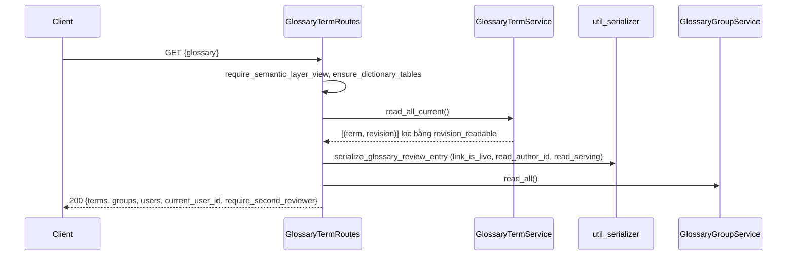
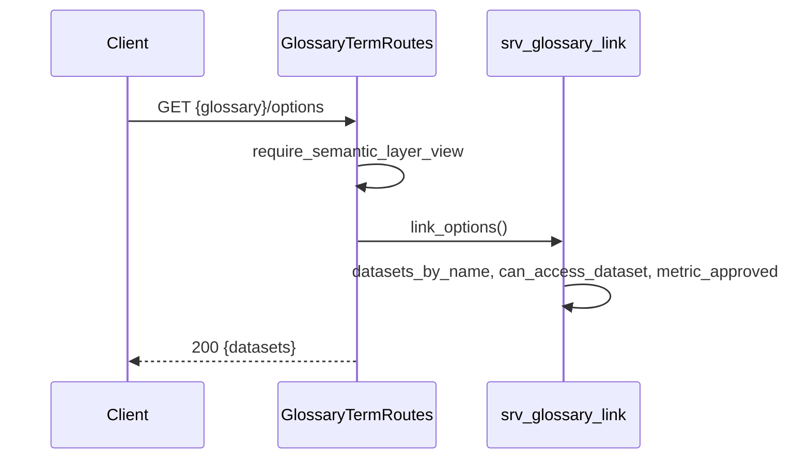
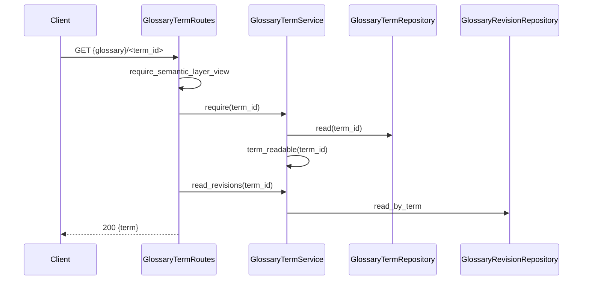
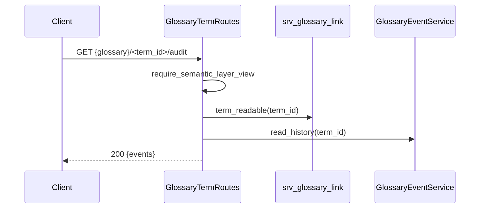
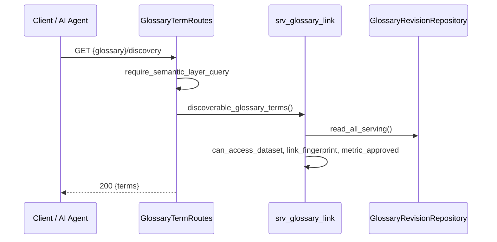
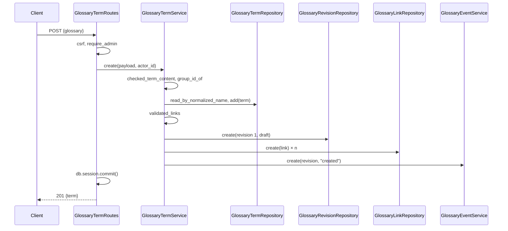
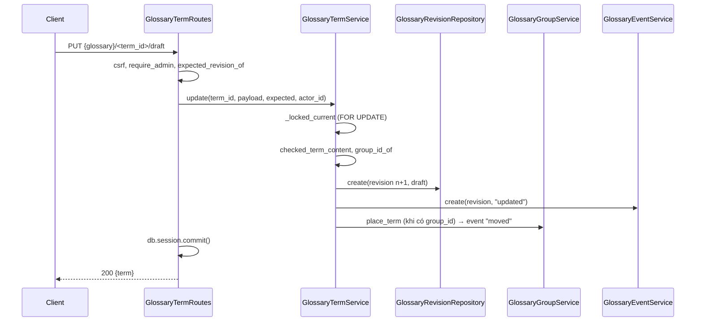
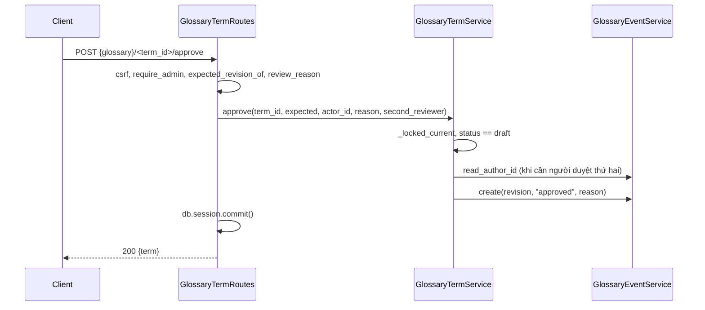
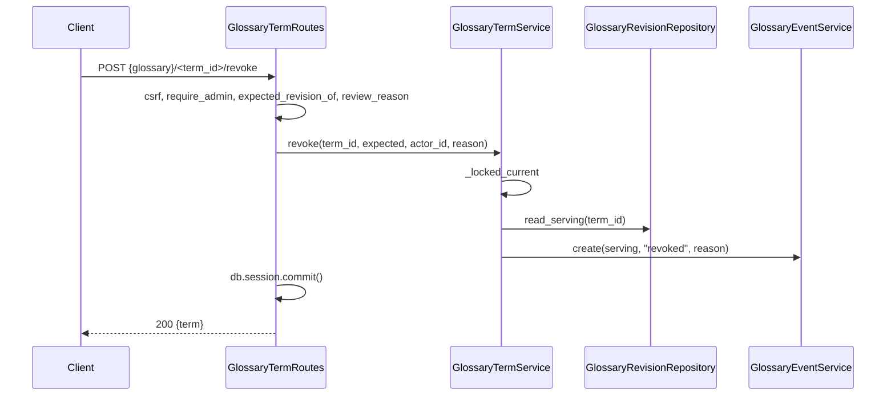
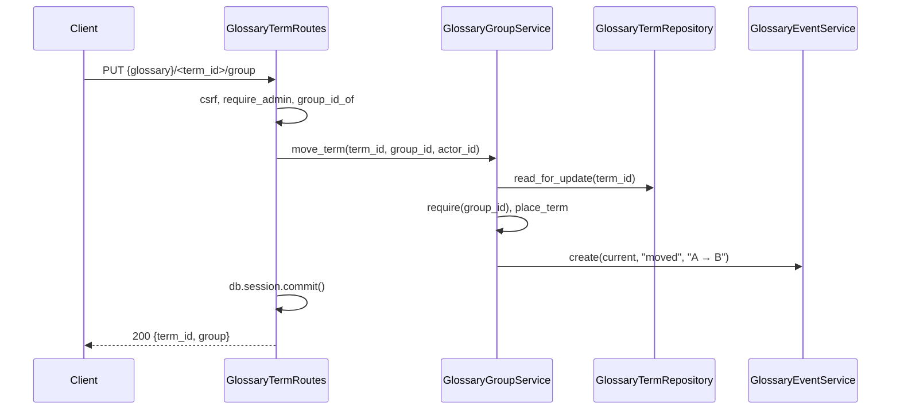

# `route_glossary_term.py`: thuật ngữ và vòng đời duyệt

Route mixin `GlossaryTermRoutes` (`modules/glossary_management/routes/route_glossary_term.py`). Mọi đường dẫn có tiền
tố `{API}/glossary` (xem [README.md](README.md#đường-dẫn)); dưới đây viết tắt là `{glossary}`.

| Method | Đường dẫn | Hàm | Ai gọi được | Commit |
| --- | --- | --- | --- | --- |
| GET | `{glossary}` | `read_glossary_terms` | Admin, "Semantic Layer Viewer" | Không |
| GET | `{glossary}/options` | `read_glossary_options` | Admin, "Semantic Layer Viewer" | Không |
| GET | `{glossary}/<int:term_id>` | `read_glossary_term` | Admin, "Semantic Layer Viewer" | Không |
| GET | `{glossary}/<int:term_id>/audit` | `read_glossary_events` | Admin, "Semantic Layer Viewer" | Không |
| GET | `{glossary}/discovery` | `read_glossary_discovery` | Admin, "Semantic Layer Query" | Không |
| POST | `{glossary}` | `create_glossary_term` | Admin | Có |
| PUT | `{glossary}/<int:term_id>/draft` | `update_glossary_term` | Admin | Có |
| POST | `{glossary}/<int:term_id>/approve` | `approve_glossary_term` | Admin | Có |
| POST | `{glossary}/<int:term_id>/revoke` | `revoke_glossary_term` | Admin | Có |
| PUT | `{glossary}/<int:term_id>/group` | `update_glossary_term_group` | Admin | Có |

Vòng đời term / revision / bản đang dùng và cách kiểm tra liên kết nằm ở
[README.md](README.md#thuật-ngữ-revision-và-bản-đang-dùng).

## Nội dung một thuật ngữ trong body

Ba route tạo, sửa và import đều kiểm tra nội dung bằng `checked_term_content(payload)`: `normalize_glossary_payload`
rồi `get_user(steward_id)` (không có là 400 "Unknown steward_id."). `normalize_glossary_payload`
(`srv_glossary_validation.py`) nhận đúng các khóa sau, khóa khác là 400 "Unsupported glossary fields.":

| Trường | Kiểu | Quy tắc |
| --- | --- | --- |
| `canonical_name` | string, bắt buộc | Gộp khoảng trắng, không rỗng, tối đa 255 ký tự |
| `definition` | string, bắt buộc | Gộp khoảng trắng, không rỗng, tối đa 10.000 ký tự |
| `synonyms` | array of string | Tối đa 50; mỗi từ không rỗng, ≤ 255 ký tự; trùng nhau thì bỏ bớt |
| `links` | array, ≥ 1 | Mỗi mục là object chỉ có `kind`, `dataset_id`, `column_name`, `metric_id` |
| `steward_id` | int \| null | ID người dùng Superset có thật |
| `group_id` | int \| null | Đọc riêng bằng `group_id_of`; int không phải `bool` |
| `expected_revision` | int | Chỉ route sửa dùng; được phép có mặt ở mọi route |

Từ đồng nghĩa trùng tên chuẩn hóa của thuật ngữ là 400. Mỗi liên kết cần `kind` ∈ `dataset`, `column`, `metric` và
`dataset_id` là int không phải `bool`.

Liên kết qua `validated_links(..., get_dataset, metric_approved)` trong `_create_revision` (xem README). `content_hash`
là SHA-256 của `canonical_name`, `definition`, `synonyms`, `links` như client gửi.

## GET `{glossary}`

Danh sách bản hiện tại của mọi thuật ngữ người gọi được đọc, cùng nhóm, người dùng để chọn người phụ trách và cấu hình
duyệt. Đây là dữ liệu của trang "Business Glossary".

**Quyền**: `@permission_name("read")`, `require_semantic_layer_view()`. Thuật ngữ có bản hiện tại liên kết tới dataset
người gọi không đọc được bị bỏ khỏi danh sách (không lỗi).

**Input**: không có.

**Luồng**:

1. `@handle_errors` → `require_semantic_layer_view()` → `ensure_dictionary_tables()`.
2. `user_names()` của module `superset`: hàm tra tên người dùng có cache trong request.
3. `GlossaryTermService().read_all_current()`: `GlossaryTermRepository.read_all()` (theo `canonical_name`), mỗi thuật
   ngữ `GlossaryRevisionRepository.read_current(term.id)`; giữ cặp (term, revision) khi có bản hiện tại và
   `revision_readable(revision.id)` đúng.
4. Mỗi cặp qua `serialize_glossary_review_entry(term, revision, user_name)`:
   1. `read_links(revision.id)` và `serialize_glossary_term(term, [revision])`.
   2. `stale = not all(link_is_live(link))`: so fingerprint, metric còn duyệt (`metric_approved`).
   3. `GlossaryEventService().read_author_id(revision)`: `read_latest_authoring` lấy sự kiện `created` / `updated` mới
      nhất của revision; người thực hiện là tác giả.
   4. `GlossaryTermService().read_serving(term.id)` cho `serving_revision_number`.
   5. Mỗi liên kết thêm `dataset_name` (`get_dataset`) và `target_name`: `null` với `dataset`; với cột / metric là
      `verbose_name`, không có thì `column_name` (cột) hoặc `metric_name` (metric).
5. `GlossaryGroupService().read_all()` → `serialize_glossary_group` từng nhóm (theo tên).
6. `serialize_users(active_users())`, `current_user.id`, `second_reviewer_required()`.

**Bảng**: đọc `text_to_bi_glossary_term`, `text_to_bi_glossary_term_revision`, `text_to_bi_glossary_term_link`,
`text_to_bi_glossary_term_audit_event`, `text_to_bi_glossary_term_group`, `text_to_bi_metric_contract`,
`text_to_bi_metric_definition`, `tables`, `table_columns`, `sql_metrics`, `dbs`, `ab_user`. Không ghi.

**Response 200**:

```json
{
  "terms": [
    {
      "id": 4, "canonical_name": "Mưa to", "steward_id": 2, "group": {"id": 1, "name": "Mưa"},
      "current_revision": {
        "id": 9, "term_id": 4, "revision_number": 2, "canonical_name": "Mưa to", "definition": "…",
        "synonyms": ["mưa lớn"], "status": "draft", "is_current": true, "created_at": "…",
        "approved_at": null, "revoked_at": null,
        "links": [{"kind": "column", "dataset_id": 3, "column_name": "luong_mua", "metric_id": null,
                   "dataset_name": "fact_tong_hop_thoi_tiet", "target_name": "Lượng mưa"}]
      },
      "revisions": ["<cùng object với current_revision>"],
      "state": "draft", "serving_revision_number": 1, "steward_name": "…", "author_id": 1, "author_name": "…",
      "approver_name": null, "revoker_name": null
    }
  ],
  "groups": [{"id": 1, "name": "Mưa", "description": null}],
  "users": [{"id": 1, "name": "…"}],
  "current_user_id": 1,
  "require_second_reviewer": false
}
```

`state` là `"outdated"` khi revision `approved` có liên kết không còn sống, còn lại là `status` của revision (`draft`,
`approved`, `revoked`). `serving_revision_number` là số của bản AI Agent đang dùng (có thể khác bản hiện tại khi một
bản nháp đang chờ), `null` khi không có.

**Lỗi**:

| Status | Message | Nguồn |
| --- | --- | --- |
| 403 | `SemanticLayerViewRequiredError` | `require_semantic_layer_view` |
| 500 | Lỗi migration | `ensure_dictionary_tables` → `@safe` |



## GET `{glossary}/options`

Những gì một thuật ngữ được liên kết tới: dataset, cột vật lý đang dùng và metric đã duyệt. Dùng cho trình soạn.

**Quyền**: `@permission_name("read")`, `require_semantic_layer_view()`. Dataset người gọi không đọc được bị bỏ.

**Input**: không có.

**Luồng**:

1. `@handle_errors` → `require_semantic_layer_view()`. Route không gọi `ensure_dictionary_tables()`.
2. `link_options()`: `datasets_by_name()` của module `superset`; bỏ dataset `is_internal_dataset` (database có cờ nội
   bộ trong `extra`) và dataset không qua `can_access_dataset`. Mỗi dataset giữ:
   - `columns`: cột `is_active is True` và không có `expression`;
   - `metrics`: metric có `metric_approved(dataset, metric)` đúng.
3. Sắp theo tên dataset (`casefold`).

**Bảng**: đọc `tables`, `table_columns`, `sql_metrics`, `dbs`, `text_to_bi_metric_contract`,
`text_to_bi_metric_definition`. Không ghi.

**Response 200**:

```json
{
  "datasets": [
    {
      "id": 3, "name": "fact_tong_hop_thoi_tiet",
      "columns": [{"column_name": "luong_mua", "name": "Lượng mưa"}],
      "metrics": [{"id": 12, "name": "Tổng lượng mưa"}]
    }
  ]
}
```

**Lỗi**: 403 `SemanticLayerViewRequiredError`.



## GET `{glossary}/<int:term_id>`

Một thuật ngữ với mọi revision của nó.

**Quyền**: `@permission_name("read")`, `require_semantic_layer_view()`, rồi `term_readable(term_id)` trong
`GlossaryTermService.require`.

**Input**: path `term_id`.

**Luồng**:

1. `@handle_errors` → `require_semantic_layer_view()` → `ensure_dictionary_tables()`.
2. `GlossaryTermService().require(term_id)`: `GlossaryTermRepository.read`; không có là 404; `term_readable(term_id)`
   sai (bản hiện tại liên kết tới dataset bị ẩn) là 403 `DatasetAccessError`.
3. `read_revisions(term_id)` → `GlossaryRevisionRepository.read_by_term` (theo `revision_number`).
4. `serialize_glossary_term(term, revisions)`: mỗi revision qua `serialize_glossary_revision(revision,
   read_links(revision.id))`; `current_revision` là revision có `is_current`.

**Bảng**: đọc `text_to_bi_glossary_term`, `text_to_bi_glossary_term_revision`, `text_to_bi_glossary_term_link`,
`text_to_bi_glossary_term_group`, `tables`. Không ghi.

**Response 200**:

```json
{
  "term": {
    "id": 4, "canonical_name": "Mưa to", "steward_id": 2, "group": {"id": 1, "name": "Mưa"},
    "current_revision": {"id": 9, "revision_number": 2, "status": "draft", "is_current": true, "links": [], "…": "…"},
    "revisions": [{"id": 5, "revision_number": 1, "status": "approved", "is_current": false, "…": "…"}, "…"]
  }
}
```

Liên kết ở đây không có `dataset_name`, `target_name` như ở danh sách.

**Lỗi**:

| Status | Message | Nguồn |
| --- | --- | --- |
| 403 | `SemanticLayerViewRequiredError` | `require_semantic_layer_view` |
| 404 | "Glossary term not found." | `GlossaryTermNotFoundError` |
| 403 | "Dataset and database access required." | `term_readable` sai |



## GET `{glossary}/<int:term_id>/audit`

Lịch sử tạo, sửa, duyệt, thu hồi và chuyển nhóm của thuật ngữ.

**Quyền**: `@permission_name("read")`, `require_semantic_layer_view()`, `term_readable(term_id)`.

**Input**: path `term_id`.

**Luồng**:

1. `@handle_errors` → `require_semantic_layer_view()` → `ensure_dictionary_tables()`.
2. `term_readable(term_id)` sai thì route ném `DatasetAccessError` (403). Route không kiểm tra thuật ngữ có tồn tại:
   `term_readable` trả đúng khi không có bản hiện tại, nên `term_id` không có cho 200 với danh sách rỗng.
3. `GlossaryEventService().read_history(term_id)` → `GlossaryEventRepository.read_history` (theo `id`).
4. `serialize_glossary_events(events, user_names())`.

**Bảng**: đọc `text_to_bi_glossary_term_revision`, `text_to_bi_glossary_term_link`, `tables`,
`text_to_bi_glossary_term_audit_event`, `ab_user`. Không ghi.

**Response 200**:

```json
{
  "events": [
    {"id": 31, "action": "approved", "revision_number": 1, "actor_id": 1, "actor_name": "…", "reason": null,
     "created_at": "2026-11-10T08:00:00+00:00"},
    {"id": 35, "action": "moved", "revision_number": 2, "actor_id": 1, "actor_name": "…",
     "reason": "Chưa phân nhóm → Mưa", "created_at": "…"}
  ]
}
```

**Lỗi**: 403 `SemanticLayerViewRequiredError`; 403 "Dataset and database access required.".



## GET `{glossary}/discovery`

Thuật ngữ cho người tiêu thụ (AI Agent, semantic catalog): chỉ bản đang dùng, chỉ liên kết còn sống tới dataset người
gọi đọc được.

**Quyền**: `@permission_name("read")`, `require_semantic_layer_query()`. Lọc theo quyền dataset của Superset từng liên
kết.

**Input**: không có.

**Luồng**:

1. `@handle_errors` → `require_semantic_layer_query()` → `ensure_dictionary_tables()`.
2. `discoverable_glossary_terms()`:
   1. `GlossaryRevisionRepository.read_all_serving()`: mọi revision `approved` / `revoked`, giữ bản số lớn nhất của
      mỗi thuật ngữ, rồi chỉ giữ bản `approved`.
   2. Mỗi liên kết của bản đó bị bỏ khi: dataset không còn hoặc không qua `can_access_dataset`; cột / metric không còn;
      `link_fingerprint` hiện tại khác fingerprint đã lưu; metric không còn `metric_approved`.
   3. Thuật ngữ không còn liên kết nào bị bỏ.

**Bảng**: đọc `text_to_bi_glossary_term_revision`, `text_to_bi_glossary_term`, `text_to_bi_glossary_term_group`,
`text_to_bi_glossary_term_link`, `tables`, `table_columns`, `sql_metrics`, `dbs`, `text_to_bi_metric_contract`,
`text_to_bi_metric_definition`. Không ghi.

**Response 200**:

```json
{
  "schema_version": 1,
  "result": {
    "terms": [
      {
        "term_id": 4,
        "canonical_name": "Mưa to",
        "group": {
          "id": 1,
          "name": "Mưa"
        },
        "definition": "…",
        "synonyms": [
          "mưa lớn"
        ],
        "links": [
          {
            "kind": "column",
            "dataset_id": 3,
            "column_name": "luong_mua",
            "metric_id": null
          }
        ]
      }
    ]
  }
}
```

**Lỗi**: 403 `SemanticLayerQueryRequiredError`.



## POST `{glossary}`

Tạo thuật ngữ mới với revision 1 ở trạng thái `draft`.

**Quyền**: `@permission_name("write")`, `@csrf_protected`, `require_admin()`.

**Input**: header `X-CSRFToken`; body JSON theo [bảng nội dung](#nội-dung-một-thuật-ngữ-trong-body), thêm `group_id`
tùy chọn.

**Luồng**:

1. `@csrf_protected` → `@rollback_on_error` → `@handle_errors` → `require_admin()` → `ensure_dictionary_tables()`.
2. `GlossaryTermService().create(payload, current_user.id)`:
   1. `checked_term_content(payload)`.
   2. `GlossaryTermRepository.read_by_normalized_name`; đã có là 409.
   3. `group_id_of(payload)`; có thì `GlossaryGroupService.require(group_id)` (404 nếu không có).
   4. `GlossaryTermRepository.add(GlossaryTerm(...))` flush; `IntegrityError` (hai request cùng tên) đổi thành 409.
   5. `_create_revision(term.id, 1, values)`: `validated_links(values["links"], get_dataset, metric_approved)`;
      `GlossaryRevisionRepository.create({..., "status": "draft", "is_current": True})` flush (`IntegrityError` là
      409 "The glossary term changed; refresh and retry."); mỗi liên kết
      `GlossaryLinkRepository.create(..., flush=False)`.
   6. `GlossaryEventService.create(revision, "created", actor_id)`: thêm sự kiện, không flush. Đặt nhóm lúc tạo không
      ghi sự kiện `moved`.
3. `db.session.commit()`.
4. `serialize_glossary_term(revision.term, [revision])`.

**Bảng**: insert `text_to_bi_glossary_term`, `text_to_bi_glossary_term_revision`, `text_to_bi_glossary_term_link`,
`text_to_bi_glossary_term_audit_event`; đọc `text_to_bi_glossary_term_group`, `ab_user`, `tables`, `table_columns`,
`sql_metrics`, `dbs`, `text_to_bi_metric_contract`, `text_to_bi_metric_definition`.

**Response 201**: `{"term": {...}}` như GET một thuật ngữ, `revisions` chỉ có revision 1.

**Lỗi**:

| Status | Message | Nguồn |
| --- | --- | --- |
| 403 | "CSRF token không hợp lệ." | `csrf_protected` |
| 403 | "Admin access required." | `require_admin` |
| 400 | "Unsupported glossary fields." | body không phải object hoặc có khóa lạ |
| 400 | "canonical_name must be a non-empty string." / "… is too long." | `_required_text` |
| 400 | "synonyms must be a bounded array." | `normalize_glossary_payload` |
| 400 | "A synonym cannot duplicate the canonical name." | `normalize_glossary_payload` |
| 400 | "At least one glossary link is required." / "Invalid glossary link." | hình dạng liên kết, `validated_links` |
| 400 | "Duplicate glossary link." / "A glossary term may link only approved metrics." | `validated_links` |
| 400 | "steward_id must be a user id." / "Unknown steward_id." | `normalize_glossary_payload`, `checked_term_content` |
| 400 | "Nhóm thuật ngữ không hợp lệ." | `group_id_of` |
| 404 | "Không tìm thấy nhóm thuật ngữ." | `GlossaryGroupService.require` |
| 409 | "A glossary term with this canonical name already exists." | tên chuẩn hóa đã có |
| 500 | "Could not save the change." | lỗi ngoài dự kiến, `rollback_on_error` |



## PUT `{glossary}/<int:term_id>/draft`

Lưu chỉnh sửa thành revision kế tiếp ở trạng thái `draft`. Bản đã duyệt trước đó vẫn là bản đang dùng tới khi bản
nháp được duyệt. Là PUT thay toàn bộ nội dung: `synonyms` bỏ trống thành `[]`, `steward_id` bỏ trống thành `null`.

**Quyền**: `@permission_name("write")`, `@csrf_protected`, `require_admin()`.

**Input**: path `term_id`; header `X-CSRFToken`; body JSON theo [bảng nội dung](#nội-dung-một-thuật-ngữ-trong-body),
bắt buộc `expected_revision` (int); `group_id` tùy chọn: có khóa thì chuyển nhóm ngay (null là bỏ khỏi nhóm), không có
khóa thì giữ nhóm.

**Luồng**:

1. `@csrf_protected` → `@rollback_on_error` → `@handle_errors` → `require_admin()` → `ensure_dictionary_tables()`.
2. `expected_revision_of(payload)`: thiếu hoặc không phải int là 400.
3. `GlossaryTermService().update(term_id, payload, expected_revision, current_user.id)`:
   1. `_locked_current(term_id, expected_revision)`: `GlossaryTermRepository.read_for_update` (404 nếu không có),
      `GlossaryRevisionRepository.read_current_for_update` (404 nếu không có), số revision khác `expected_revision`
      là 409.
   2. `checked_term_content(payload)`; `normalized_name` khác tên của thuật ngữ là 400.
   3. `group_id_of(payload)` và `GlossaryGroupService.require` khi có `group_id`.
   4. Gán `term.steward_id`, đặt `current.is_current = False`.
   5. `_create_revision(term_id, current.revision_number + 1, values)` như khi tạo (flush cả thay đổi trên).
   6. `GlossaryEventService.create(revision, "updated", actor_id)`.
   7. Body có khóa `group_id` thì `GlossaryGroupService.place_term(term, group, actor_id)`: nhóm khác nhóm cũ thì gán
      `term.group`, `term.group_id` và ghi sự kiện `moved` lên bản hiện tại (bản nháp vừa tạo) với lý do
      "`<nhóm cũ>` → `<nhóm mới>`" ("Chưa phân nhóm" khi không có nhóm).
4. `db.session.commit()`.
5. `serialize_glossary_term(revision.term, [revision])`.

**Bảng**: update `text_to_bi_glossary_term` (`steward_id`, có thể `group_id`), update bản cũ và insert bản mới
`text_to_bi_glossary_term_revision`, insert `text_to_bi_glossary_term_link`, `text_to_bi_glossary_term_audit_event`;
đọc như khi tạo.

**Response 200**: `{"term": {...}}` với `revisions` chỉ có bản nháp mới.

**Lỗi**: các lỗi kiểm tra nội dung, nhóm, CSRF, admin và 500 như POST `{glossary}` (không có 409 tên trùng), và thêm:

| Status | Message | Nguồn |
| --- | --- | --- |
| 400 | "expected_revision is required." | `expected_revision_of` |
| 404 | "Glossary term not found." | `_locked_current` |
| 409 | "The glossary term changed; refresh and retry." | `expected_revision` lệch, hoặc trùng số revision |
| 400 | "The canonical name cannot be changed after creation." | tên chuẩn hóa đổi |



## POST `{glossary}/<int:term_id>/approve`

Duyệt bản nháp hiện tại; nó thành bản AI Agent dùng.

**Quyền**: `@permission_name("write")`, `@csrf_protected`, `require_admin()`; khi `second_reviewer_required()` đúng,
tác giả của bản nháp không được tự duyệt.

**Input**: path `term_id`; header `X-CSRFToken`; body JSON:

| Trường | Kiểu | Quy tắc |
| --- | --- | --- |
| `expected_revision` | int, bắt buộc | Số revision hiện tại client đã đọc |
| `reason` | string \| null | Tối đa 512 ký tự (đo trước khi `strip`); rỗng sau `strip` là không có |

**Luồng**:

1. `@csrf_protected` → `@rollback_on_error` → `@handle_errors` → `require_admin()` → `ensure_dictionary_tables()`.
2. `expected_revision_of(payload)`, `review_reason(payload)`, `second_reviewer_required()`.
3. `GlossaryTermService().approve(...)`:
   1. `_locked_current(term_id, expected_revision)`.
   2. Bản hiện tại không ở `draft` là 400.
   3. Cần người duyệt thứ hai và `GlossaryEventService.read_author_id(revision) == actor_id` là 403.
   4. Gán `status = "approved"`, `approver_id`, `approved_at = now (UTC)`.
   5. `GlossaryEventService.create(revision, "approved", actor_id, reason)`.
   Service không kiểm tra lại liên kết: bản nháp có liên kết đã cũ vẫn duyệt được, rồi hiện `outdated` ở danh sách.
4. `db.session.commit()`.

**Bảng**: update `text_to_bi_glossary_term_revision`; insert `text_to_bi_glossary_term_audit_event`; đọc
`text_to_bi_glossary_term`, `text_to_bi_glossary_term_audit_event`.

**Response 200**: `{"term": {...}}` với `revisions` chỉ có bản vừa duyệt.

**Lỗi**:

| Status | Message | Nguồn |
| --- | --- | --- |
| 403 | CSRF, "Admin access required." | decorator, `require_admin` |
| 400 | "expected_revision is required." / "Invalid review reason." | `expected_revision_of`, `review_reason` |
| 404 | "Glossary term not found." | `_locked_current` |
| 409 | "The glossary term changed; refresh and retry." | `expected_revision` lệch |
| 400 | "Only the current draft can be approved." | bản hiện tại không phải `draft` |
| 403 | "Người soạn thuật ngữ không thể tự duyệt; cần một quản trị viên khác duyệt." | `GlossarySelfApprovalError` |
| 500 | "Could not save the change." | `rollback_on_error` |



## POST `{glossary}/<int:term_id>/revoke`

Thu hồi bản AI Agent đang dùng, kể cả khi đang có bản nháp chờ duyệt. Bản nháp giữ nguyên.

**Quyền**: `@permission_name("write")`, `@csrf_protected`, `require_admin()`.

**Input**: path `term_id`; header `X-CSRFToken`; body JSON `expected_revision` (int, bắt buộc, so với bản hiện tại chứ
không phải bản đang dùng) và `reason` (bắt buộc ở đây, tối đa 512 ký tự).

**Luồng**:

1. `@csrf_protected` → `@rollback_on_error` → `@handle_errors` → `require_admin()` → `ensure_dictionary_tables()`.
2. `expected_revision_of(payload)`, `review_reason(payload)`.
3. `GlossaryTermService().revoke(term_id, expected_revision, current_user.id, reason)`:
   1. `_locked_current(term_id, expected_revision)`.
   2. `GlossaryRevisionRepository.read_serving(term_id)`; không có bản đang dùng là 400.
   3. `reason` là `None` là 400.
   4. Trên bản đang dùng: `status = "revoked"`, `revoker_id`, `revoked_at`;
      `GlossaryEventService.create(serving, "revoked", actor_id, reason)`.
   5. Trả bản **hiện tại** (có thể là bản nháp), không phải bản vừa thu hồi.
4. `db.session.commit()`.

**Bảng**: update `text_to_bi_glossary_term_revision`; insert `text_to_bi_glossary_term_audit_event`.

**Response 200**: `{"term": {...}}` với `revisions` chỉ có bản hiện tại.

**Lỗi**:

| Status | Message | Nguồn |
| --- | --- | --- |
| 403 | CSRF, "Admin access required." | decorator, `require_admin` |
| 400 | "expected_revision is required." / "Invalid review reason." | `expected_revision_of`, `review_reason` |
| 404 | "Glossary term not found." | `_locked_current` |
| 409 | "The glossary term changed; refresh and retry." | `expected_revision` lệch |
| 400 | "Only the current approved revision can be revoked." | không có bản đang dùng |
| 400 | "A bounded revocation reason is required." | thiếu `reason` |
| 500 | "Could not save the change." | `rollback_on_error` |



## PUT `{glossary}/<int:term_id>/group`

Chuyển thuật ngữ vào một nhóm, hoặc bỏ khỏi mọi nhóm. Không tạo revision, không cần duyệt, bản đang dùng giữ nguyên.

**Quyền**: `@permission_name("write")`, `@csrf_protected`, `require_admin()`.

**Input**: path `term_id`; header `X-CSRFToken`; body JSON `{"group_id": <int> | null}`. Body không phải object hoặc
thiếu khóa được hiểu là `null`.

**Luồng**:

1. `@csrf_protected` → `@rollback_on_error` → `@handle_errors` → `require_admin()` → `ensure_dictionary_tables()`.
2. `group_id_of(payload)`.
3. `GlossaryGroupService().move_term(term_id, group_id, current_user.id)`:
   1. `GlossaryTermRepository.read_for_update(term_id)`; không có là 404.
   2. `require(group_id)` khi `group_id` khác `null`.
   3. `place_term(term, group, actor_id)`: cùng nhóm thì không làm gì; khác thì gán nhóm và, khi có bản hiện tại, ghi sự
      kiện `moved` lên bản đó với lý do "`<nhóm cũ>` → `<nhóm mới>`".
4. `db.session.commit()`.
5. `serialize_group_reference(term.group)`.

**Bảng**: update `text_to_bi_glossary_term.group_id`; insert `text_to_bi_glossary_term_audit_event`; đọc
`text_to_bi_glossary_term_group`, `text_to_bi_glossary_term_revision`.

**Response 200**: `{"term_id": 4, "group": {"id": 1, "name": "Mưa"}}`; `group` là `null` khi bỏ khỏi nhóm.

**Lỗi**:

| Status | Message | Nguồn |
| --- | --- | --- |
| 403 | CSRF, "Admin access required." | decorator, `require_admin` |
| 400 | "Nhóm thuật ngữ không hợp lệ." | `group_id_of` |
| 404 | "Glossary term not found." | `move_term` |
| 404 | "Không tìm thấy nhóm thuật ngữ." | `GlossaryGroupService.require` |
| 500 | "Could not save the change." | `rollback_on_error` |


