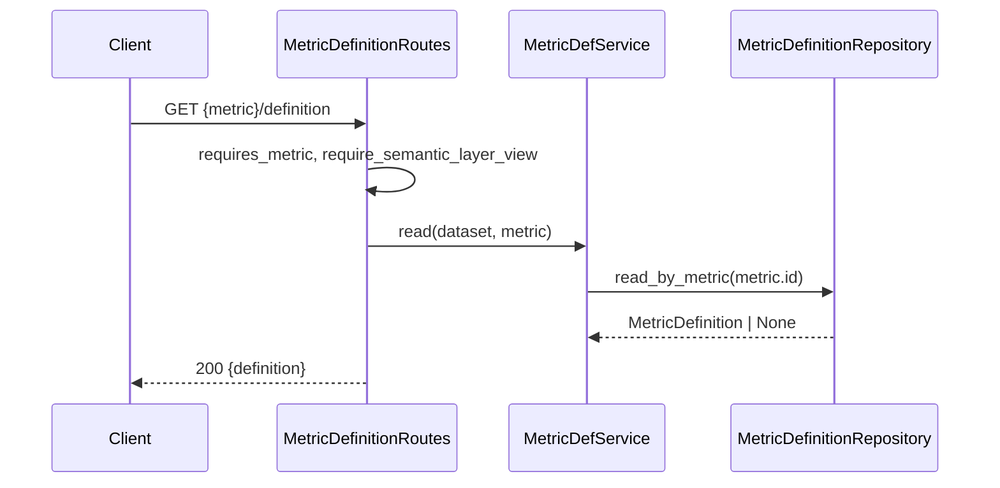
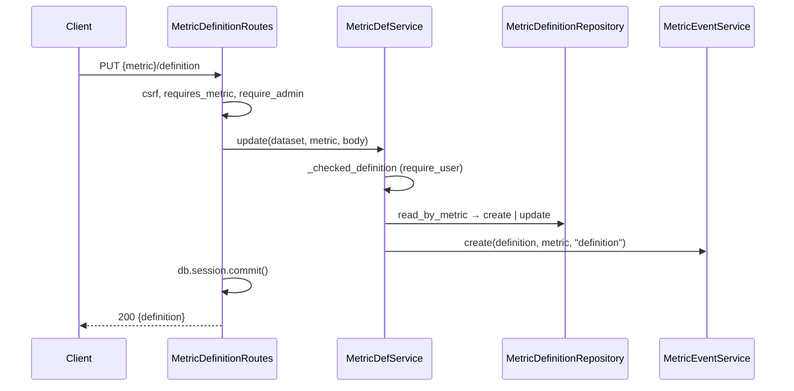
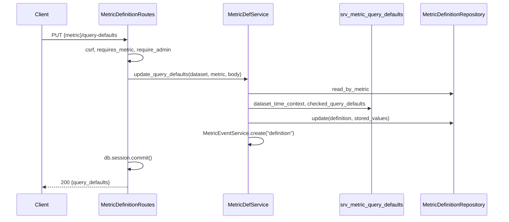
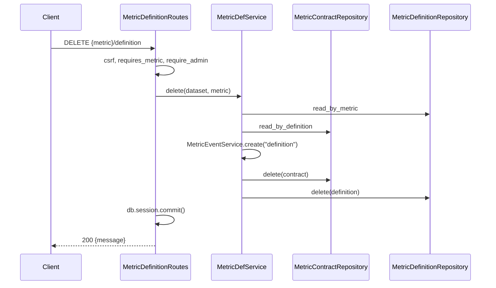

# `route_crud_metric_def.py`: định nghĩa nghiệp vụ và giá trị mặc định

Route mixin `MetricDefinitionRoutes` (`modules/metric_management/routes/route_crud_metric_def.py`). Mọi đường dẫn có
tiền tố `{API}/dataset/<int:dataset_id>/metrics/<int:metric_id>` (xem [README.md](README.md#đường-dẫn)); dưới đây viết
tắt là `{metric}`.

| Method | Đường dẫn | Hàm | Ai gọi được | Commit |
| --- | --- | --- | --- | --- |
| GET | `{metric}/definition` | `read_metric_definition` | Admin, "Semantic Layer Viewer" | Không |
| PUT | `{metric}/definition` | `update_metric_definition` | Admin | Có |
| PUT | `{metric}/query-defaults` | `update_metric_query_defaults` | Admin | Có |
| DELETE | `{metric}/definition` | `delete_metric_definition` | Admin | Có |

Một metric chỉ có một định nghĩa (`text_to_bi_metric_definition`, unique trên `metric_id`). Định nghĩa là gốc: phải có
nó trước khi đặt giá trị mặc định hay đề xuất metric ([route-metric-contract.md](route-metric-contract.md)).

`MetricDefService.read(dataset, metric)` dùng ở mọi route: `MetricDefinitionRepository.read_by_metric(metric.id)`, rồi
trả `None` nếu định nghĩa thuộc dataset khác `dataset.id`.

## GET `{metric}/definition`

Đọc định nghĩa nghiệp vụ và giá trị mặc định của metric.

**Quyền**: `@permission_name("read")`, rồi `require_semantic_layer_view()` (Admin hoặc permission `can_view` trên
"Text to BI Semantic Layer"). Route không gọi `require_dataset_access`, nên quyền dataset của Superset không được kiểm
tra ở đây.

**Input**: path `dataset_id`, `metric_id`. Không có query hay body.

**Luồng**:

1. `@handle_errors` → `@requires_metric` nạp `dataset` và `metric`.
2. `require_semantic_layer_view()`.
3. `ensure_dictionary_tables()`.
4. `MetricDefService().read(dataset, metric)` → `MetricDefinitionRepository.read_by_metric`.
5. `serialize_metric_definition(definition)`: `None` nếu chưa có; nếu có thì `json.loads(default_filters)` (lỗi JSON
   thành `[]`) và tra tên người phụ trách bằng `user_names()` của module `superset`.

**Bảng**: đọc `tables`, `sql_metrics`, `text_to_bi_metric_definition`, `ab_user`. Không ghi.

**Response 200**:

```json
{
  "definition": {
    "business_definition": "…", "unit": "mm", "steward_id": 3, "steward_name": "…",
    "grain": "day", "row_kind_value": "DU_BAO_NGAY", "time_column": "ngay", "time_window": "last_7_day",
    "time_anchor": "now", "default_filters": [{"column": "…", "operator": "==", "value": "…"}]
  }
}
```

`definition` là `null` khi metric chưa có định nghĩa (vẫn 200, không 404).

**Lỗi**:

| Status | Message | Nguồn |
| --- | --- | --- |
| 404 | "Dataset not found." / "Không tìm thấy metric này trong dataset." | `requires_metric` |
| 403 | `SemanticLayerViewRequiredError` | `require_semantic_layer_view` |
| 500 | Lỗi migration | `ensure_dictionary_tables` → `@safe` |



## PUT `{metric}/definition`

Tạo hoặc thay định nghĩa nghiệp vụ, đơn vị và người phụ trách. Là PUT thay toàn bộ ba trường: trường bỏ trống trong
body thành `null`. Không đụng giá trị mặc định.

**Quyền**: `@permission_name("write")`, `@csrf_protected`, `require_admin()`.

**Input**: path `dataset_id`, `metric_id`; header `X-CSRFToken`; body JSON:

| Trường | Kiểu | Quy tắc |
| --- | --- | --- |
| `business_definition` | string, bắt buộc | Không rỗng sau `strip`, tối đa `METRIC_DEFINITION_MAX_LENGTH` (4000) |
| `unit` | string \| null | Tối đa `settings.METRIC_UNIT_MAX_LENGTH` (64); chuỗi rỗng lưu thành `null` |
| `steward_id` | int \| null | ID người dùng Superset có thật (`require_user`); `bool` bị từ chối |

**Luồng**:

1. `@csrf_protected` → `@rollback_on_error` → `@handle_errors` → `@requires_metric`.
2. `require_admin()`, `ensure_dictionary_tables()`.
3. `MetricDefService().update(dataset, metric, request.get_json(silent=True))`:
   1. `_checked_definition(body)` kiểm tra như bảng trên; `require_user(steward_id)` đọc `ab_user`, lỗi
      `SupersetUserNotFoundError` đổi thành `MetricContractValidationError`.
   2. `read(dataset, metric)`; chưa có thì `MetricDefinitionRepository.create({... , dataset_id, metric_id})` (flush),
      có rồi thì `MetricDefinitionRepository.update(definition, values)` (flush).
   3. `MetricEventService.create(definition, metric, "definition")`: thêm một `MetricContractEvent` không flush, không
      lý do, `expression`/`expression_hash` là `null`, `definition_snapshot` gồm định nghĩa và sáu trường mặc định,
      `actor_id = current_user.id`.
4. `db.session.commit()`.
5. `serialize_metric_definition(definition)`.

**Bảng**: ghi `text_to_bi_metric_definition` (insert hoặc update), insert `text_to_bi_metric_contract_event`; đọc
`ab_user`. Sửa định nghĩa không đổi `metric_contract_hash`, nên bản duyệt giữ hiệu lực.

**Response 200**: `{"definition": {...}}` như GET.

**Lỗi**:

| Status | Message | Nguồn |
| --- | --- | --- |
| 403 | "CSRF token không hợp lệ." | `csrf_protected` |
| 404 | Dataset / metric không có | `requires_metric` |
| 403 | "Admin access required." | `require_admin` |
| 400 | "Nội dung gửi lên phải là một đối tượng JSON." | body không phải object |
| 400 | "Định nghĩa nghiệp vụ không được để trống." | `_checked_definition` |
| 400 | "Định nghĩa nghiệp vụ tối đa 4000 ký tự." | `_checked_definition` |
| 400 | "Đơn vị phải là văn bản tối đa 64 ký tự." | `_checked_definition` |
| 400 | "Người phụ trách không tồn tại." | `steward_id` sai kiểu hoặc không có |
| 500 | "Could not save the change." | lỗi ngoài dự kiến, `rollback_on_error` |



## PUT `{metric}/query-defaults`

Đặt grain, loại dòng, cột thời gian, khoảng thời gian, mốc tính và bộ lọc mặc định của metric. Giá trị đã chuẩn hóa
được trả về. Các trường này nằm trong `metric_contract_hash`, nên đổi chúng làm bản duyệt hiện có thành `outdated`.

**Quyền**: `@permission_name("write")`, `@csrf_protected`, `require_admin()`.

**Input**: path `dataset_id`, `metric_id`; header `X-CSRFToken`; body JSON chỉ được có các khóa trong
`QUERY_DEFAULT_FIELDS`:

| Trường | Kiểu | Quy tắc chính (`checked_query_defaults`) |
| --- | --- | --- |
| `grain` | string \| null | `hour`, `day`, `week`, `month`, `quarter`, `year`; không mịn hơn grain của dòng |
| `row_kind_value` | string \| null | Dataset có `row_kind_column`; giá trị có grain trong `text_to_bi_dataset_grain` |
| `time_column` | string \| null | Một cột trong `temporal_columns` của dataset |
| `time_window` | string \| null | `last_<n>_<đơn vị>`, `current_<đơn vị>`, `previous_<đơn vị>`, `<đơn vị>_to_date` |
| `time_anchor` | string \| null | `now` hoặc `latest_data` |
| `default_filters` | array | Tối đa 10 mục `{column, operator, value}` |

- Mọi trường chuỗi qua `_optional_text`: tối đa 255 ký tự, `strip`, rỗng thành `null`.
- `grain` thuộc `READ_GRAINS` (`GRAINS` của Data Dictionary bỏ `instant`); đơn vị của `time_window` cũng không được
  mịn hơn grain của dòng metric đọc (`native_grain`).
- `time_column` bỏ trống mà có `grain` hoặc `time_window` thì lấy `time_column` của dataset dictionary.
- `time_anchor` chỉ giữ khi có `time_window` (bỏ trống là `now`); không có `time_window` thì lưu `null`.

**Luồng**:

1. `@csrf_protected` → `@rollback_on_error` → `@handle_errors` → `@requires_metric`.
2. `require_admin()`, `ensure_dictionary_tables()`.
3. `MetricDefService().update_query_defaults(dataset, metric, body)`:
   1. `read(dataset, metric)`; chưa có định nghĩa là 400.
   2. `parse_contract_metric(metric.expression)` đọc công thức.
   3. `dataset_time_context(dataset)` → `dataset_time_contexts([dataset])`: đọc
      `DatasetDictionaryRepository.list_by_ids` (`time_column`, `row_kind_column`),
      `ColumnDictionaryRepository.list_for_datasets` (`temporal_kind`), `DatasetGrainRepository.list_for_datasets`
      (grain và nhãn từng loại dòng); `temporal_columns` là cột active, không tính toán, `filterable`, và `is_dttm`
      hoặc có `temporal_kind`.
   4. `formula_row_kinds(formula, row_kind_column)`: loại dòng mà điều kiện `CASE WHEN <row_kind_column> = '…'` của
      công thức đã chọn.
   5. `checked_query_defaults(body, columns, context, formula_row_kinds)`:
      - Công thức chỉ chọn một loại dòng có grain: nếu body khai báo gì đó mà bỏ trống `row_kind_value` thì lấy loại
        dòng đó; khai báo loại khác là 400.
      - Dataset trộn nhiều grain mà không chọn loại dòng thì không được đặt `grain` hay `time_window`.
      - Mỗi bộ lọc qua `checked_query_filter`: đủ ba khóa, `operator` ∈ `==, !=, <, <=, >, >=, IN, NOT IN`,
        `IN`/`NOT IN` cần mảng 1–100 giá trị, giá trị là số, bool hoặc chuỗi ≤ 1024 ký tự;
        `query_column(..., "filterable")` đòi cột có thật, active, `filterable`, không tính toán; `_check_value_type`
        đòi ngày `YYYY-MM-DD[ HH:MM:SS]` có thật cho cột ngày giờ và số cho cột số.
      - Bộ lọc không được nằm trên cột thời gian hay `row_kind_column`, mỗi cột một bộ lọc.
      - Trả `MetricQueryDefaults` kèm `row_kind_column` và `native_grain` (không lưu, lấy từ Data Dictionary).
   6. `MetricDefinitionRepository.update(definition, defaults.stored_values())` (flush); `default_filters` lưu thành
      chuỗi JSON, mảng rỗng lưu `null`.
   7. `MetricEventService.create(definition, metric, "definition", "Đổi grain, mốc thời gian hoặc bộ lọc mặc định.")`.
4. `db.session.commit()`.

**Bảng**: update `text_to_bi_metric_definition`, insert `text_to_bi_metric_contract_event`; đọc
`text_to_bi_dataset_dictionary`, `text_to_bi_column_dictionary`, `text_to_bi_dataset_grain`, `table_columns`.

**Response 200**:

```json
{
  "query_defaults": {
    "grain": "day", "row_kind_column": "loai_quan_sat", "row_kind_value": "DU_BAO_NGAY", "native_grain": "day",
    "time_column": "ngay", "time_window": "last_7_day", "time_anchor": "now",
    "default_filters": [{"column": "ma_tinh", "operator": "==", "value": "HN"}]
  }
}
```

`query_defaults` là `null` khi `MetricQueryDefaults.is_empty()` (không có grain, loại dòng, cột thời gian, khoảng thời
gian hay bộ lọc), tức là gửi body rỗng để xóa mọi giá trị mặc định.

**Lỗi** (mọi lỗi kiểm tra là `MetricContractValidationError`, 400):

| Status | Message (rút gọn) | Nguồn |
| --- | --- | --- |
| 403 / 404 | CSRF, admin, dataset / metric | decorator, `require_admin` |
| 400 | "Nhập định nghĩa nghiệp vụ trước khi đặt grain, mốc thời gian và bộ lọc mặc định." | chưa có định nghĩa |
| 400 | "Chỉ gửi grain, row_kind_value, time_column, time_window, time_anchor và default_filters." | body sai khóa |
| 400 | "<field> phải là văn bản tối đa 255 ký tự hoặc null." / "default_filters phải là một mảng." | kiểu |
| 400 | "Dataset chưa khai báo cột phân loại dòng…", "Loại dòng “…” chưa được khai báo grain…" | loại dòng |
| 400 | "Công thức chỉ tính các dòng “…”…", "Dataset có nhiều loại dòng với grain khác nhau…" | loại dòng |
| 400 | "Grain phải là một trong: …", "Grain “…” mịn hơn dữ liệu metric dùng…" | grain |
| 400 | "Khoảng thời gian phải có dạng…", "Khoảng thời gian tính theo “…” mịn hơn…" | khoảng thời gian |
| 400 | "Mốc tính phải là now (thời điểm hiện tại) hoặc latest_data (mốc dữ liệu mới nhất)." | mốc tính |
| 400 | "Cột thời gian “…” phải là cột ngày hoặc ngày giờ lọc được…", "Chọn cột thời gian cho grain…" | cột thời gian |
| 400 | "Metric có tối đa 10 bộ lọc mặc định.", "Mỗi bộ lọc cần đủ column, operator và value.", … | bộ lọc |
| 400 | "Lọc theo thời gian bằng khoảng thời gian…", "Chọn loại dòng ở mục loại dòng…", "Mỗi cột chỉ có một…" | bộ lọc |
| 500 | "Could not save the change." | `rollback_on_error` |



## DELETE `{metric}/definition`

Xóa định nghĩa nghiệp vụ, cùng bản duyệt chưa được duyệt của nó. Lịch sử duyệt còn lại.

**Quyền**: `@permission_name("write")`, `@csrf_protected`, `require_admin()`.

**Input**: path `dataset_id`, `metric_id`; header `X-CSRFToken`. Không body.

**Luồng**:

1. `@csrf_protected` → `@rollback_on_error` → `@handle_errors` → `@requires_metric`.
2. `require_admin()`, `ensure_dictionary_tables()`.
3. `MetricDefService().delete(dataset, metric)`:
   1. `require(dataset, metric)`: chưa có định nghĩa là `MetricDefinitionNotFoundError` (404).
   2. `MetricContractRepository.read_by_definition(definition.id)`; contract có `status == approved` (kể cả bản đã
      `outdated`) thì 400.
   3. `MetricEventService.create(definition, metric, "definition", "Xóa định nghĩa nghiệp vụ.")`, chưa flush.
   4. Có contract (`draft` hoặc `revoked`) thì `MetricContractRepository.delete(contract)`.
   5. `MetricDefinitionRepository.delete(definition)`.
4. `db.session.commit()`: event được insert trước, rồi contract và định nghĩa bị xóa; FK `ON DELETE SET NULL` đặt
   `definition_id` của các event về `null`, còn `metric_id`, `dataset_id` và ảnh chụp giữ nguyên.

**Bảng**: insert `text_to_bi_metric_contract_event`; delete `text_to_bi_metric_contract`,
`text_to_bi_metric_definition`.

**Response 200**: `{"message": "Đã xóa định nghĩa nghiệp vụ."}`.

**Lỗi**:

| Status | Message | Nguồn |
| --- | --- | --- |
| 403 / 404 | CSRF, admin, dataset / metric | decorator, `require_admin` |
| 404 | "Metric này chưa có định nghĩa nghiệp vụ." | `MetricDefinitionNotFoundError` |
| 400 | "Thu hồi metric trước khi xóa định nghĩa nghiệp vụ." | contract đang `approved` |
| 500 | "Could not save the change." | `rollback_on_error` |


