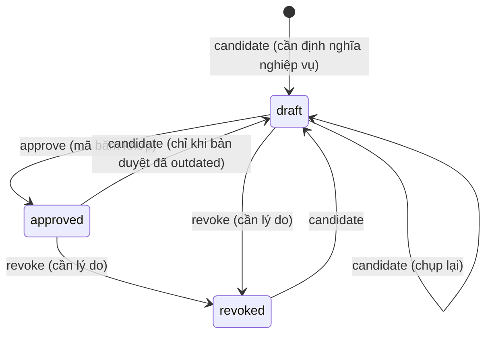
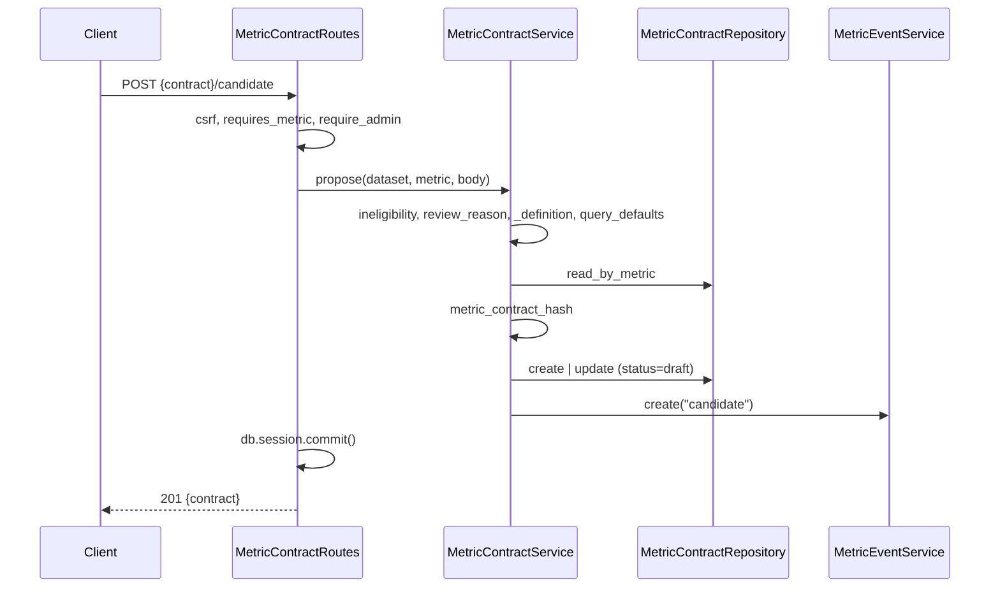
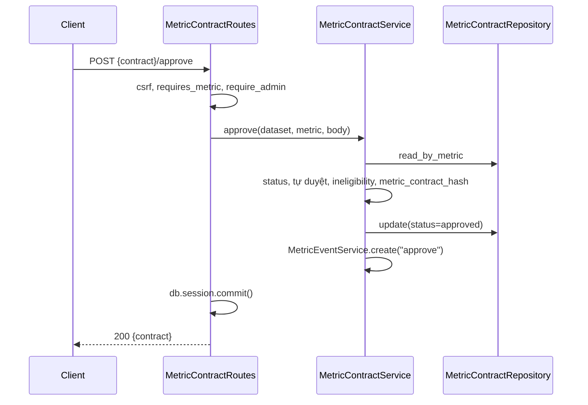
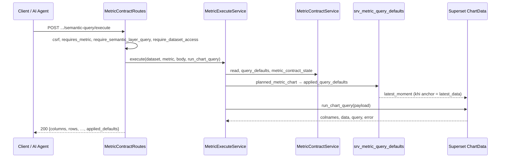

# `route_metric_contract.py`: danh sách, bản duyệt và chạy metric

Route mixin `MetricContractRoutes` (`modules/metric_management/routes/route_metric_contract.py`). Đường dẫn tương đối
với `{API}` (xem [README.md](README.md#đường-dẫn)); `{contract}` viết tắt cho
`/dataset/<int:dataset_id>/metrics/<int:metric_id>/contract`.

| Method | Đường dẫn | Hàm | Ai gọi được | Commit |
| --- | --- | --- | --- | --- |
| GET | `/metric-contracts?database_id=` | `read_metric_contracts` | Admin, "Semantic Layer Viewer" | Không |
| GET | `{contract}` | `read_metric_contract` | Admin, "Semantic Layer Viewer" | Không |
| GET | `{contract}/events` | `read_metric_contract_events` | Admin, "Semantic Layer Viewer" + quyền dataset | Không |
| POST | `{contract}/candidate` | `create_metric_contract` | Admin | Có |
| POST | `{contract}/approve` | `approve_metric_contract` | Admin | Có |
| POST | `{contract}/revoke` | `revoke_metric_contract` | Admin | Có |
| POST | `{execute}` | `execute_metric_contract` | Admin, "Semantic Layer Query" + quyền dataset | Không |

`{execute}` là `/dataset/<int:dataset_id>/metrics/<int:metric_id>/semantic-query/execute`.

Vòng đời một contract (`text_to_bi_metric_contract.status`, `ReviewStatus`):



## Helper `_serialized`

Ba route đọc / ghi một contract trả về qua `MetricContractRoutes._serialized(service, contract, dataset, metric)`:

1. `service.query_defaults(dataset, metric)` → `query_defaults_for(dataset.id, metric.id)` → `query_defaults_on`:
   đọc `MetricDefinitionRepository.read_on_datasets`, `DatasetDictionaryRepository.list_by_ids`,
   `DatasetGrainRepository.list_for_datasets`, dựng `MetricQueryDefaults` bằng `stored_query_defaults` (`None` nếu
   chưa đặt).
2. `metric_contract_state(contract, dataset, metric, defaults)` (xem
   [README.md](README.md#trạng-thái-hiển-thị-của-metric)); tính mã băm nạp lười `dataset.database`.
3. `serialize_metric_contract(contract, metric, state)`:
   - Chưa có contract: `{"metric_id", "metric_name", "state"}`.
   - Có contract: `id`, `dataset_id`, `metric_id`, `metric_name`, `status`, `state`, `current` (`state == "approved"`),
     `origin`, `owner_id`/`owner_name`, `approver_id`/`approver_name`, `approved_at`, `revoker_id`/`revoker_name`,
     `revoked_at` (ISO 8601 qua `iso_datetime`; tên tra bằng `user_names()`).

## GET `/metric-contracts?database_id=`

Danh sách mọi metric của một database cho màn quản trị Metric, kèm dataset, người dùng và cấu hình duyệt.

**Quyền**: `@permission_name("read")`, `require_semantic_layer_view()`; dataset người gọi không đọc được bị lọc bỏ bằng
`can_access_dataset` (không báo lỗi).

**Input**: query `database_id` (int, bắt buộc).

**Luồng**:

1. `@handle_errors` → `@requires_database`: `request.args.get("database_id", type=int)` → `require_database`.
2. `require_semantic_layer_view()`, `ensure_dictionary_tables()`.
3. `datasets_on_database(database.id)` (module `superset`, `DatasetDAO.filter_by`, sắp theo tên bảng), giữ dataset có
   `can_access_dataset(dataset)` (`security_manager.raise_for_access`).
4. `MetricContractService().read_entries(datasets)`:
   1. `MetricContractRepository.read_on_datasets(ids)` và `MetricDefinitionRepository.read_on_datasets(ids)`, gom theo
      `metric_id`.
   2. `query_defaults_on(ids)` lấy giá trị mặc định theo `(dataset_id, metric_id)`.
   3. Với mỗi `dataset.metrics`, bỏ metric tên `count` hoặc công thức `COUNT(*)` (metric mặc định của Superset).
   4. Dựng `MetricEntry` với `state = metric_contract_state(...)` và
      `ineligibility = metric_contract_ineligibility(dataset, metric)`.
5. `dataset_column_labels(datasets)`: tên hiển thị của cột, ưu tiên `display_name` trong
   `ColumnDictionaryRepository.list_for_datasets`, không có thì `verbose_name` của Superset.
6. `dataset_time_contexts(datasets)`: ngữ cảnh thời gian của từng dataset (xem `route-crud-metric-def.md`).
7. Serialize:
   - `serialize_query_dataset(dataset, labels, context)`: `id`, `name` (`schema.table`), `columns` (cột active, không
     tính toán, `groupby` hoặc `filterable`, kèm `type`, `is_dttm`), `time_column`, `row_kind_column`, `row_kinds`
     (`value`, `label`, `grain`), `temporal_columns`.
   - `serialize_metric_entry(entry)`: `dataset_id`, `metric_id`, `metric_name`, `verbose_name`, `description`,
     `expression`, `d3format`, `formula` (`ContractMetricFormula.as_dict()` hoặc `null`), `ineligibility`, `state`,
     `query_defaults`, `contract` (`serialize_metric_contract` hoặc `null`), `definition`
     (`serialize_metric_definition`).
   - `serialize_users(active_users())`: mọi người dùng Superset đang active, `{id, name}`.

**Bảng**: đọc `dbs`, `tables`, `sql_metrics`, `table_columns`, `ab_user`, `text_to_bi_metric_contract`,
`text_to_bi_metric_definition`, `text_to_bi_dataset_dictionary`, `text_to_bi_column_dictionary`,
`text_to_bi_dataset_grain`. Không ghi.

**Response 200**:

```json
{
  "datasets": [{"id": 12, "name": "public.fact_tong_hop_thoi_tiet", "columns": [], "time_column": "ngay",
                "row_kind_column": "loai_quan_sat", "row_kinds": [], "temporal_columns": []}],
  "metrics": [{"dataset_id": 12, "metric_id": 40, "metric_name": "luong_mua", "state": "draft", "contract": {},
               "definition": {}, "query_defaults": null, "formula": {}, "ineligibility": null}],
  "users": [{"id": 1, "name": "Admin"}],
  "current_user_id": 1,
  "require_second_reviewer": false
}
```

`require_second_reviewer` là `second_reviewer_required()` (`TEXT_TO_BI_REQUIRE_SECOND_REVIEWER` trong
`superset_config`).

**Lỗi**:

| Status | Message | Nguồn |
| --- | --- | --- |
| 400 | "database_id is required." | thiếu hoặc không phải số |
| 404 | "Database not found." | `require_database` |
| 403 | `SemanticLayerViewRequiredError` | `require_semantic_layer_view` |

## GET `{contract}`

Bản duyệt và trạng thái của một metric.

**Quyền**: `@permission_name("read")`, `require_semantic_layer_view()`. Không gọi `require_dataset_access`.

**Input**: path `dataset_id`, `metric_id`.

**Luồng**:

1. `@handle_errors` → `@requires_metric`.
2. `require_semantic_layer_view()`, `ensure_dictionary_tables()`.
3. `MetricContractService().read(dataset, metric)` → `MetricContractRepository.read_by_metric(metric.id)` (join
   `text_to_bi_metric_definition`), trả `None` nếu contract thuộc dataset khác.
4. `_serialized(...)`.

**Bảng**: đọc `text_to_bi_metric_contract`, `text_to_bi_metric_definition`, bảng Data Dictionary, `ab_user`.

**Response 200**: `{"contract": {...}}` theo `serialize_metric_contract`; chưa đề xuất vẫn 200 với
`{"metric_id", "metric_name", "state": "not_started" | "ineligible"}`.

**Lỗi**: 404 dataset / metric (`requires_metric`), 403 `SemanticLayerViewRequiredError`.

## GET `{contract}/events`

Lịch sử duyệt của metric, mới nhất trước. Còn trả về cả khi định nghĩa đã bị xóa.

**Quyền**: `@permission_name("read")`, `require_semantic_layer_view()`, rồi `require_dataset_access(dataset)`.

**Input**: path `dataset_id`, `metric_id`.

**Luồng**:

1. `@handle_errors` → `@requires_metric`.
2. `require_semantic_layer_view()`, `ensure_dictionary_tables()`, `require_dataset_access(dataset)`.
3. `MetricEventService().read_history(metric)` → `MetricContractEventRepository.read_history_by_metric(metric.id)`,
   sắp `created_at DESC, id DESC`. Lọc theo `metric_id` (không theo `definition_id`) nên event của định nghĩa đã xóa
   vẫn còn.
4. `serialize_metric_events(events)`.

**Bảng**: đọc `text_to_bi_metric_contract_event`, `ab_user`.

**Response 200**:

```json
{"events": [{"id": 9, "action": "approve", "actor_id": 1, "actor_name": "Admin", "reason": null,
             "expression": "SUM(luong_mua)", "created_at": "2026-11-10T08:00:00+00:00"}]}
```

`action` ∈ `candidate`, `approve`, `revoke`, `definition`. `definition_snapshot` và `expression_hash` được lưu nhưng
không trả về.

**Lỗi**: 404 dataset / metric, 403 `SemanticLayerViewRequiredError`, 403 "Dataset and database access required."
(`DatasetAccessError`).

## POST `{contract}/candidate`

Đề xuất metric: chụp công thức, vị trí dữ liệu và giá trị mặc định hiện tại thành bản nháp chờ duyệt.

**Quyền**: `@permission_name("write")`, `@csrf_protected`, `require_admin()`.

**Input**: path `dataset_id`, `metric_id`; header `X-CSRFToken`; body JSON tùy chọn `{"reason": "ghi chú"}`.
`review_reason(body)`: body không phải object hoặc không có `reason` là không có ghi chú; `reason` phải là chuỗi tối đa
`settings.METRIC_REVIEW_REASON_MAX_LENGTH` (2000) ký tự, chuỗi rỗng sau `strip` thành `null`.

**Luồng**:

1. `@csrf_protected` → `@rollback_on_error` → `@handle_errors` → `@requires_metric`.
2. `require_admin()`, `ensure_dictionary_tables()`.
3. `MetricContractService().propose(dataset, metric, body)`:
   1. `metric_contract_ineligibility(dataset, metric)`; có lý do là 400 với chính lý do đó.
   2. `review_reason(body)`.
   3. `_definition(dataset, metric)` → `MetricDefinitionRepository.read_by_metric`; chưa có là 400.
   4. `query_defaults(dataset, metric)`, `read(dataset, metric)`.
   5. Contract đang `approved` và `contract_is_approved_current` đúng là 409 `ApprovedMetricContractExistsError`.
   6. Tính `metric_contract_hash` trước khi thêm contract vào session (nạp `dataset.database` gây autoflush).
   7. Giá trị ghi: `metric_name`, `expression`, `expression_hash`, `status = draft`, `owner_id = current_user.id`,
      `origin = manual` (admin nhận lại bản nháp của AI Agent thì nó thành `manual`), xóa `approver_*`, `revoker_*`.
   8. Chưa có contract: `MetricContractRepository.create({..., definition_id})`; có rồi (draft, revoked hoặc approved
      đã outdated): `MetricContractRepository.update(contract, values)`.
   9. `MetricEventService.create(definition, metric, "candidate", note, contract)`.
4. `db.session.commit()`.
5. `_serialized(...)`.

**Bảng**: insert hoặc update `text_to_bi_metric_contract`, insert `text_to_bi_metric_contract_event`; đọc
`text_to_bi_metric_definition`, bảng Data Dictionary, `dbs`.

**Response 201**: `{"contract": {...}}`, `state` thường là `draft`.

**Lỗi**:

| Status | Message | Nguồn |
| --- | --- | --- |
| 403 / 404 | CSRF, admin, dataset / metric | decorator, `require_admin` |
| 400 | `METRIC_CONTRACT_RULE`, "Cột … là cột tính toán.", … | `metric_contract_ineligibility` |
| 400 | "Lý do phải là văn bản tối đa 2000 ký tự." | `review_reason` |
| 400 | "Nhập định nghĩa nghiệp vụ trước khi đề xuất metric." | chưa có định nghĩa |
| 409 | "Thu hồi bản đã duyệt trước khi tạo bản đề xuất mới." | `ApprovedMetricContractExistsError` |
| 500 | "Could not save the change." | `rollback_on_error` (ví dụ vi phạm unique) |



## POST `{contract}/approve`

Duyệt bản nháp khi metric chưa đổi kể từ lúc đề xuất.

**Quyền**: `@permission_name("write")`, `@csrf_protected`, `require_admin()`; khi `second_reviewer_required()`, người
đề xuất (`owner_id`) không tự duyệt được.

**Input**: path `dataset_id`, `metric_id`; header `X-CSRFToken`; body tùy chọn `{"reason": "ghi chú"}` (như candidate).

**Luồng**:

1. `@csrf_protected` → `@rollback_on_error` → `@handle_errors` → `@requires_metric`.
2. `require_admin()`, `ensure_dictionary_tables()`.
3. `MetricContractService().approve(dataset, metric, body)`:
   1. `require(dataset, metric)`: chưa có contract là 404.
   2. `status != draft` là 400.
   3. `owner_id == current_user.id` và `second_reviewer_required()` là 403.
   4. `metric_contract_ineligibility` có lý do là 400.
   5. `expression_hash` khác `metric_contract_hash(dataset, metric, query_defaults(...))` là 400.
   6. `review_reason(body)`.
   7. `MetricContractRepository.update(contract, {status: approved, approver_id, approved_at: now UTC})`.
   8. `MetricEventService.create(contract.definition, metric, "approve", note, contract)`.
4. `db.session.commit()`.
5. `_serialized(...)`.

**Bảng**: update `text_to_bi_metric_contract`, insert `text_to_bi_metric_contract_event`.

**Response 200**: `{"contract": {...}}` với `state = "approved"`, `current = true`.

**Lỗi**:

| Status | Message | Nguồn |
| --- | --- | --- |
| 403 / 404 | CSRF, admin, dataset / metric | decorator, `require_admin` |
| 404 | "Metric này chưa được đề xuất trong dataset." | `MetricContractNotFoundError` |
| 400 | "Chỉ duyệt được metric đang chờ duyệt." | status không phải `draft` |
| 403 | "Người đề xuất không thể tự duyệt; cần một quản trị viên khác duyệt." | `MetricSelfApprovalError` |
| 400 | Lý do không đủ điều kiện | `metric_contract_ineligibility` |
| 400 | "Metric đã đổi sau lần đề xuất; tạo bản đề xuất mới trước khi duyệt." | mã băm khác |
| 400 | "Lý do phải là văn bản tối đa 2000 ký tự." | `review_reason` |



## POST `{contract}/revoke`

Thu hồi metric để nó không trả lời người dùng nữa. Thu hồi được cả bản `draft` lẫn `approved`.

**Quyền**: `@permission_name("write")`, `@csrf_protected`, `require_admin()`.

**Input**: path `dataset_id`, `metric_id`; header `X-CSRFToken`; body `{"reason": "lý do"}`, bắt buộc.

**Luồng**:

1. `@csrf_protected` → `@rollback_on_error` → `@handle_errors` → `@requires_metric`.
2. `require_admin()`, `ensure_dictionary_tables()`.
3. `MetricContractService().revoke(dataset, metric, body)`:
   1. `require(dataset, metric)`: chưa có contract là 404.
   2. `status == revoked` là 400.
   3. `review_reason(body)`; `None` (thiếu, rỗng, body không phải object) là 400.
   4. `MetricContractRepository.update(contract, {status: revoked, revoker_id, revoked_at: now UTC})`.
   5. `MetricEventService.create(contract.definition, metric, "revoke", reason, contract)`.
4. `db.session.commit()`.
5. `_serialized(...)`.

**Bảng**: update `text_to_bi_metric_contract`, insert `text_to_bi_metric_contract_event`.

**Response 200**: `{"contract": {...}}` với `status = state = "revoked"`.

**Lỗi**:

| Status | Message | Nguồn |
| --- | --- | --- |
| 403 / 404 | CSRF, admin, dataset / metric | decorator, `require_admin` |
| 404 | "Metric này chưa được đề xuất trong dataset." | `MetricContractNotFoundError` |
| 400 | "Metric này đã bị thu hồi." | đã `revoked` |
| 400 | "Lý do phải là văn bản tối đa 2000 ký tự." / "Nhập lý do thu hồi." | `review_reason` |

## POST `{execute}`

Chạy metric đã duyệt qua ChartData của Superset, với quyền của người gọi. Admin chạy thử được bản nháp; bản nháp do AI
Agent tạo (`origin = ai_agent`) trả số tạm cho mọi người gọi có quyền. AI Agent gọi route này
(`superset_ai_agent/modules/semantic_layer/services/metrics.py`).

**Quyền**: `@permission_name("read")` (nhóm "Semantic Layer Query" có `can_read`), `@csrf_protected`,
`require_semantic_layer_query()`, `require_dataset_access(dataset)`; quyền datasource và RLS do `ChartDataCommand`
của Superset kiểm tra thêm.

**Input**: path `dataset_id`, `metric_id`; header `X-CSRFToken`; body JSON chỉ gồm các khóa `QUERY_FIELDS`:

| Trường | Kiểu | Quy tắc |
| --- | --- | --- |
| `dimensions` | string[] | Tối đa 50, không trùng; mỗi cột qua `query_column(..., "groupby")` |
| `filters` | object[] | Tối đa 50 `{column, operator, value}`, mỗi mục qua `checked_query_filter` |
| `time_grain` | string \| null | Một trong `READ_GRAINS`, không mịn hơn `native_grain` |
| `apply_defaults` | bool | Mặc định `true`; `false` bỏ qua mọi giá trị mặc định |

`time_grain` cần metric có `time_column` mặc định và cột đó nằm trong `dimensions`. Body có khóa `joins` bị từ chối
riêng; không có SQL, biểu thức hay giới hạn dòng do người gọi đặt.

**Luồng**:

1. `@csrf_protected` → `@rollback_on_error` → `@handle_errors` → `@requires_metric`.
2. `require_semantic_layer_query()`, `ensure_dictionary_tables()`, `require_dataset_access(dataset)`.
3. `MetricExecuteService().execute(dataset, metric, body, run_chart_query)`:
   1. `MetricContractService.read(dataset, metric)`; không có contract là 403.
   2. `query_defaults(dataset, metric)`.
   3. `previewable` = (`is_admin()` hoặc `origin == ai_agent`) và `metric_contract_state(...) == "draft"`. Không
      previewable thì phải `contract_is_approved_current(...)`, không thì 403.
   4. `semantic_query_row_cap()`: `SEMANTIC_QUERY_MAX_ROWS` của `superset_config`, kẹp trong 1–1000.
   5. `planned_metric_chart(dataset, metric, body, max_rows, defaults, latest_time)`:
      - Kiểm tra body như bảng trên.
      - `applied_query_defaults(...)`: khi có defaults và `apply_defaults`, thêm bộ lọc loại dòng
        (`source: row_kind`), bộ lọc mặc định (`source: default`) và hai cận của khoảng thời gian
        (`source: time_window`), trừ cột người gọi đã lọc. Mốc tính `latest_data` gọi `latest_time` →
        `latest_moment(dataset, time_column, filters)` của `metric_management/services/srv_metric_data.py` (một ChartData đọc
        giá trị mới nhất, lọc theo bộ lọc mặc định đã áp); không đọc được thì dùng `current_moment()` (giờ UTC+7).
        `time_window_bounds` tính cận. Grain lấy `time_grain` gửi lên, không thì `grain` mặc định khi cột thời gian nằm
        trong `dimensions`.
      - Cột thời gian có grain thành trục `BASE_AXIS` (`time_axis_column`, `timeGrain` ISO 8601).
      - Payload: `datasource {id, type: table}`, một query với `columns`, `metrics: [metric_name]`,
        `filters` (người gọi + mặc định), `row_limit = max_rows + 1`, `result_type: full`, `result_format: json`.
   6. `run_chart_query(payload)`: `ChartDataQueryContextSchema().load`, `ChartDataCommand.validate()` (cổng quyền
      datasource / RLS), `run()["queries"][0]`.
   7. Cắt `rows` còn `max_rows`, `truncated = len(rows) > max_rows`; `sql` chỉ trả cho admin.
4. Route bắt lỗi của bước 3:
   - `SemanticLayerError`: ném tiếp cho `handle_errors`.
   - `ValueError` khác: log, đổi thành `MetricContractValidationError("Superset không nhận truy vấn metric này.")`.
   - `Exception` khác: `db.session.rollback()`; `is_superset_access_error` (tên lớp chứa access / forbidden /
     permission / security) là `MetricExecutionDeniedError`, còn lại log và trả 500.
5. `result.pop("error")` có giá trị thì 500. Không commit.

**Bảng**: đọc `text_to_bi_metric_contract`, `text_to_bi_metric_definition`, bảng Data Dictionary, `tables`,
`table_columns`, `sql_metrics`, `dbs`; truy vấn chạy trên database của dataset (ví dụ `data_wh`) qua Superset. Không
ghi.

**Response 200**:

```json
{
  "schema_version": 1,
  "result": {
    "columns": [
      "ngay",
      "luong_mua"
    ],
    "rows": [
      {
        "ngay": "2026-11-10",
        "luong_mua": 12.5
      }
    ],
    "row_count": 1,
    "truncated": false,
    "sql": "SELECT … (chỉ admin, null với người khác)",
    "preview": false,
    "applied_defaults": {
      "filters": [
        {
          "column": "loai_quan_sat",
          "operator": "==",
          "value": "DU_BAO_NGAY",
          "source": "row_kind"
        }
      ],
      "time_window": {
        "window": "last_7_day",
        "anchor": "now",
        "column": "ngay",
        "reference": "…",
        "start": "2026-11-05",
        "end": "2026-11-12",
        "end_included": false
      },
      "time_grain": "day"
    }
  }
}
```

`preview` là `true` khi contract đang `draft`. `applied_defaults` là `null` khi không có defaults (hoặc
`apply_defaults = false`) và không gửi `time_grain`.

**Lỗi**:

| Status | Message | Nguồn |
| --- | --- | --- |
| 403 | "CSRF token không hợp lệ." | `csrf_protected` |
| 404 | Dataset / metric | `requires_metric` |
| 403 | `SemanticLayerQueryRequiredError` | `require_semantic_layer_query` |
| 403 | "Dataset and database access required." | `require_dataset_access` |
| 403 | "Metric chưa được duyệt, hoặc đã đổi sau lần duyệt, nên chưa chạy được." | `execute` |
| 400 | "Truy vấn metric không nối nhiều dataset." | `planned_metric_chart` |
| 400 | "Truy vấn chỉ gồm dimensions, filters, time_grain và apply_defaults." | `planned_metric_chart` |
| 400 | "dimensions và filters phải là mảng." | `planned_metric_chart` |
| 400 | "Truy vấn có tối đa 50 chiều phân tích và 50 bộ lọc." | `planned_metric_chart` |
| 400 | "apply_defaults phải là true hoặc false.", "Mỗi chiều phân tích chỉ chọn một lần." | `planned_metric_chart` |
| 400 | Lỗi cột / bộ lọc (`query_column`, `checked_query_filter`) | `srv_metric_query_defaults` |
| 400 | "time_grain phải là một trong: …", "time_grain “…” mịn hơn dữ liệu của metric…" | `applied_query_defaults` |
| 400 | "time_grain cần chiều phân tích là cột thời gian của metric." | `applied_query_defaults` |
| 400 | "Superset không nhận truy vấn metric này." | `ValueError` từ Superset |
| 403 | "Superset không cho bạn chạy metric này." | `MetricExecutionDeniedError` |
| 500 | "Superset không chạy được truy vấn metric này." | lỗi khác khi chạy |
| 500 | "Truy vấn metric chạy không thành công." | ChartData trả `error` |


